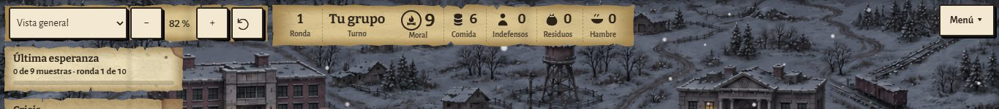
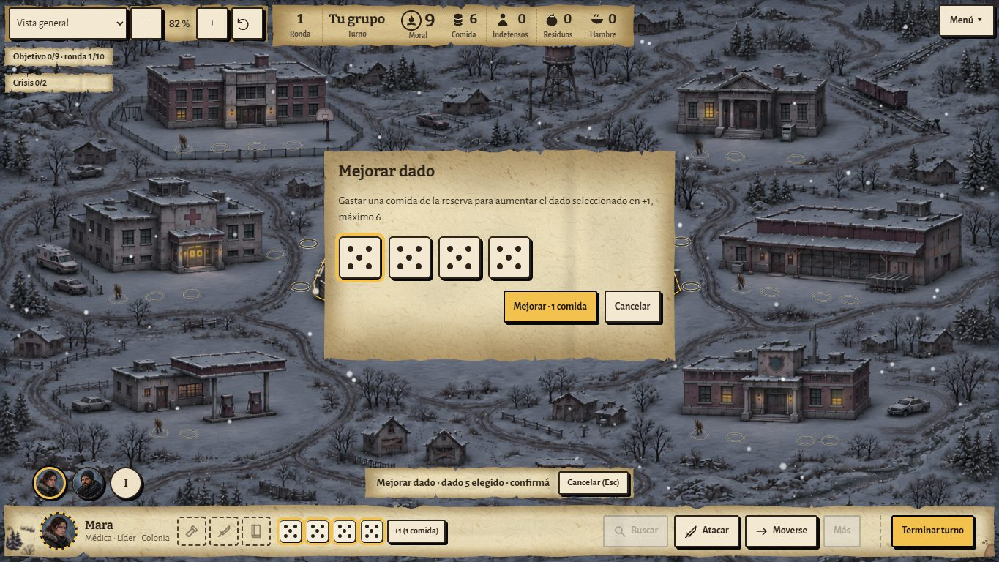
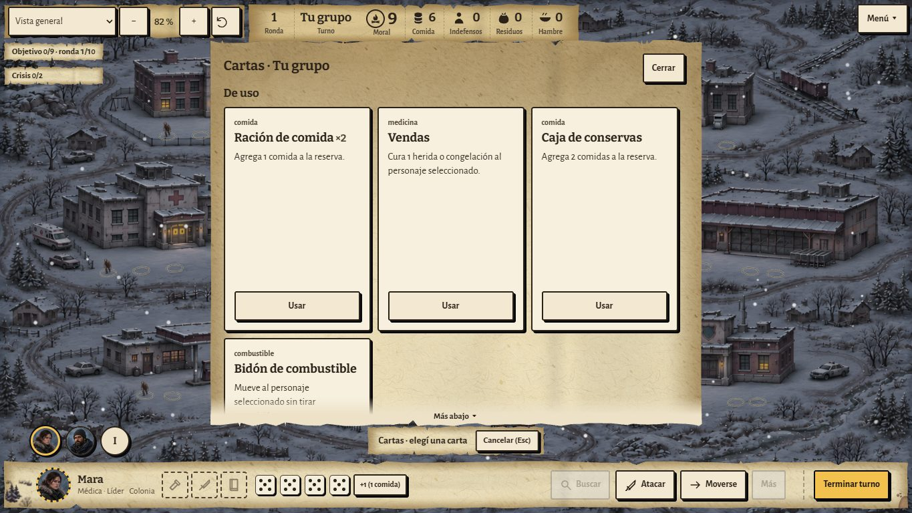
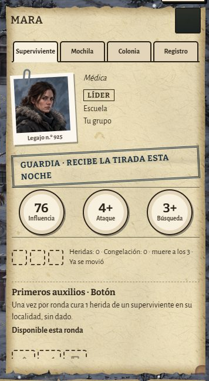

# 126 — Interfaz v2, sesión 7: una sola barra para actuar y un expediente para leer

24/11/2026. Rama `feature/interfaz-v2-sesion-7`, apilada sobre `feature/interfaz-v2-sesion-6` ([125](125-interfaz-v2-sesion-6.md)). Foco en escritorio (1365×768); en 852×393 no se rompe nada.

- `src/` no cambió. No hizo falta exponer ninguna capacidad nueva: todo sale de las opciones que el motor ya proyecta.
- La guía [109 §8](109-guia-de-estilo.md) quedó actualizada.

## Paso 0: inventario de acciones y decisiones

Lo revisó el creador antes de implementar. Decisiones:
- inventario por propósitos;
- «+1» en la zona de dados;
- movimiento sin papel al centro;
- tocar una ficha no abre el expediente.

| Antes | id | Capacidad del motor | Cuándo aparece | Ahora |
|---|---|---|---|---|
| Ficha · Acciones | `search-action` | `search.options[id]` | Superviviente propio en su turno | **Barra**, siempre visible |
| Ficha · Acciones | `attack-action` | `action.options[id].attack` | Ídem | **Barra**, siempre visible |
| Ficha · Acciones | `move-action` | `movement.options[id]` | Ídem | **Barra**, siempre visible |
| Ficha · Acciones | `barricade-action` | `action.options[id].barricade` / `barricade-ability` | Ídem | **Abanico** |
| Ficha · Acciones | `clean-action` | `play.options[id].clean` | Ídem | **Abanico** |
| Ficha · Acciones | `attract-action` | `play.options[id].attract` | Ídem | **Abanico** |
| Ficha · Acciones | `special-action` | `play.options[id].special` | Médico o enfermera | **Abanico** |
| Ficha · Acciones | `return-home-action` | `play.options[id]['return-home']` | Regla activa | **Abanico** |
| Ficha · Dados | `boost-action` | `play.boost` | Turno propio | **Zona de dados de la barra**, «+1 (1 comida)», solo si está permitido |
| Ficha · Personaje | `character-inventory` (Usar, Equipar, Transferir, Aportar) | `inventory.private.options` | Superviviente del turno | Dividido por propósito (ver abajo) |
| — | `use-card-action` (nuevo) | ídem, modo `use` | Si el motor permite usar alguna carta de uso | **Abanico** → papel al centro |
| Tarjeta de crisis | `crisis-contribute` | ídem, propósito `crisis` | Siempre | Sin cambio; único lugar para aportar |
| Menú | `menu-inventory`, `menu-groups`, `menu-new-game` | — | Siempre | Sin cambio (el inventario del menú abre la vista del expediente) |
| Barra | `bar-search/attack/move` | — | — | **Quitados**: la barra usa los botones reales |
| Barra | `bar-more`, `bar-portrait`, `finish-turn` | — | — | «Más» abre el abanico; el retrato abre el expediente; «Terminar turno» sin cambio |
| Ficha | `search-panel`, `action-panel` | search / action | Durante la acción | **Papel al centro** (`#action-stage`) |
| Ficha | `move-planner` | movement | Durante el movimiento | **Papel chico sobre la barra** + tira |
| Ficha / cuerpo | `play-dialog` (loot, heal, attract, transfer, recruit, ack) y `cycle-dialog` (fin de turno, fase de colonia) | play / cycle | Decisiones | **Papel al centro**; «Grupo y líderes» queda en el expediente |
| Modal | mordedura, encrucijada, muerte, pase, final | play / cycle | Decisiones obligatorias | Sin cambio (modales al centro) |

**Inventario por propósitos.** Es un solo componente (`inventoryView` en `juego/turn-flow.mjs`):
- `use`: abanico «Usar carta». Solo cartas de uso, incluido el combustible con destino. Va en papel al centro.
- `manage`: expediente y menú. Cartas para equipar («Equipar») y equipo («Dar … a…»).
- `crisis`: tarjeta de crisis. Solo lo legal para aportar.

«Aportar a la crisis» ya no aparece en las otras vistas.

## Qué cambió

- **Barra única.** De izquierda a derecha:
  - miniaturas del grupo (la activa en Lámpara; tocar una la hace activa);
  - el superviviente activo, con tres ranuras de equipo: muestran lo que tiene y no aplican el límite «uno de cada tipo», que es regla del hito;
  - los dados y «+1»;
  - Buscar, Atacar, Moverse y «Más»;
  - «Terminar turno», separado a la derecha.

  Si no hay nadie seleccionado, las acciones actúan sobre el líder del grupo en turno, igual que la vista previa que ya mostraba la barra.
- **Abanico.** Solo lista las acciones cuyo botón el motor habilita. Se cierra al elegir, con Esc o tocando fuera. «Más» se apaga si no hay ninguna, en turno ajeno o con una acción en curso.
- **Tira de acción.** Una línea sobre la barra («Buscar en Escuela · elegí un dado de 3 o más · Cancelar (Esc)»).
  - Los dados que el motor acepta se marcan en Lámpara y los demás se apagan.
  - Tocar un dado de la barra o pulsar 1–4 lo elige a través del mismo botón del panel.
  - «Cancelar» usa el mismo camino que Esc en cada panel.
- **Papel al centro** (`#action-stage`). Se movieron los paneles existentes y se los vistió; no se reescribieron. `present()` los manda al centro cuando el diálogo resuelve una acción (`data-stage`). Las cartas reveladas al buscar van grandes y lado a lado.
- **Expediente.**
  - Es solo información: datos, mano y equipo, Registro, Ajustes y Ayuda.
  - Se abre y se cierra con el retrato o con E, y se cierra también con Esc.
  - Empieza cerrado y, cerrado, no ocupa pantalla.
  - Cerrarlo ya no cancela una acción en curso.
  - Tocar una ficha o un edificio del mapa no lo abre (hallazgo 20). Si el jugador eligió una localidad y abre el expediente, ve esa localidad; si no, ve al superviviente activo.
- **Atajos.** B, A, M, E, 1–4 y Espacio.
  - **Conflictos:** con Esc, Enter, −, +, 0, flechas y H no hay ninguno; las pruebas lo verifican tecla por tecla.
  - **Bloqueos:** ninguno actúa con Ctrl, Alt, Mayús o Meta, con autorrepetición, en campos de texto, con un modal abierto ni con la partida bloqueada (pase de dispositivo).
  - **Espacio:** sobre un botón lo activa como siempre.
  - **Documentación:** quedaron en la Ayuda y en las instrucciones del mapa.
- **Doble toque.** Un clic con `detail>1` sobre la barra se descarta en captura, antes del botón. Los atajos pasan por la traba de la barra.
- **Dado nocturno.** Va centrado en una casilla de papel: título, D12 y «Tirando…» o el resultado. `#sequence-status` conserva el texto completo para lectores de pantalla y baterías. La duración y el salto con un toque no cambiaron.
- **Objetivo y Crisis.** Una columna de grilla del ancho de la más ancha. Plegadas, las tiras se estiran a ese ancho.

## Motivos que el motor no da

Las principales apagadas muestran en el globo el código `reason` del motor (el mismo texto que tenía la ficha). En estos casos no hay motivo del motor y quedan apagadas sin globo:
1. **Superviviente ajeno, o turno de la IA o del otro jugador:** las opciones no traen entrada para ese id.
2. **Acción, búsqueda o inventario en curso:** lo traba la interfaz; no hay `reason`.
3. **Un código `reason` sin texto conocido:** antes caía en «No disponible ahora»; en la barra ya no se inventa.

Además: «Usar carta» trae motivo por carta, no global, así que el abanico simplemente no la muestra. «Más» apagado tampoco tiene motivo.

## Cambios en las baterías de navegador

No se borró ninguna. Los ids reales se conservan; solo cambió dónde viven.

| Batería | Cambio | Por qué |
|---|---|---|
| `test-support/h344-browser-checks.mjs` | `panel()` abre con el retrato (o «×/Expediente» si la barra está vacía); nuevo `more()` | El expediente empieza cerrado y no se ve; las secundarias están en el abanico |
| `check-h344`, `check-h344-edge`, `check-map-cycle`, `check-map-migration` | `t.more(p)` antes de `#barricade-action` / `#clean-action` | Abanico |
| `check-h344`, `check-h344-movement`, `check-horizontal-composition` | `.actions-section` visible → `#action-bar[data-own]` | Ya no hay sección de acciones en el expediente |
| `check-horizontal-map-comfort` | Elegir localidad ya no abre el expediente; la ida y vuelta de cámara se mide abriéndolo con el retrato y cerrándolo con «×»; barricada por el abanico | Decisión 4 |
| `check-map-experience` | `actor()` abre con el retrato; `act()` usa el abanico; «usar» por «Usar carta» | Inventario por propósitos |
| `check-map-feedback-camera` | El alternar usa el retrato; «acciones visibles» se mide en la barra | Ídem |
| `check-h344-camera`, `check-h344-presentation-stalls`, `check-horizontal-presentation`, `map-rule-presentations` | Abrir el expediente antes de usar su selector; cerrar solo si está abierto; «Regresar» por el abanico | Empieza cerrado; tocar el mapa no lo abre |

Pruebas unitarias:
- `interfaz-v2-sesion-4`: deja de buscar `bar-search/attack/move` y `barAct`.
- `interfaz-v2-sesion-6`: el globo de los motivos (`data-no-fold`) no se marca para plegar.

## Qué se comprobó

- **944 pruebas, 0 fallos.** Hay 14 nuevas en `interfaz-v2-sesion-7.test.mjs`:
  - cada acción del inventario en la barra o el abanico y nunca en el expediente;
  - el abanico solo con lo permitido;
  - inventario por propósitos;
  - principales con motivo o sin globo;
  - tira y cancelación;
  - doble toque;
  - atajos y sus bloqueos;
  - grupo y ranuras;
  - expediente;
  - papel al centro;
  - dado nocturno;
  - tarjetas del mismo ancho;
  - «+1».
- `check:build` y `check:mapa-build` en verde.

## Qué informa una herramienta

Un guion propio con Edge (no es una batería del CI) jugó una partida «un grupo» con La noche, a 1365×768 y 852×393:
- **Abanico:** con Mara en la colonia lista barricada, atraer y usar carta. El globo de Buscar dice «Fuera de colonia».
- **Expediente:** E lo abre con la ficha de Mara y Esc lo cierra.
- **Búsqueda:**
  - mover a la Escuela y la tecla B muestran la tira «Buscar en Escuela · elegí un dado de 3 o más»;
  - 1 elige el dado;
  - la carta revelada aparece grande en el centro.
- **Fin de turno:** Espacio abre «Terminar turno» al centro.
- **Noche:** el D12 queda centrado en su casilla, 0 px corrido, con el título arriba.
- **Pantalla:** sin desbordes y sin errores de página.

Capturas citadas (1365×768):
- [barra](evidencias/interfaz-v2/126-barra-1365x768.jpg)
- [abanico](evidencias/interfaz-v2/126-abanico-1365x768.jpg)
- [búsqueda con la carta al centro](evidencias/interfaz-v2/126-busqueda-cartas-1365x768.jpg)
- [expediente](evidencias/interfaz-v2/126-expediente-1365x768.jpg)
- [dado nocturno](evidencias/interfaz-v2/126-dado-nocturno-1365x768.jpg)

## Qué falta

- **CI del PR:**
  - las baterías de navegador, en particular las modificadas;
  - el oráculo `test:poc`, que en Windows falla con EPERM al crear el enlace simbólico (hallazgo 14).
- **Jugando en escritorio:**
  - si la barra completa se lee bien a 1365 (debajo de 1250 px se ocultan las miniaturas del grupo y el estado del ciclo);
  - si el papel central tapa demasiado mientras el expediente está abierto;
  - si alcanza mostrar la localidad elegida solo al abrir el expediente.
- **En el Galaxy A15:**
  - la barra compacta, sin ranuras ni grupo;
  - la tira;
  - el abanico al tacto.

## Ajustes (después de jugarla)

Commits nuevos en la misma rama. `src/` no cambió y ninguna batería de navegador se tocó.

| Problema | Qué se hizo |
|---|---|
| Grupo duplicado, miniaturas ovaladas y tercera miniatura vacía | El grupo flota en círculos de 44 px sobre el borde superior izquierdo de la barra, y la barra muestra solo al activo. Los óvalos venían del mínimo global de 44 px de ancho de los botones. El círculo vacío era Iris (`h2`): solo cuatro supervivientes tienen retrato provisional y su círculo usaba la clase de iniciales de la ficha. Ahora las iniciales en tinta sobre papel están siempre debajo y quedan visibles si no hay retrato o si la imagen falla (hallazgo 24). |
| «Usar carta» sin equipables | Pasa a llamarse «Cartas», con dos secciones: «De uso» y «Equipables». Equipables son las cartas con opción `allowed` del motor para el superviviente activo (`equipableCards`). Una sección vacía no se muestra. |
| Ícono de libro raro | Los tres íconos de las ranuras son SVG con el mismo trazo; el libro tiene tapas, lomo y canto de hojas. |
| Dado de exposición en la caja oscura | Hay una sola casilla para todas las tiradas animadas (`experiencia/roll-card.mjs`, `data-kind=roll`), con títulos como «Exposición · Leo» o «La noche en X · Leo». La duración, el freno y el salto con un toque no cambiaron. |
| Papel plano y borde regular | Se integraron las capas de `papel-fuente/` (arrugas y grano) en soft-light sobre el crema, con `--papel-arrugas: .8` y `--papel-grano: .7`. Los bordes se generan con mulberry32 y una semilla por panel (`experiencia/papel.mjs`). La sangre seca y el oscurecido siguen en sus capas. |
| Fuente del sistema fuera del papel | La base de la página es Alegreya Sans. Las reglas heredadas pasan por `--fuente-ui`, que en v2 vale la fuente de texto. Bitter va en títulos, chapas, zoom y números de los dados. |
| Papel de búsqueda enorme y botones oscuros | El papel mide 330, 580 u 800 px según haya 1, 2 o 3 cartas. Toda la carta es el botón (`aria-label` «Conservar …»). «Revelar otra carta» y los demás botones del centro son de papel con sombra dura. Un doble toque en el papel central se descarta antes de llegar al botón. |
| Crisis y rótulos encima del papel central | Con papel central, Objetivo y Crisis se muestran plegadas sin tocar lo guardado (`shownFolded`), y los rótulos del mapa se ocultan. Al cerrar, vuelven como estaban. |
| Objetivo cortado por el zoom | La columna empieza a 64 px, debajo de la barra del zoom (que termina en 58 px), con el mismo margen de 6 px. |

**Peso medido en el navegador:**
- las texturas nuevas suman 186 KB (`papel-grano.webp` 169 KB y `papel-arrugas.webp` 17 KB);
- el papel anterior y las manchas suman 47 KB;
- no hay fuentes nuevas.

**Contraste.** Lo cubre una prueba unitaria. Para el peor caso combinado se tomó el tono más oscuro del interior de la tarjeta, por el grano viejo más oscuro, con las capas nuevas en su percentil 1. La tinta queda en 5,2:1, por encima de AA. En motas sueltas del grano (0,1 % de los píxeles) baja a unos 3,6:1 local (hallazgo 25).

**Qué se comprobó:**
- 955 pruebas, 0 fallos. Hay 11 nuevas en `interfaz-v2-sesion-7-ajustes`, y `interfaz-v2-sesion-7` se ajustó a `data-kind=roll` y a «Cartas».
- `check:build` y `check:mapa-build` en verde.
- `test:poc` sigue fallando en Windows por EPERM; lo valida el CI.
- Con el mismo guion propio con Edge (1365×768 y 852×393) se comprobó todo lo de la tabla, sin desbordes ni errores de página.

**Capturas (1365×768):**
- [grupo flotante](evidencias/interfaz-v2/126-ajustes-grupo-1365x768.jpg)
- [«Cartas»](evidencias/interfaz-v2/126-ajustes-cartas-1365x768.jpg)
- [búsqueda con 1 carta](evidencias/interfaz-v2/126-ajustes-busqueda-1-carta-1365x768.jpg)
- [búsqueda con 3 cartas](evidencias/interfaz-v2/126-ajustes-busqueda-3-cartas-1365x768.jpg)
- [dado de exposición](evidencias/interfaz-v2/126-ajustes-dado-exposicion-1365x768.jpg)
- [papel de cerca](evidencias/interfaz-v2/126-ajustes-papel-de-cerca.jpg)

**Falta:**
- ver jugando la intensidad del papel;
- revisar el papel de búsqueda con 3 cartas en el teléfono, que necesita desplazamiento;
- probar el grupo flotante al tacto en el A15.

### J. Registro duplicado (rompía el CI)

`check-exposure-d12-browser` fallaba en el CI (#44): `locator('[data-info=registro]')` encontraba dos botones «Registro», uno en el menú flotante del mapa y otro en «Consultas del expediente». Lo mismo pasaba con «Ayuda».

**Qué se quitó:** «Registro» y «Ayuda» salieron del menú flotante. Quedan solo en el expediente, en «Registro» y «Ayuda y atajos».

**Qué hacían que el expediente no hace:**
- Abrían el diálogo sin abrir el expediente, con un clic menos. Ahora son dos: retrato o E, y después «Registro».
- El menú también estaba disponible durante el pase de dispositivo. El expediente no se abre en el pase, y eso es coherente con la privacidad.
- El contenido no cambia: los dos botones llamaban a la misma `showInfo`.

**Lo que no cambió:** «Ajustes» sigue en los dos lugares. No es un `data-info`: el botón del expediente delega en `menu-settings`, así que no hay dos botones con el mismo selector. El menú sigue con Inventario, Grupo y líderes, Ajustes y Nueva partida.

**Prueba unitaria:** cada `data-info` aparece una sola vez en el HTML. Registro y ayuda están en el expediente, el menú no tiene ninguno y ningún módulo crea `data-info` en tiempo de ejecución.

**Baterías.** Había que cambiarlas: abrían el menú para llegar al registro, y ese acceso ya no existe. El expediente empieza cerrado, así que hay que abrirlo antes.

| Batería | Cambio |
|---|---|
| `test-support/h344-browser-checks.mjs` | Nuevo `registry(p)`: abre el expediente si hacía falta, toca «Registro» y, al cerrar el registro, deja el expediente como estaba. |
| `check-exposure-d12-browser` | Usa `t.registry(p)` en lugar de menú → Registro. |
| `check-map-feedback-camera-browser` | Ídem. |
| `check-map-experience-browser` | Abre el expediente (retrato) antes de «Registro», en los dos lugares. La lista esperada del menú queda sin «Registro» ni «Ayuda». |

**Corrida local con Edge** (`CHROMIUM_PATH`, servidor QA en otro puerto):
- `check-exposure-d12-browser` pasa a 1365×768 y 852×393, con `EXPOSURE_QUICK=1`.
- `check-map-experience-browser` y `check-map-feedback-camera-browser` fallan antes de llegar al registro: el foco al cerrar el globo de Objetivo, y el enfoque del Hospital. Fallan igual en los commits de la sesión 6 (`29ec1b7`) y de la sesión 7 (`c665668`), así que no vienen de este cambio. Parece una diferencia de Edge en Windows. Las valida el CI.

## Ajustes 2 (después de la prueba del creador)

Base: `2972552`. Foco en escritorio (1365×768); a 852×393 no se rompe nada (sin desbordes ni errores en una corrida propia con Edge).

| | Qué cambió |
|---|---|
| **A. Residuos en peligro** | El umbral pasó de un `10` literal en `colony()` a `WASTE_LIMIT` en `src/domain/reference-state.mjs`, expuesto como capacidad de solo lectura `wasteLimit` (como `noiseLimit`). El motor se comporta igual (−1 moral por cada 10). La proyección agrega `resources.waste` con `count`, `limit` y `danger`, y la chapa usa el mismo estado de peligro que la comida. Como en las sesiones 1 y 4, se regeneró `invierno_colonia_v9_9.html`; la etiqueta `v0.9.9-referencia-modular` no cambia. |
| **B. Papeles centrales** | Las opciones del mismo tipo van en grilla y con el mismo tamaño (`paperOptions`), y las acciones abajo a la derecha (`paperActions`, una sola principal en Lámpara). Aplicado a «Mejorar dado» (un título, dados cuadrados con puntos, el elegido con borde Lámpara, «Mejorar · 1 comida» y «Cancelar»), limpiar, atraer, regresar, tratamiento, mordedura, carta de búsqueda, transferencia, encrucijada, recibos, preparación, búsqueda y ataque. Los ids no cambian. |
| **C. Cartas del mismo tamaño** | 220 × 336 px en búsqueda, «Cartas» y mochila, a 15 px. Medido con «Hacha de bombero» (220 caracteres): necesita 285 px y entra sin desplazarse. |
| **D. Copias agrupadas** | `groupCopies` junta las copias iguales en una ficha «×N» que actúa con la primera copia. Usarla descuenta una. Antes salían dos fichas «Ración de comida ×1». |
| **E. «Cartas» sin cortes** | Si el papel no entra, aparece «Más abajo ▾» con un fundido, y se desplaza con rueda, teclado y tacto (`data-scroll`). |
| **F. Un estilo de botón** | Tinta sobre papel con sombra dura en la barra, el abanico, los papeles, el zoom y el menú. Apagados: desaturados y sin sombra. Lámpara solo en «Terminar turno» y en la principal de cada papel. |
| **G. Barra superior** | Decisión: papel rasgado, como tarjetas y barra. Ronda, turno y recursos son sellos de tinta con el número en Bitter y la etiqueta debajo. Hambre suma un ícono (cuenco). La moral es la chapa más grande, con anillo. |
| **H. Textos** | «0 de 9 muestras · ronda 1 de 10», «Si falla: 1 herida al de menor influencia en la colonia» (y las demás consecuencias con artículo), y la búsqueda muestra solo la categoría. |
| **I. Legajo** | Pestañas Superviviente, Mochila, Colonia y Registro. Superviviente: foto con clip y «Legajo n.º X», sello azul de guardia, tres medallones, casillas de daño y «muere a los 3», habilidad a la vista con su tipo y su estado, y tres ranuras. Sin «Dados de tu grupo» ni desplegable. «Ajustes» y «Ayuda y atajos» pasaron al menú. |
| **J. Toque doble** | El primer toque sobre un superviviente (mapa o grupo) lo elige; uno sobre el elegido abre su legajo. «Activo» es el elegido: la vista previa del líder se elige con el primer toque, como antes. No hace nada durante el pase. |

 

 

**Decisiones que tomé y conviene revisar:**
- **Límite de muerte.** El motor no lo expone: es un `3` literal en `map-exposure` y en la crisis parcial, y el pedido limitaba `src/` al umbral de residuos. El legajo usa `DEATH_DAMAGE = 3`, y una prueba lo compara con el motor (hallazgo 26).
- **Tipo de habilidad.** Lo asigna la interfaz: botón para médica, enfermera y constructor; reacción para Resistencia; automática para el resto. El estado de uso sí sale del motor (`skill.used`).
- **Selector de superviviente.** Sigue en la página, solo para teclado y lector de pantalla (y para las baterías, que lo usan).
- **Pestaña Colonia.** Sin una localidad elegida, muestra la del superviviente.

**Pruebas.** `npm test` pasa 963 de 963, con siete pruebas nuevas en `tests/interfaz-v2-sesion-7-ajustes-2.test.mjs`. `check:build` y `check:mapa-build` están en verde. Seis pruebas anteriores cambiaron porque el pedido cambia lo que fijaban:
- los textos de Objetivo;
- la proyección, que ahora lee residuos;
- dónde están registro y ayuda;
- el toque, que pasa por `tapCharacter`.

`test:poc` sigue sin correr en Windows (EPERM, hallazgo 14).

**Baterías.**

| Batería | Cambio | Por qué |
|---|---|---|
| `check-map-experience-browser` | Agrega «Ayuda y atajos» a la lista esperada del menú. | El pedido movió la ayuda al menú. |

Ninguna otra cambia. Corridas locales con Edge:
- `check-exposure-d12-browser` pasa a 1365×768 y 852×393.
- **`check-map-inventory-browser` falla, y ya fallaba antes de este cambio.** Corrí una copia sin vídeo (acá no hay ffmpeg) contra `2972552` y contra este commit, y las dos se detienen en la misma línea: `choose('Vendas')`. Desde la sesión 7, «Inventario» del menú abre la vista de equipables y la batería busca ahí una carta de uso. Hay que decidir si la batería pasa a «Cartas» o si el menú vuelve a mostrar la mano completa.
- `check-map-migration-browser` usa el mismo camino; probablemente falle igual. No la corrí: graba vídeo.
- Las demás las valida el CI.

**Falta probar jugando:** la barra superior a distintos anchos, el sello y las pestañas en el A15, si el toque doble resulta natural, y el tamaño de las cartas en el teléfono, donde «Cartas» se desplaza.

## Ajustes 3 (recorrido completo de baterías)

Base: `73371b3`. El recorrido completo («Mapa — baterías de navegador» por `workflow_dispatch`, run 45505544633) falló en la primera batería. Era la primera vez que corría desde que empezó la interfaz v2: en los PR solo corre la versión reducida. Corrí localmente, con Edge y en el orden del workflow, las doce baterías del paso «Presentación y recorrido de acciones», con sus variables. Las que graban vídeo corrieron con un envoltorio de Playwright sin vídeo, porque acá no hay ffmpeg; el resto de lo que verifican es igual.

| Batería | Falla | Causa | Origen | Arreglo |
|---|---|---|---|---|
| `check-horizontal-presentation` | `casilla hospital:0` a 1365×768 | Con 36 supervivientes, el grupo flotante (`#bar-group`, encima de la barra) tapa el primer acceso del hospital. El encuadre no lo medía y el borde del mapa no dejaba subirlo. | Ajustes de la sesión 7 (`a3300e6`) | **Juego:** `focusInset` mide el grupo, que también da margen inferior de desplazamiento (`panelSlack`). |
| ídem | El expediente no se reabría | El anti-doble-toque (450 ms) se comía el retrato cuando el expediente se había cerrado con «×» un instante antes. | Sesión 7 (`c665668`) | **Juego:** cerrar con «×» libera el retrato (`createClickGuard().release`). El doble toque sobre el retrato sigue frenado. |
| ídem | `cartel QA fuera del área de juego` | Desde la sesión 1 el mapa ocupa toda la pantalla, así que el cartel no puede quedar arriba del lienzo. Además quedaba tapado por el mapa. | Sesión 1 (`065fc2a`) | **Juego (solo QA):** el cartel flota debajo de la barra superior. **Batería:** exige que sea visible, que esté por encima del mapa, que no tape controles y que no reciba toques. |
| ídem | `panel-toggle` sin caja (44 px) | El expediente cerrado ya no deja botón: se abre con el retrato. | Sesión 7 (`c665668`) | **Batería:** mide el retrato cerrado y la «×» abierta, los dos de 44 px o más. |
| ídem | `ficha superpuesta seleccionable hospital` a 852×393 | Objetivo y Crisis tapan, a la izquierda, una ficha del hospital, y el borde del mapa frenaba la cámara. | Anterior a la sesión 7; no la aislé | **Juego:** Objetivo y Crisis dan margen lateral, como la ficha abierta. **Batería:** «la ficha solo ajusta bordes» calcula los bordes con ese margen, con la misma `safeInsets` del juego. |
| `check-map-inventory` | `choose('Vendas')` | «Inventario» del menú gestiona el equipo y las cartas de uso se juegan desde «Más» → «Cartas». Además, las copias agrupadas «×N» muestran una sola ficha. | Sesión 7 y ajustes 2 | **Batería:** Vendas y Ración por «Cartas» (`t.cards`), Palanca por «Inventario». Se toca la ficha que agrupa las copias. |
| `check-map-migration` | `#clean-action` invisible | «Limpiar» está en el abanico «Más». | Sesión 7 | **Batería:** abre «Más» si la acción está ahí. |
| ídem | El abanico no abría | El mismo anti-doble-toque se comía «Más» después de elegir una acción del abanico. | Sesión 7 | **Juego:** cerrar el abanico por otra vía libera «Más». |
| ídem | Equipo sin «Dar a…» | La transferencia vive en «Inventario». | Sesión 7 | **Batería:** equipa y transfiere por «Inventario»; el resto, por «Cartas». |
| ídem | `No avanzó a ronda 2`, intermitente (2 de 5 corridas) | Un papel exclusivo (aviso de la encrucijada de la IA) cerraba el repaso del ciclo. Como su contenido no cambiaba, el render no lo reabría y la partida quedaba sin botón para seguir. | Sesión 7 (papel al centro) | **Juego:** si el repaso tiene que verse y está cerrado, se vuelve a presentar. Después: 4 de 4 corridas y el recorrido completo. |
| `check-map-experience` | El foco no volvía a `objective-details` | El objetivo ya no abre una consulta: el papel se pliega tocándolo. | Sesión 6 (`29ec1b7`) | **Batería:** toca el papel dos veces (respetando `FOLD_GUARD_MS`) y comprueba que se pliegue, que se despliegue y que el estado no cambie. La vuelta del foco con Esc la sigue probando Ajustes. |
| ídem | Mapa vertical (393×852) de menos de 576 px | En vertical la v2 conserva la pila anterior y muestra «Girá el teléfono» (informe 119). La pila creció: 590 px en la sesión 5, 553 en la 6, 375 en la 7 y 323 con los ajustes 2. | Sesión 6 en adelante | **Batería:** en vertical exige el aviso visible y sin bloquear toques, y el mapa a la vista. Los umbrales horizontales no cambian. Queda como hallazgo 29. |
| `check-map-feedback-camera` | `aviso por encima de ficha móvil` | El aviso tiene borde rasgado (hasta 6 px); en las esquinas, a 2 px, se tocaba el mapa a través del recorte. | Sesión 2 (`a0e1189`) | **Batería:** mide las esquinas 8 px adentro. |
| ídem | Enfoque y zoom máximo a 2560×1440 | El enfoque llega hasta el tope por resolución (2), como aprobó la sesión 5. | Sesión 5 (`3e4578e`) | **Batería:** usa ese tope y, si la cámara lo trae (`ceiling`), lo acepta como máximo. |
| `check-map-capacities`, `check-map-cycle`, `check-map-death-decisions`, `check-exposure-d12`, `check-map-2x`, `check-h344` | — | — | — | Pasan sin cambios. |

Ninguna batería se borró ni se salteó. Donde fallaba un camino que ya no existe, se prueba lo mismo por el camino nuevo.

**Contornos.** El paso hacía `git fetch` de `26fe4ec` abreviado; GitHub no acepta un SHA abreviado y el `|| true` lo escondía. La comparación sí se hacía, porque con `fetch-depth: 0` el commit ya estaba: localmente salen los siete «antes». Ahora el paso usa el SHA completo, lo pide solo si falta, y el script termina con error si no puede dibujar el «antes», en vez de saltearlo en silencio.

**Legajo.**
- La «×» es un botón de papel con la cruz a la vista; antes heredaba un degradado oscuro.
- Si el contenido no entra, se desplaza con «Más abajo ▾», como «Cartas». A 1365×768 entra entero en la partida de prueba; a 1365×600 y 852×393 muestra el aviso.
- «Ya se movió» va en su propia línea.

**Pruebas.**
- `npm test`: 969 de 969, con seis nuevas en `tests/interfaz-v2-sesion-7-ajustes-3.test.mjs`. Tres anteriores fijaban el texto del código que cambió: el workflow de contornos, el cierre del abanico y el del retrato.
- `check:build` y `check:mapa-build` en verde.
- `test:poc` sigue sin correr en Windows (EPERM, hallazgo 14). `src/` no cambió, así que el 40/40 lo confirma el CI.
- Baterías locales con Edge, todas en verde, en el orden del workflow:
  - **presentación:** 1365×768 y 852×393;
  - **capacidades, inventario, ciclo y migración:** sus tamaños, que incluyen 1365×768 y 852×393;
  - **experiencia:** 1365×768, 852×393 y 393×852, con movimiento normal y reducido;
  - **cámara:** hasta 2560×1440;
  - **muertes, D12 y 2×:** sus tres tamaños;
  - **`check-h344`:** `H344_VIEWPORTS=1365x768,852x393`.
- El vídeo de las cuatro que lo graban sale solo en el CI.

**Falta probar jugando:** reabrir el expediente y «Más» enseguida; el repaso del ciclo con la IA; el legajo desplazándose en el A15.
