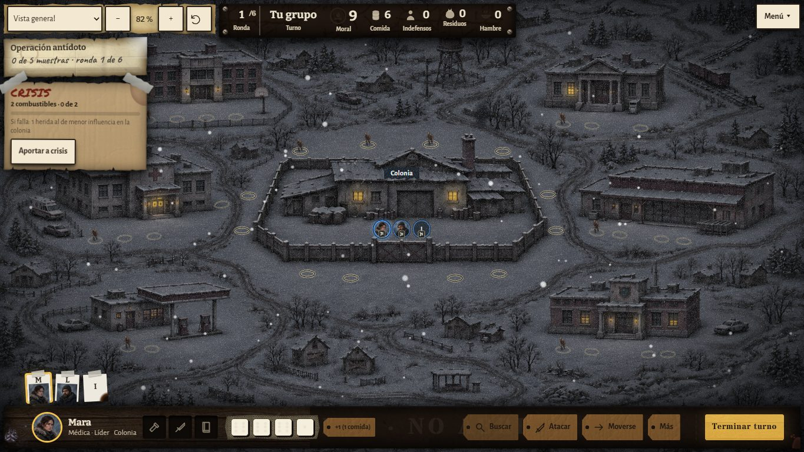
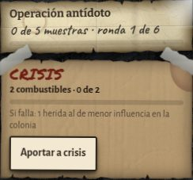
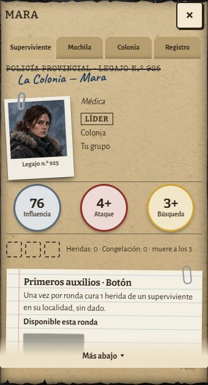
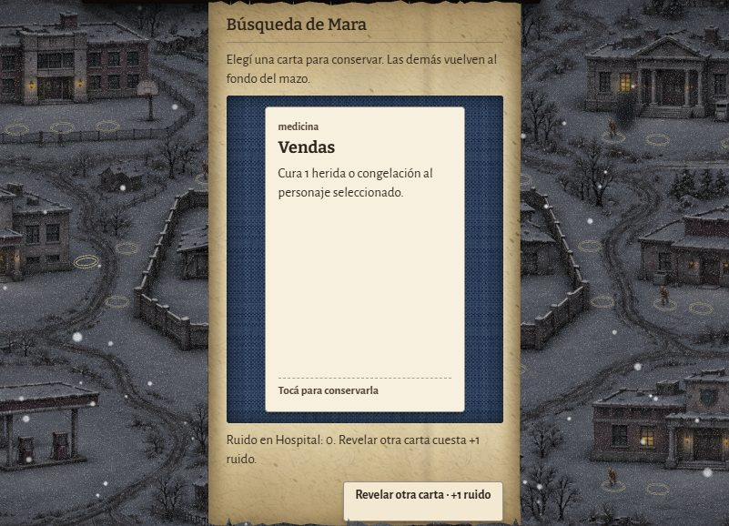
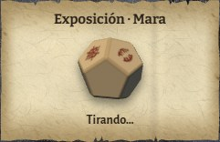
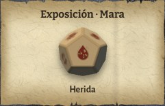
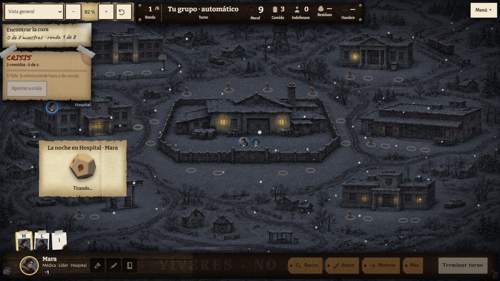

# 127 — Interfaz v2, sesión 8: objetos a carbón y D12 en 3D

Rama `feature/interfaz-v2-sesion-8`. Base: `0d414c5` (materiales), más `main` (`b78ba3b`, con las sesiones 1 a 7 fusionadas). Foco: escritorio a 1365×768; a 852×393 no se rompe nada. `src/` no cambió.

## Qué cambió

**Dirección «objetos a carbón»** (decisión del creador del 25/11; guía [109](109-guia-de-estilo.md) §8.1). Cada panel pasa a ser un objeto distinto, con el mismo marcado: mismos ids, mismo orden y misma accesibilidad. Todo va en `app/mapa/estilos/carbon.css`, que se carga última. Lo que varía por objeto (giro, hollín, manchas, la esquina quemada) y las texturas generadas salen de `app/mapa/experiencia/carbon.mjs`, con semilla fija.

| Panel | Objeto |
|---|---|
| Recursos | Chapa oxidada y oscurecida, con cuatro tornillos. Números en esténcil. Comida en peligro en rojo óxido, con un círculo a mano. Residuos con rayas de conteo en grupos de cinco. Ronda «1/8», separada por una línea. |
| Objetivo | Hoja doblada en cuatro, con los pliegues a la vista, escrita a lápiz (Caveat). Escarcha en una esquina, marca de taza en el borde, apenas torcida. |
| Crisis | Cartón con dos tiras de cinta americana; el título en marcador rojo óxido. Una crisis nueva entra deslizándose (sin movimiento reducido). |
| Legajo | Carpeta manila de la policía, reutilizada: «POLICÍA PROVINCIAL · LEGAJO N.º X» a máquina, tachado, y encima, a mano, «La Colonia — Mara». Foto como polaroid con clip; sello de guardia en azul. Medallones con los colores de las cartas. La habilidad en una ficha rayada con clip. Pestañas como lengüetas. |
| Grupo | Polaroids pegadas con cinta, levemente torcidas; la activa, con marco Lámpara. Una tiene la esquina quemada, siempre la misma. |
| Barra | Tablón de cajón con el esténcil «VÍVERES · NO ABRIR» desvaído. Ranuras como huecos oscuros. Dados sobre lona. Botones como etiquetas de cartón con muesca; «Terminar turno», una tabla pintada de Lámpara. |
| Papeles centrales | Papel con sombra blanda y hollín. En la búsqueda, las cartas se apoyan sobre una manta azul tejida. |
| Avisos del mapa | Nota chica a lápiz, clavada con una chinche metálica. |

- **Reglas generales.** La sombra dura (`--sombra-dura`, que usaban todos los botones) pasa a ser blanda, de lámpara, y los bordes llevan hollín.
- **Mapa más oscuro.** El filtro frío multiplica saturación y brillo con `--mapa-saturacion` (0,72) y `--mapa-brillo` (0,8), solo sobre la textura del fondo; fichas, Lámpara y noche no pasan por ahí. Encima van una viñeta (`--mapa-vineta`) y el grano de carbón (`--mapa-grano`).
- **Vertical.** Los objetos se aplican en la disposición v2: horizontal o de más de 600 px de ancho. En vertical sigue la pila anterior con «Girá el teléfono» (informe [119](119-interfaz-v2-sesion-1.md)), con la misma altura que en `main`; si no, el mapa vertical se achicaba y la vista general cortaba la escuela.

 

**D12 en 3D.**
- **Chunk aparte.** Three.js 0.187 vive solo en `dist/mapa/d12-3d.mjs` (fuente `app/mapa/movimiento/d12-3d.mjs`), que el visor pide en tiempo de ejecución la primera vez que aparece el dado. El build falla si Three.js entra al bundle principal. No toca Phaser ni el motor.
- **Modelo.** Dodecaedro generado por código, con aristas achaflanadas sombreadas como redondeadas. Marfil gastado, símbolos tallados y pintura roja medio saltada (fija por cara). Las caras y su orden son los datos actuales del dado.
- **Luces.** Una cálida desde arriba, un relleno frío y una sombra blanda sobre el papel.
- **Tirada.** El resultado viene del motor. `app/mapa/movimiento/d12-orientation.mjs`, que es puro y está probado, calcula la orientación de reposo con esa cara mirando a la cámara y el símbolo derecho. Le suma un giro con un eje y unas vueltas que salen de un PRNG con semilla visual, y un rebote. Las duraciones son las de siempre: 1200 + 200 ms. Un toque adelanta al final.
- **Respaldos.** Con movimiento reducido, el dado aparece quieto. Sin WebGL, o si el chunk no llega, queda el D12 plano de siempre, que además se sigue actualizando.
- **Rendimiento.** Dibuja una vez por cuadro de la tirada y, quieto, no dibuja.

 

**Fuentes nuevas,** autoalojadas desde Fontsource 5.3.0: Caveat (lápiz), Stardos Stencil (esténcil), Special Elite (máquina de escribir) y Permanent Marker (marcador). Caveat y Stardos Stencil tienen licencia OFL 1.1; Special Elite y Permanent Marker, Apache 2.0. Las licencias van en cada carpeta. Se usan solo para frases cortas.

## Pesos

| Qué | Peso |
|---|---|
| Texturas usadas | chapa 213 KB, cartón 53 KB, tablas 293 KB (`tablon-crudo.webp`, 77 KB, queda sin usar) |
| Texturas generadas | grano, lona y manta: se dibujan al arrancar con semilla (192 y 96 px), sin archivos |
| Fuentes nuevas | 258 KB en disco: Caveat 138 KB, Stardos Stencil 14 KB, Special Elite 77 KB, Permanent Marker 29 KB. La página carga solo el subconjunto latino que usa (Stardos Stencil, por ejemplo, 14 KB) |
| Chunk 3D | 542 KB sin comprimir, 136 KB con gzip −9. Se baja recién con el primer D12 |
| Bundle principal | +6 KB (1 664 → 1 671 KB) |

## Qué se comprobó

- **Pruebas unitarias:** 984 de 984. Nueve son nuevas, en `tests/interfaz-v2-sesion-8.test.mjs`:
  - el D12 termina en la cara del motor para las doce caras y varias semillas, derecho y mirando a la cámara;
  - da el mismo resultado con o sin animación, y con movimiento reducido aparece quieto;
  - el giro no usa `Math.random`;
  - el chunk va aparte y hay respaldo sin WebGL;
  - las manchas, el hollín y las texturas son iguales entre recargas;
  - las rayas de conteo;
  - el contraste AA de cada texto sobre su material;
  - el filtro del mapa es regulable;
  - las fuentes tienen licencia y los ids no cambiaron.

  La prueba de fuentes de la sesión 5 ahora cuenta solo Bitter y Alegreya Sans.
- `check:build` y `check:mapa-build` en verde.
- **Partida real con Edge a 1365×768** (guion propio):
  - el D12 3D gira y termina en la cara del motor; a mitad de giro está en 3D, porque el chunk carga durante el traslado;
  - la primera tirada se dibuja 300 a 350 ms después de pedir el chunk;
  - quieto, cero dibujos en el segundo y medio siguiente;
  - con movimiento reducido, quieto en su cara;
  - con el WebGL del dado anulado, queda el D12 plano;
  - la noche con el D12 3D;
  - sin errores en la consola.
- **Contraste:** los fondos de la tabla `MATERIALS` salen de muestras de la pantalla real. Por ejemplo, el cartón de la crisis da `#A78D68`, con 5,5:1 contra el texto. La comida en peligro (4,27:1) va en número grande de esténcil, que pide 3:1.

## Baterías

Corridas con Edge, en el orden del workflow y con sus variables. Las que graban vídeo corrieron sin vídeo, porque acá no hay ffmpeg.

| Batería | Resultado | Cambio |
|---|---|---|
| presentación, capacidades, inventario, ciclo, migración, experiencia, cámara, 2× y `check-h344` | Pasan | — |
| `check-exposure-d12` | Pasa | Con el D12 en 3D, la cara que queda adelante la publica la vista 3D (`data-front`), calculada con la misma orientación con la que dibuja, y el tamaño se mide sobre el lienzo. Antes la batería medía el D12 plano, que ahora queda oculto. Sin 3D mide lo de siempre. |
| `check-map-death-decisions` | **Intermitente**: falló 2 de 4 corridas, siempre igual, a 393×852 (atacante solo). El clic en el dado no deja ninguno elegido y «Atacar» queda apagado con «Elegí un dado». En `main` (`b78ba3b`), 3 de 3 pasan. La causa no está encontrada (hallazgo 33) | — |

Ninguna batería se borró. Dos fallas de esta sesión salieron de las baterías y se corrigieron en el juego: los objetos ya no agrandan la pila vertical, y el expediente ya no lleva `filter` en vertical, donde convertía al papel de «Grupo y líderes» en hijo recortado.

## Qué falta

- **Jugar en escritorio** y decidir cada objeto, la oscuridad del mapa (las cuatro variables) y si el D12 se lee a 82 px.
- **Notas del mapa (hallazgo 31):** tienen el material, pero siguen arriba al centro y no clavadas junto a la ficha.
- **Ritmo del D12 3D con GPU real (hallazgo 32):** la medición fue con SwiftShader (15 a 19 dibujos por tirada); los 60 cuadros por segundo hay que verlos en escritorio y en el Galaxy A15.
- **El recorrido completo en el CI** (`workflow_dispatch`, con Chromium en Linux y vídeo) y el oráculo `test:poc` (EPERM en Windows; `src/` no cambió).
- **`check-map-death-decisions` intermitente (hallazgo 33):** se paró al segundo fallo igual, como pide el encargo. Lo que se sabe: pasa siempre en `main` y falla solo en vertical, al atacar. Ahí la sesión 8 solo agrega el mapa oscurecido, los adornos ocultos y el D12. Hay que reproducirlo y aislarlo antes de fusionar.
- **El teléfono de referencia:** a 852×393 las baterías pasan y no hay desbordes, pero el material no se miró a ojo en el A15.
