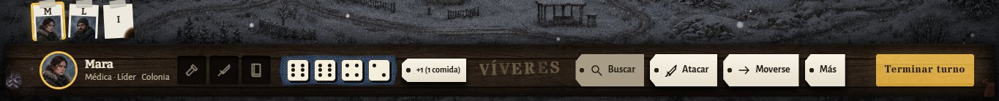
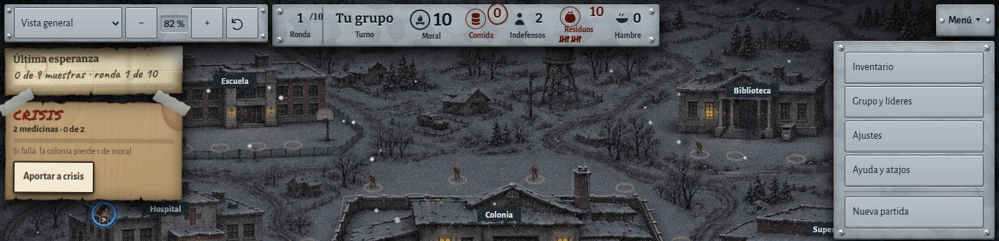
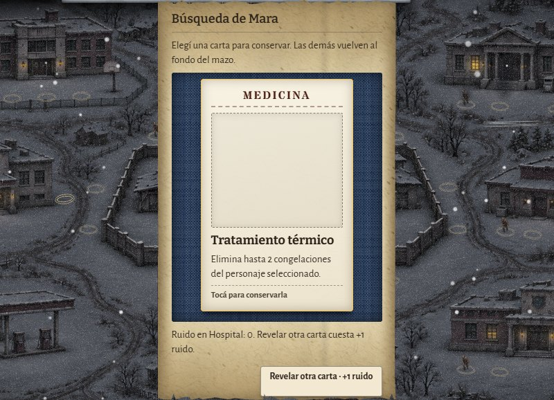
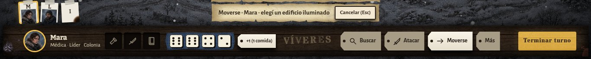
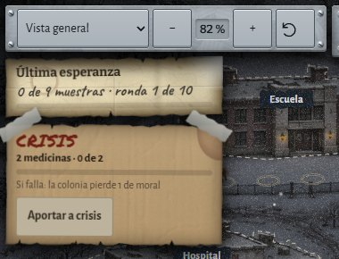

# 128 — Interfaz v2, sesión 8: ajustes de la revisión visual

Rama `feature/interfaz-v2-sesion-8` (PR #45, borrador). Base: `0a50ea4`. Foco: escritorio a 1365×768; a 852×393 solo se comprobó que nada se rompa. `src/` no cambió. El legajo, la hoja del objetivo, el cartón de la crisis, las polaroids, la manta y el D12 en 3D, aprobados en la revisión, no se tocaron.

## Qué cambió

| # | Problema | Cómo quedó |
|---|---|---|
| 1 | Puntos de los dados invisibles (crema sobre crema) | Tinta fija `#1E1610`, que el dado ya no hereda de la barra. El dado usado conserva el punto opaco. «Nueva partida» y «Ver resultado final» tenían el mismo error y quedaron en tinta oscura. |
| 2 | Corte de textura en la barra | Las dos capas de madera se repiten (la textura es repetible). |
| 3 | Esténcil tapado | Solo «VÍVERES», a 22 px, en el hueco entre «Mejorar dado» y «Buscar». Está en el flujo de la barra, no encima; si el hueco no llega a 112 px (como a 852×393), no se muestra. |
| 4 | Botones de cartón marrón | Etiquetas de papel crema con muesca y texto oscuro. «Terminar turno» sigue en Lámpara. La sombra ahora se ve: antes la cortaba el recorte de la muesca. |
| 5 | Apagado ilegible o indistinguible | Sin opacidad sobre el texto: sin sombra, papel apagado y cursor de «no permitido». Vale en la barra, en «Aportar a crisis» y en el zoom. |
| 6 | Lona de los dados | Lona azul, de la familia de la manta, con la misma semilla de antes. |
| 7 | Chapa que se leía como madera | Chapa galvanizada gris fría, generada por código (flor de zinc, semilla fija). Óxido solo en comida en peligro y residuos desde el límite. |
| 8 | Zoom y menú sin estilo | La misma chapa, con tornillos y controles estampados; también el menú desplegable. Mismos ids, orden y nombres accesibles. |
| 9 | Carta de búsqueda lisa | Provisoria hasta el hito 2: papel con textura, tipo en esténcil («MEDICINA», «EDUCACIÓN»…) y un recuadro vacío para la ilustración. |

`chapa-oxidada.webp` queda sin usar. No se agregó ningún archivo de textura.

## Hallazgo 33: sin causa; se paró en la sexta corrida

La falla: a 393×852, al atacar con Mara, el panel queda abierto, ningún dado elegido y «Atacar» apagado. Las capturas que dejan las corridas fallidas muestran ese estado. Se la había visto en el caso «atacante solo»; en la verificación final apareció una vez en el caso «contagio».

Seis corridas de investigación, 30 intentos del caso «atacante solo», ninguno falló: el caso repetido con registro de eventos, la batería completa con el mismo registro, la CPU del navegador frenada seis veces, la geometría del panel cuadro a cuadro, la máquina cargada con 12 hilos y la secuencia completa de eventos.

| Candidato | Qué se midió o leyó | Resultado |
|---|---|---|
| Mapa oscurecido (viñeta y grano) | En el centro y en el borde inferior del dado, el punto cae sobre el dado | Descartado |
| Adornos ocultos en vertical | No se muestran; mismo punto sobre el dado | Descartado |
| Capa del D12 | En la captura de la falla no hay dado de exposición; antes de elegir el dado no hay tirada en curso | Descartado |
| Desplazamiento del panel | No tiene: alto del contenido igual al visible (270 px) | Descartado |
| Animación de entrada | Corre el dado 8 px; el dado mide 58 px | Descartado |
| Aviso «Girá el teléfono» | No recibe el puntero y termina antes de donde empieza el dado | Descartado |
| Freno del doble clic (`detail>1`) | La batería manda un clic simple (`detail=1`), que el freno deja pasar | Descartado |
| Redibujados nuevos de la sesión 8 en `map-view.mjs` | Los cambios no agregan ninguno | Descartado por lectura |

En los intentos correctos, apretar, soltar y hacer clic caen en el mismo milisegundo, y los dados se reemplazan solo al abrir el panel y al elegir. **Queda sin descartar** que una actualización tardía del estado o un escucha global coma ese clic: no hay evidencia a favor ni en contra. Tampoco está demostrado que la falla la haya traído la sesión 8: 3 corridas limpias en `main` contra 2 fallas en 4 en la rama es una muestra chica. No se cambió código por esto.

## Qué se comprobó

**Pruebas y construcción**

- 990 de 990 pruebas unitarias. Seis son nuevas, en `tests/interfaz-v2-sesion-8.test.mjs`: contraste de los puntos del dado (activo y usado), repetición de las tablas, ubicación de «VÍVERES», estado apagado, ids y nombres accesibles de zoom y menú, y materiales nuevos. **Leen las hojas de estilo y el marcado: comprueban valores y estructura, no lo que calcula el navegador.** Que el esténcil no se superpone con nada se garantiza ahí por estructura y se midió aparte.
- `check:build` y `check:mapa-build` en verde. `test:poc` sigue sin correr en Windows (EPERM, hallazgo 14).

**Medido con Edge (guion propio)**

| Qué | Resultado |
|---|---|
| Puntos del dado | 15,4:1 activo y 5,8:1 usado (antes 1,1:1) |
| Capa de tablas | `repeat, repeat` |
| «VÍVERES» a 1365×768 | Caja de 643 a 780 px; «Mejorar dado» termina en 637 y «Buscar» empieza en 786 |
| Chapa, incluida comida 0 y residuos 10 | Números 5,3:1 o más; rótulos 4,8:1 o más |
| Zoom, menú y opciones | 6,4:1 o más |
| Botones activos de la barra | 14,3:1; «Terminar turno» 7,7:1 |
| Botones apagados | Barra 6,1:1; «Aportar a crisis» 7,0:1. Opacidad 1, sin sombra, cursor `not-allowed` |
| Carta de búsqueda | 7,8:1 o más |
| 852×393 | Sin desborde horizontal; el esténcil se oculta; zoom y recursos no se tocan; el menú desplegable entra |

El contraste sale de los píxeles del fondo con el texto oculto, tomando el 5 % más desfavorable. «Mejorar dado» no se midió así (estaba oculto con comida 0); usa los mismos colores que las demás etiquetas.

**Baterías de navegador** (Edge, sin vídeo porque acá no hay ffmpeg; servidor propio en el puerto 8790)

| Batería | Resultado |
|---|---|
| presentación, capacidades, inventario, ciclo, migración, experiencia, cámara, D12, 2×, `check-h344` y reglas de prueba | Pasan sobre el estado final |
| `check-map-death-decisions` | 5 corridas: pasa la 1.ª, falla la 2.ª, pasan la 3.ª a la 5.ª. **No se cumplieron las cinco seguidas en verde** |

La batería de presentación encontró un defecto de esta entrega: la caja del zoom había crecido 2 px y a 852×393 tocaba el cartel de QA. Se corrigió en el juego. Las corridas de `check-map-death-decisions` son anteriores a esa corrección, que no se aplica en vertical.

## Observado y no tocado

- **Cartas de búsqueda apiladas (hallazgo 34).** Desde la sesión 8, con dos o tres cartas quedan en columna y la segunda se corta: el relleno de 12 px de la manta deja 436 px útiles y dos cartas piden 456. No se corrigió porque la manta está aprobada tal como está; el arreglo es ensanchar el papel 24 px.
- **Apagados fuera del alcance (hallazgo 36).** Los botones de los papeles centrales siguen bajando la opacidad, y el dado que «no sirve» para la acción en curso se muestra al 35 %.
- **Cintas sobre la crisis plegada (hallazgo 36).** En una captura de trabajo, durante la búsqueda, las cintas del cartón plegado tapan parte del rótulo.

## Qué falta probar jugando

- Escritorio: la chapa galvanizada contra el mapa oscuro, si «VÍVERES» se lee como pintura sin competir, las etiquetas crema y la diferencia entre activo y apagado.
- La carta de búsqueda con el resultado ya conservado.
- Teléfono de referencia (Galaxy A15): nada de esto se miró en el equipo.
