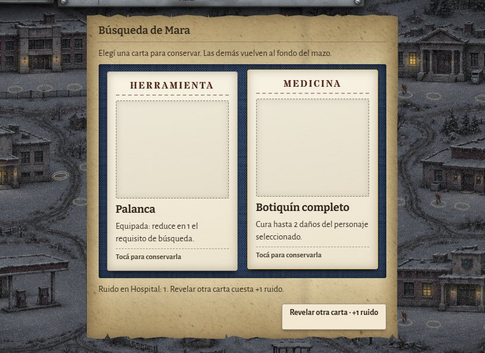
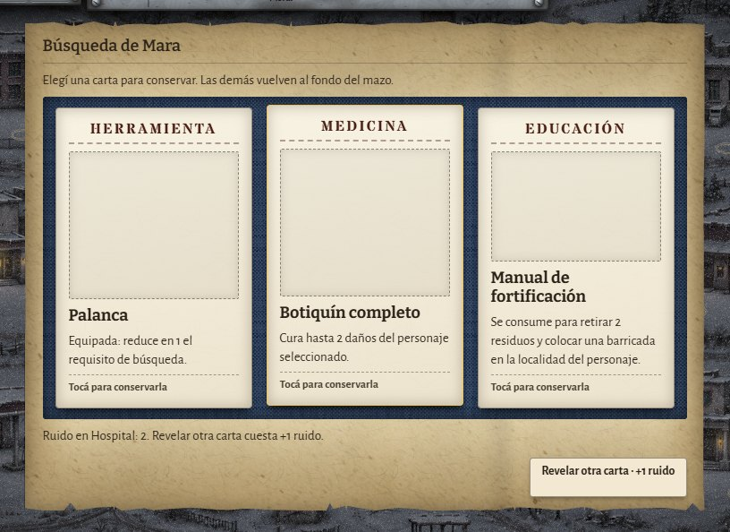
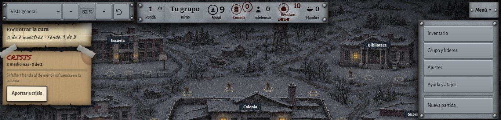
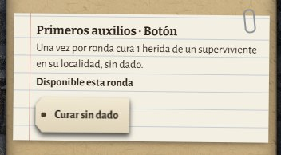
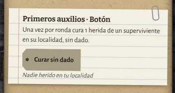

# 129 — Interfaz v2, sesión 8: segunda revisión

Rama `feature/interfaz-v2-sesion-8` (PR #45, borrador). Base: `ff4f36f` (informe [128](128-interfaz-v2-sesion-8-ajustes.md), aceptado jugando). Foco: escritorio a 1365×768; a 852×393 solo se comprobó que nada se rompa. `src/` no cambió y no hay archivos de textura nuevos.

## Qué cambió

| # | Problema | Cómo quedó |
|---|---|---|
| 1 | Con 2 o 3 cartas, la búsqueda las apilaba | El papel mide 24 px más: 2 y 3 cartas entran en fila, enteras y sin desplazar. La manta es la misma. |
| — | Copo del D12 | En celeste (Escarcha `#7FC4E8`, la de la guía), con el hueco azul oscuro para que se lea; en el dado 3D y en el plano. |
| 2 | Chapa demasiado limpia | Más oscura (recursos 14,5 %, zoom y menú 18 %, mediana contra la captura del 128), con hollín en los extremos y alrededor de los tornillos y mugre irregular con semilla fija. El rojo óxido pasó a `#2F0802` para sostener el contraste: se ve más apagado. |
| 3 | «VÍVERES» se corría | Va apoyada contra las acciones, que no se mueven. En escritorio, «Mejorar dado» oculto conserva su lugar (invisible y fuera del teclado). Queda en el mismo punto con o sin ese botón, en la tirada y en turno ajeno. Con 5 dados o más no entra y se oculta. |
| 4 | El retrato escondía las acciones | La causa era tocar el nombre o la madera junto al retrato: eso plegaba la barra y quedaba guardado, así que el retrato abría el legajo con las acciones escondidas. En escritorio la barra ya no se pliega (ni tocando, ni con «H», ni por lo guardado). En el teléfono se pliega como antes. |
| 5 | Habilidad del legajo ilegible | Etiqueta de papel crema con muesca; apagada, sin opacidad ni sombra. Cuando está apagada, el motivo reemplaza a «Disponible esta ronda». |
| 6 | Botones ilegibles | Papel crema en ajustes, inventario y «Cartas», «×», y supervivientes de la pestaña Colonia. Los apagados de los papeles centrales, la preparación, las pestañas del legajo y las cartas en espera ya no bajan la opacidad. |

**Motivos de la habilidad.** El motor informa `treatment` tanto si la habilidad ya se usó como si no hay a quién tratar; con su dato `skillUsed`, que la proyección ya expone, la interfaz distingue «Ya usada esta ronda» de «Nadie herido en tu localidad» (o «Nadie con congelación…»), sin recalcular reglas. Los motivos que el motor entrega sin texto propio (preparación, fin de partida, pase, dueño equivocado, o ningún dato) muestran **«No se puede usar ahora»**.

 

 

## Hallazgo 33

**Sin clasificar: no apareció en ninguna de las 20 corridas pedidas.** `check-map-death-decisions` se corrió 10 veces sobre `main` (`b78ba3b`, en un árbol aparte) y 10 sobre el estado final de la rama (`558b268`), intercaladas, en el mismo equipo y con las mismas variables. La batería y sus utilidades son idénticas en los dos.

| Árbol | Corridas | Fallas por caso |
|---|---|---|
| `main` | 10 de 10 en verde (80 casos) | ninguna |
| rama | 10 de 10 en verde (80 casos) | ninguna |

Sin una falla no hay nada que bisecar: no se puede decir que sea preexistente ni señalar un commit. No se cambió código por esto.

Acumulado de los informes 127, 128 y este, sin contar las corridas instrumentadas: `main`, 0 fallas en 13 corridas; la rama, 3 en 20 (2 de 4 con el 127, 1 de 5 con el 128, 0 de 11 ahora), todas a 393×852 al atacar. Si `main` fallara con esa misma frecuencia, 13 corridas limpias saldrían por azar alrededor de 1 de cada 8 veces: tampoco alcanza para culpar a la sesión 8. Que ahora no aparezca no demuestra que esté arreglada.

## Qué se comprobó

**Pruebas y construcción**

- 997 pruebas unitarias, 0 fallos; siete nuevas en `tests/interfaz-v2-sesion-8.test.mjs`. Comprueban valores, estructura y funciones puras; las posiciones y el contraste en pantalla se midieron aparte.
- `check:build` y `check:mapa-build` en verde. `test:poc` sigue sin correr en Windows (EPERM, hallazgo 14).

**Medido con Edge (guion propio)**

| Qué | Resultado |
|---|---|
| Contraste de cada `button` visible, 1365×768 | 104 botones, ninguno por debajo de 4,5:1 (el más bajo, 5,0:1, «Aportar a crisis» apagado). Los 10 apagados medidos, sin opacidad menor que 1 |
| Búsqueda con 2 cartas | Papel de 524 px, en fila, enteras; alto del contenido igual al visible (547 px) |
| Búsqueda con 3 cartas | Papel de 760 px, en fila, enteras; sin desplazamiento |
| «VÍVERES» | De 672 a 773 px en todos los estados medidos, sin superponerse; oculto con 8 dados |
| Barra en escritorio | Desplegada tras tocar retrato, nombre y madera, tras «H» y con una barra guardada como plegada; la pestaña de plegado no aparece |
| Chapa | Texto a 4,5:1 o más en los dos tamaños (mínimo 4,6:1 a 1365×768 y 4,5:1 a 852×393), tomando el 5 % más desfavorable bajo cada letra |
| 852×393 | Sin desborde horizontal; zoom, recursos y menú no se tocan; la barra se pliega como antes |

Para el contraste de los botones se captura cada uno con y sin texto y se compara en los píxeles que cambian, así que cuentan la opacidad, los filtros y las texturas. El recorrido pasa por preparación, barra, menú, legajo (habilidad activa y apagada), ajustes, inventario, cartas, ayuda, grupo, movimiento, ataque, barricada, tratamiento, búsqueda, cierre de ronda, mordedura, final y pase. **No se alcanzaron** «Limpiar residuos», «Regresar a la colonia», atraer zombis (el paso de elegirlos), transferencia, saqueo ni reclutamiento; comparten estilos con los medidos. Los dados no se miden: no tienen texto.

**Baterías de navegador** (Edge, sin vídeo porque acá no hay ffmpeg)

| Batería | Resultado |
|---|---|
| reglas de prueba, presentación, capacidades, inventario, ciclo, migración, experiencia, cámara, muertes durante acciones, D12, 2× y `check-h344` | Las doce pasan sobre el estado final |

Ninguna batería se modificó.

## Observado y no tocado

- **Búsqueda con 4 o 5 cartas.** El motor permite revelar hasta cinco; a partir de la cuarta pasan a una segunda fila y hay que desplazar.
- **Búsqueda a 852×393.** Las cartas siguen en columna, como antes: el ancho nuevo se aplica con más de 500 px de alto.
- **Dado que no sirve.** Se queda al 35 % en la barra, como se pidió; las casillas de dados de los papeles centrales que no alcanzan el requisito siguen al 45 %.
- **Nombre del superviviente.** En escritorio tocarlo ya no hace nada; si conviene que también abra el legajo, es un cambio chico.

## Qué falta probar jugando

- Escritorio: si la chapa oscura y sucia queda bien junto al resto y el rojo de peligro se sigue notando; «VÍVERES» en su lugar nuevo; la búsqueda con tres cartas; los ajustes y el inventario en papel crema; el copo celeste a 82 px.
- Teléfono de referencia (Galaxy A15): nada de esto se miró en el equipo.
