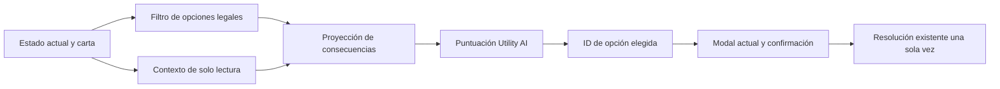

# 41 — Propuesta modular de Utility AI para encrucijadas (#7)

**Fecha:** 27/10/2026. **Base leída:** `6fdb774`, rama `fix/estabilizacion-v9-9`, PR14. **Alcance autorizado:** analizar el funcionamiento, proponer arquitectura, dependencias, riesgos y pasos con pruebas. **No modificar código ni crear commits.** Solo documentación local, sin staging, push, comentarios de GitHub, fusión ni cambios a `main`.

**Estado:** propuesta técnica, no implementación ni política de puntuación aprobada. El pedido autoriza este análisis de #7; no aprueba automáticamente pesos, preferencias o reglas nuevas. Continúan las reglas de cartas, turno, propietarios y resolución existentes.

## 1. Funcionamiento actual comprobado

El mazo contiene 26 cartas y 52 opciones: 6 cartas de ronda, 6 de movimiento, 10 de búsqueda y 4 de ataque. Cada opción mezcla etiqueta, descripción visible y callback de efecto; algunas recompensas son cadenas antiguas y otras objetos del catálogo.

1. `crossDraw(side)` extrae sin repetir hasta agotar y volver a mezclar; reinicia propietario, actor y banderas. Es una carta candidata por turno del grupo, no una nueva carta por cada acción ni una garantía de activación.
2. `crossTrigger(kind, actor)` exige partida activa, carta sin resolver ni pendiente, ausencia de mordedura en resolución, propietario igual al turno, tipo de acción correcto y `require` satisfecho. En ronda puede usar al líder; en acciones registra al actor.
3. `crossOptionAllowed()` filtra opciones por recursos/capacidad en casos concretos identificados mediante títulos: medicina, combustible o herramientas en la mano del dueño; comida en reserva; plazas y personajes disponibles, entre otros. No es aún una tabla general de requisitos.
4. La IA automática solo opera cuando `game.turn==='ai'` y el modo no es local. Selecciona la primera opción permitida cuya descripción no coincida con `-1 moral`, `+2 zombis`, `+1 zombi` o `-2 comida`; si ninguna cumple, toma la primera permitida. Cambiar redacción puede cambiar la elección sin cambiar el efecto.
5. Se conserva `aiCrossChoice` y se muestra la decisión en el modal. `waitForAiCross()` detiene el avance hasta «Continuar turno». J1 y J2 local siguen eligiendo manualmente.
6. `resolveCross()` vuelve a comprobar la opción, marca la carta resuelta, ejecuta su callback y llama a `verify()`. `crossAiContinue()` limpia la espera y reanuda la secuencia. La evaluación futura debe seleccionar, no resolver anticipadamente.

### Condiciones y consecuencias relevantes

- Requisitos de activación: localidad, influencia mínima/máxima, liderazgo y moral, además del tipo de acción. Distinguirlos de los requisitos para escoger una opción.
- Comida de reserva (`game.food`) no es una carta de comida en la mano. Las manos pertenecen al propietario de la carta; actor/líder y ubicación no siempre son el personaje seleccionado en pantalla.
- Hay efectos de comida, moral, residuos, ruido, indefensos, barricadas, zombis, muestras, objetos y reclutamiento. Un objeto obtenido no equivale a su efecto usado: recibir notas no aumenta automáticamente muestras.
- `addZombie()` puede ocupar una entrada, destruir una barricada o causar muerte por desbordamiento. La muerte puede devolver equipo, afectar moral, producir sucesión y reemplazo. El orden de dos zombis importa.
- Reclutar depende de capacidad y del roster, y el personaje se elige al azar. Las barricadas se limitan por entradas libres; comida/residuos y otras restas tienen límites específicos. No representar todas las cartas como una suma plana.
- Los callbacks son la fuente actual del comportamiento, no las descripciones. Por ejemplo, la muestra de «Un mensaje en la pared» incrementa `samples` directamente: no aplicar sin más el bono de investigador de `gainSample()`.
- `verify()` prioriza derrota por moral, luego ausencia de supervivientes/reemplazo y después objetivo de muestras. Una opción que alcanza muestras pero deja moral cero no debe proyectarse como victoria.

## 2. Objetivo y límites de la propuesta

Eliminar dependencia del texto al elegir entre opciones ya permitidas. Mantener activación, elegibilidad, efectos, azar de resolución, turnos y decisiones humanas. No modificar C7 de botín/crisis, acciones generales de IA, campañas, memoria persistente ni perfiles de facción en este bloque.

Una Utility AI compara valor contextual, no «opción buena» fija. La legalidad es un filtro obligatorio: una opción imposible no obtiene simplemente una puntuación baja.

## 2 bis. Comparación crítica de alternativas — 27/10/2026

El creador aclara que Utility AI fue su idea y solicita alternativas mejores. **El objetivo de #7 es independizar la decisión del texto y considerar consecuencias/contexto; no exige un algoritmo concreto.** La arquitectura Utility de los apartados siguientes responde al pedido original, no es una opción ya elegida ni una condición necesaria para corregir.

| Alternativa | Ventaja para este proyecto | Costo o límite |
| --- | --- | --- |
| Política de prioridades contextuales | Compara primero desenlaces/urgencias definidos, luego criterios secundarios; explicación y pruebas directas para dos opciones | El orden exige decisión de diseño, puede producir cambios bruscos y acumular excepciones si crece sin control |
| Utility AI | Intercambios graduados entre recursos/peligros, pesos configurables y posibles perfiles futuros | Curvas, escalas, pesos e interacciones necesitan calibración; una suma puede ocultar sacrificios absurdos si no trata bien límites terminales |
| Búsqueda de varios turnos | Puede comparar consecuencias futuras y secuencias | Mayor costo y necesidad de simulación fiel con azar/información oculta; desproporcionada como primer arreglo de #7 |

**Recomendación para esta etapa, no decisión aprobada:** comenzar con una política pequeña de prioridades, sobre el mismo catálogo de efectos, contexto y modelo de consecuencias propuestos. El selector consulta una interfaz de evaluación intercambiable; una Utility AI puede incorporarse después si los escenarios requieren compensaciones graduales que las prioridades no expresen bien. No combinar ambos sistemas de entrada sin demostrar la necesidad.

Ejemplos a acordar: preferir victoria inmediata real (respetando `verify()`), evitar derrota inmediata cuando otra opción no la cause, atender urgencias de hambre/moral/desbordamiento y después progreso/conservación. El orden entre urgencias y los desempates todavía requieren ejemplos aprobados. **Estas son preferencias propuestas de IA, no reglas nuevas de legalidad:** no se prohíbe una opción permitida ni se altera lo que hace.

La política debe operar sobre hechos de consecuencias y contexto, nunca sobre títulos de cartas o frases. No se propone una lista fija «en esta carta elegir 0»; el mismo evento puede generar otra decisión cuando cambie el estado. Los árboles de comportamiento pueden servir para secuenciar el turno completo, pero por sí solos no resuelven la evaluación de consecuencias de estas dos opciones.

El trabajo más delicado sigue siendo describir/proyectar efectos sin alterar el juego. Las prioridades simplifican la selección, no eliminan esa dependencia ni garantizan una IA óptima. La elección entre prioridades y Utility debe apoyarse en los mismos escenarios, con explicaciones esperadas; solo incorporar puntuaciones si aportan una ventaja verificable.

**Registro de esta comparación:** solo lectura y documentación local; sin nuevas pruebas de ejecución porque no existe implementación nueva. Se conservan los resultados de la revisión anterior como históricos, sin atribuirlos a ninguna alternativa. No hay elección de algoritmo aprobada, cambios de código, staging, commits o push.

### Comparación concreta posterior

Se compararon seis escenarios con efectos reales aislados, prioridades ilustrativas y un perfil Utility no calibrado. Coinciden en cinco; difieren con moral2 y comida0/3 en la radio. La sensibilidad de un peso cambia la elección Utility. [Informe42](42-comparacion-politicas-encrucijadas.md) conserva supuestos, consecuencias, puntuaciones y límites. No se infiere superioridad de un algoritmo ni aprobación del creador; siguiente decisión: preferencia ante ese conflicto y orden de urgencias.

## 3. Módulos propuestos

Los nombres/rutas son candidatos futuros, no archivos creados. Inicialmente pueden definirse como funciones con límites claros dentro del HTML. Extraer después a módulos o empaquetar solo ese subsistema si aporta valor: no exigir una refactorización general ni romper la apertura autocontenida/offline con imports o fetch nuevos.

| Pieza | Responsabilidad | Contrato clave |
| --- | --- | --- |
| Catálogo de encrucijadas | IDs estables de carta/opción; textos separados; requisitos y consecuencias descritos con datos tipados | La presentación no participa en la puntuación; no usar títulos como identidad nueva |
| Adaptador de contexto | Construir una instantánea de solo lectura del dueño, actor, líder, recursos, equipos, crisis, localidades, capacidad, objetivo y rondas | Sin DOM, mensajes, escritura de `game` ni uso de información oculta del mazo/futuro azar |
| Modelo de consecuencias | Proyectar efectos en orden sobre una copia aislada; producir estado/resultados y riesgos conocidos/inciertos | No invocar callbacks actuales sobre un clon: capturan globals/helpers y podrían modificar el juego real |
| Política de utilidad | Convertir cada resultado en valores de supervivencia, alimentos, moral, peligro y progreso; entregar desglose de puntaje | Funciones puras, sin azar ni ejecución de efectos. Pesos y prioridades son decisiones explícitas |
| Selector e integración | Puntuar únicamente IDs legales, elegir de forma determinista y devolver índice/ID para el flujo existente | Empates estables; ninguna selección si no hay opción legal; `resolveCross()` conserva ejecución real y validación final |

### Una sola semántica, migración gradual

No mantener indefinidamente una descripción estructurada para la IA y callbacks independientes que hagan otra cosa. Durante la transición se puede añadir un descriptor paralelo, **con pruebas de conformidad** contra cada callback original. Migrar luego efectos simples, por familias, a operaciones tipadas cuya semántica compartan proyección y ejecución; los detalles de escritura y notificación siguen separados.

Los efectos complejos no se convierten a sumas aproximadas presentadas como exactas. Modelar explícitamente condiciones, secuencias, desbordamientos, reclutamiento y resultados inciertos. Cuando no exista una proyección fiel, señalarlo como no soportado/incierto y no activar esa carta en el selector nuevo hasta completar su cobertura. La migración del evaluador puede probarse sin cambiar el selector en juego; no dejar un fallback textual permanente que perpetúe #7.

## 4. Cómo puntuar, sin inventar reglas

Propuesta de forma, no pesos aprobados:

`utilidad(opción, estado) = suma(peso × cambio de valor contextual) − penalización de riesgo/incertidumbre`

Cada valor usa una escala comparable; no sumar literalmente «1 comida + 1 moral − 2 zombis». Las curvas valoran escasez y umbrales. Ningún límite de la curva cambia el valor real guardado en el juego.

- **Alimentos:** déficit previsto para alimentar la colonia, población, hambre acumulada y recursos que quedarían. Dos comidas pueden ser decisivas con hambre y poco útiles con excedente.
- **Moral:** margen respecto de cero y riesgos de muerte; evitar valorar igual pasar de 1 a 0 que de 9 a 8.
- **Peligro:** localidad afectada, entradas, barricadas, población expuesta, ruido y daños; prever desbordamiento, no penalizar un zombi igual en toda situación.
- **Objetivo:** progreso efectivo hacia muestras y rondas disponibles. Distinguir ganar una carta de investigación de conseguir una muestra inmediatamente.
- **Otros recursos:** cartas consumidas/obtenidas, crisis vigente y posibilidades de uso, sin gastar ni reservar nada durante la evaluación.

Antes de aplicar la suma, clasificar resultados terminales según `verify()` real. Recomendación a aprobar: preferir una victoria segura compatible con esas reglas y evitar una derrota inmediata si existe alternativa no derrotada. Si ambas opciones son peligrosas, comparar sus consecuencias; no agregar una prohibición inexistente ni inventar una opción nueva.

Los pesos iniciales y el tratamiento de incertidumbre deben acordarse con escenarios. No asignar probabilidades arbitrarias a identidades de reclutas o al mazo. Primera versión: perfil cooperativo único, sin aprendizaje, LLM, personalidades, aleatoriedad de desempate ni planificación de partidas enteras. Utility AI no garantiza una estrategia óptima ni un balance correcto.

### Ejemplos de aceptación propuestos

- **La radio encendida:** con hambre y espacio exterior puede convenir comida; con exterior saturado y supervivientes expuestos puede convenir moral. Mismas palabras, contexto distinto. No afirmar que una opción siempre sea la correcta.
- **Fiebre en el refugio:** sin medicina la opción costosa no entra en la puntuación; con medicina, comparar su costo con el valor de conservar moral.
- **Un mensaje en la pared:** distinguir una muestra que realmente produce victoria de una que provoca antes una derrota por desbordamiento/moral cero.
- **La señal del mando:** si no hay acceso libre, la primera opción no produce ni barricada ni moral; no premiar el texto como si ambos beneficios estuvieran garantizados.
- **Refugiados:** incluir ocupación y necesidad de comida; respetar la elegibilidad actual, sin nuevas reglas de capacidad.

Son casos para discutir y después probar, no nuevas preferencias ya aceptadas.

## 5. Dependencias y riesgos

| Dependencia/riesgo | Protección propuesta y pruebas |
| --- | --- |
| `crossOwner`, actor/líder, manos y C9-R1 | Contexto explícito por propietario; J1/J2 manuales intactos; no usar selección UI como actor universal |
| `kind()`, objetos antiguos, catálogo, crisis C7 | Normalizar para leer sin cambiar las cartas originales; probar consumo/recompensa exactamente una vez y ambas representaciones |
| Callback vs descriptor desincronizados | Conformidad de resultados para las 52 opciones, condiciones límite y semillas controladas; IDs únicos y cobertura completa antes del cambio global |
| Proyección con efectos secundarios | Congelar estado de entrada; evaluar varias veces sin cambiar recursos, mazos, log, colas, foco o RNG real |
| Desbordamiento, muertes, sucesión y reemplazos | Secuencias explícitas y escenarios de borde; mantener reserva de dos líderes simultáneos identificada, sin ocultarla con el cambio de IA |
| Reclutamiento aleatorio y datos ocultos | Proyección de capacidades/resultados conocidos; resolver el azar solo al ejecutar; no consumir el generador aleatorio al puntuar |
| Modales y promesas de IA | Mantener mostrar-elección → continuar → resolver → liberar espera; Chromium con muerte, pase y encrucijada, además de tests de motor |
| Estado cambia antes de confirmar | `resolveCross()` revalida. Si deja de ser válida, política de actualización visible por definir; no ejecutar otra opción silenciosamente |
| Pesos mal calibrados o valores incompatibles | Escenarios contrastados, curvas acotadas y desglose determinista de puntuación; no aceptar solo porque la suite pase |
| Refactor/bundle rompe HTML o harness VM | Separación conceptual primero; si luego se extrae, probar carga autocontenida y adaptar explícitamente tests sin retirar comprobaciones |

## 6. Secuencia de implementación propuesta (no iniciada)

| Paso pequeño | Cambio y criterio de salida | Pruebas propias antes de continuar |
| --- | --- | --- |
| 1. Acordar contrato y escenarios | Inventario de 26 cartas/52 opciones, requisitos, efectos reales y resultados esperados; acordar prioridades y casos de empate/riesgo | Caracterización de reglas y bordes; mantener tests históricos del regex hasta sustituir sus expectativas en el cambio de política |
| 2. Contexto y selector puros, desconectados | Leer estado y elegir entre resultados ya puntuados, sin conectar al juego | Propietario/actor correcto, entrada inmutable, sin opciones legales, empate estable, repetibilidad y sin llamadas DOM/RNG |
| 3. Primera familia de efectos | Recursos simples y consumo de cartas, con IDs estables y descriptores; conservar callbacks o migrarlos con equivalencia comprobada | Conformidad antes/después para alimentos, moral, consumo, límites y objetos antiguos; cambiar texto no modifica el resultado de evaluación |
| 4. Peligros y efectos compuestos | Barricadas/zombis, ruido, refugiados/reclutamiento, muestras y cadenas en orden; completar las 52 opciones | Entradas llenas, absorción de barricadas, muerte, reemplazo, capacidades, azar controlado, ausencia de desvíos respecto a reglas existentes |
| 5. Política Utility en evaluación paralela | Puntuar contextos de prueba y registrar explicación técnica; aún no seleccionar distinto en juego | Escenarios de escasez/excedente, derrota/victoria simultánea según `verify()`, incertidumbre y sensibilidad de pesos; invariancia ante redacción |
| 6. Integración acotada de #7 | Reemplazar solamente la selección de IA en `crossTrigger()`, mantener índice/ID al modal y ejecución actual | Regresión roja de dependencia textual y decisiones contextuales; elegibilidad, una sola aplicación, continuar IA, J1/J2 manuales y preservación C7–C9 |
| 7. Revisión y validación | Revisar implementación, ejecutar suite/CI y recorridos de navegador; actualizar tablero/registro con límites | `npm test`, CI del SHA exacto, Chromium encrucijadas + esperas + muerte/pase; nuevas partidas dirigidas. Pruebas naturales/balance y Android siguen separados |

No integrar una familia nueva en el juego antes de que coincida con las reglas originales en sus casos admitidos. Un nuevo caso ambiguo de regla se consulta; no se arregla silenciosamente dentro de Utility AI.

## 7. Trabajo realizado y situación al cerrar esta revisión

Se leyó el código de cartas, condiciones, ejecución, auxiliares y flujo IA, junto con documentación11/01/15/18 y tests de encrucijadas. **Pruebas existentes ejecutadas:** `node --test tests/encrucijadas.test.mjs`, **30 aprobadas, 0 fallidas/canceladas/omitidas y 0 TODO**. Dos tests caracterizan la heurística defectuosa actual: pasar no significa que #7 esté resuelto. No se escribieron pruebas nuevas, ni se ejecutó de nuevo navegador o suite completa para una propuesta sin código.

Solo documentos41, tablero18 y registro25 modificados localmente; `git diff --check`. Sin commits, staging, push, cambios de código/tests/configuración, edición del PR, fusión ni modificación de `main`. La arquitectura y pesos no están implementados. El análisis usa la copia local `6fdb774`; comprobar nuevos avances remotos antes de empezar una implementación futura.

**Siguiente tarea única propuesta:** comparar prioridades contextuales y Utility mediante escenarios del paso1 y acordar la política antes de implementar. Quedan por decidir algoritmo, prioridades terminales, pesos/curvas si corresponde, proyección de incertidumbre y tratamiento de opción invalidada al confirmar. No comenzar #13, narrativa persistente ni refactor general en este bloque.
