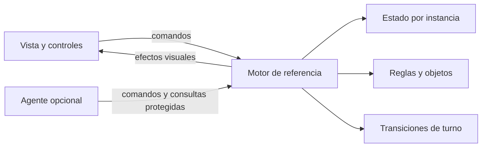

# 67 — Continuación D1 y D2 (29/10/2026)

**Seguimiento documental29/10:** el encargo posterior autorizó reconciliar SP-03 y abrir/comprobar el PR hacia main. [PR15 abierto](https://github.com/LeviEdition/invierno-en-la-colonia/pull/15), sin fusionar; preapertura7d6a68a con CI aprobado. Este informe conserva los hechos, SHA y resultados de su cierre histórico; las frases «PR no abierto» o «esperar autorización de apertura» describen ese momento. Estado actual en [tablero18](18-tablero-operativo.md), [documento69](69-pr-propuesto-d1-d2.md) e [informe70](70-reconciliacion-documental-y-pr-d1-d2.md). La reconciliación no cambia el código auditado6277e62 ni sus reservas.

## Autorización y límites

El creador indicó: «Avanza todo incluso d2, manteniendo las reglas de alcance y de autorización». Autoriza continuar las etapas técnicas después del checkpoint D1.2b. Los límites anteriores de detener cada subetapa quedan superados por esta autorización; siguen prohibidos cambios de reglas/balance, SP-02, singleplayer, narrativa, fusiones, releases y modificaciones de main. No crear una versión oficial de referencia (hito 2).

Rama de trabajo: `refactor/d1-d2-arquitectura`, desde `57872ee279e924460a126aecbcd0ee7141b5e078`, árbol inicialmente limpio. Remoto main `0b75d01`, D1 `ba9a423`, sin diferencias con los SHA conocidos. PR14 **ya está fusionado** según GitHub; corresponde a estabilización histórica, no es un PR de esta refactorización. Esta tarea no realizó esa fusión.

## Referencia y compuertas

`npm ci`, `npm run check:build` y `npm test`: referencia local aprobada, 451 pruebas, cero fallos/omisiones. Se conserva checkout temporal detached de 57872ee para comparación independiente: no comparar dos builds del mismo código y llamarlo preservación. No se crea tag ni release.

Secuencia: completar contratos de eventos/build (D1), separar estado/reglas/transiciones y presentación por puertos (D2), separar automatismos como cliente opcional, conservar adaptadores de las pruebas históricas, comparar 40 configuraciones completas contra 57872ee; validar interfaz, offline y CI sobre SHA entregado. Cada bloque debe poder revertirse.

Riesgos confirmados: paint procesa rescates, funciones de reglas abren/cierra modales y DeathDirector escribe DOM; extraer archivos sin separar esos efectos no sería completar D2. Se conservará el orden de cada efecto. Contexto interno de compatibilidad no será API pública del motor ni se publicará en window.

## Resultados

En curso. Las pruebas de la implementación y el CI final todavía no se han ejecutado. La emulación móvil no sustituye Android físico. El entorno administrado bloquea file://; se verificará también en Actions, sin eludir la política local.

## Bloque 1 — separación del motor, todavía sin cambiar distribución

Se extrajeron fábricas de datos/estado/reglas/objetos/crisis, transiciones de turno, cola de muertes y presentación. `reference-engine.mjs` conserva los comandos y enlaces privados de compatibilidad; ningún acceso se publica en window. El motor importa reglas/turnos, pero no DOM, presentación ni agente. Los efectos visuales son puertos opcionales. El renderer observa una vista viva protegida contra escritura. `paint` sigue siendo un refresco de aplicación que procesa rescates en los mismos puntos; `draw` solo presenta.

Adaptador de pruebas separado, construido desde los mismos módulos: reemplaza extracción/regex del script en 15 fixtures sin cambiar aserciones de mecánicas. El test de IA sustituye explícitamente el puerto pause en vez de reescribir texto. El producto no importa el adaptador. La distribución principal aún es la de referencia durante este bloque; no se declara adoptado todo el build.

Validación inicial de extracción: 451/451. Nuevas pruebas de frontera: primero dos fallos reales (vista podía escribir; modo IA sin cliente permitido), luego 3/3; suite total 454/454, sin omisiones. Comparación estricta de 40 partidas (20 por modo) contra checkout57872ee: **40/40 idénticas**, excluyendo exclusivamente metadatos source. Incluye trace.step, mensajes y eventos; no se normalizó el orden de acciones para obtener igualdad. La última extracción de datos/clases conserva 454/454; se repetirá comparación en el artefacto integrado.

Revisión crítica propia: el estado de referencia aún contiene humans/bots y reglas de dos grupos, por fidelidad al comportamiento aprobado. La fábrica de estado y el paquete de reglas son dependencias sustituibles; no se implementa una regla de un grupo. Agente extraído pero todavía requiere endurecer sus capacidades para dejar de escribir directamente. Antes de dar D2 terminado se migrarán eventos globales, se adoptará el artefacto modular y se validará esa separación. No se afirma revisión por una segunda persona/agente.

## Bloque 2 — adopción de módulos y capacidades

La plantilla pasa a ser HTML/CSS con un único marcador. Un solo pipeline esbuild genera la IIFE y la inserta; ya no hay sustitución de firmas export ni script monolítico activo. Los comandos PoC conservan aliases de CLI, no otro build. Se eliminaron los puentes transitorios catalog-poc-entry/handover-ui al desaparecer sus consumidores.

Se migraron los55 atributos de eventos originales a nombres de comandos/argumentos JSON y listeners, sin eval ni publicación de funciones/estado en window. Se conservan propagación de selección, condiciones de cierre del backdrop, valores de select, hover, botones deshabilitados, dados y confirmación de nueva partida. Las tres pruebas del piloto ahora ejercitan el registro usado por producción, conservando sus casos de routing, deshabilitados y ciclo de conexión; una nueva prueba añade entradas malformadas/heredadas/evento incorrecto. Los seis contratos de build ahora comprueban el bundler completo y el adaptador explícito, en lugar del antiguo marcador del catálogo. Las aserciones de reglas permanecen intactas.

El agente ve actores mediante proxies de solo lectura con identidad estable. Las mutaciones se piden por comandos del motor (uso de objetos, contribución, movimiento, exposición, dados y habilidades); mensajes, efectos y orden se mantienen. Las capacidades de vista/agente son listas explícitas, no acceso al contexto privado completo. Estado/reglas/turnos son fábricas inyectables para no imponer su implementación V9.9 a otro consumidor futuro; no se añadió ninguna mecánica singleplayer.

### Fallos encontrados y corregidos

- Chromium detectó receptor inválido al convertir queueMicrotask en método de un contexto: error real al morir. Se añadió prueba dirigida que fallaba antes de cambiar el adaptador y pasó después. Se conservó el orden de microtareas:40 registros completos siguen idénticos.
- El adaptador QA, al evaluar código bajo un scope explícito, necesitó ligar funciones nativas de Window como getComputedStyle. Era un defecto del harness; se corrigió exclusivamente allí. No existe ese evaluador en el producto.
- El nuevo smoke de producción esperaba dados antes de resolver la encrucijada inicial. No se cambió la regla ni se borró el requisito: el recorrido resuelve esa decisión mediante botones antes de medir dados.

### Validación de navegador y límites

Escenarios QA:5 partidas completas,3 recorridos C16,6 inicio/pase,6 viewports táctiles C11, sin errores/invariantes. El manifest QA registra hashes de los mismos módulos usados por producción; solo entrada/instrumentación difieren. El HTML del producto no contiene eval, with, testBindings, __test ni globals del juego. Se repiten las entradas reales de las5 partidas sobre ese artefacto, comparando recursos/objetivo/resultado visibles; las invariantes internas se validan en Node y QA, no se finge inspección privada de producción.

Local file://: intento real rechazado con ERR_BLOCKED_BY_ADMINISTRATOR. No aprobado ni eludido; pendiente de Actions sobre SHA exacto. Emulación Chromium no equivale a Android físico/TalkBack.

## Revisión crítica y decisión D1.2d

**Recomendación: adoptar esbuild en esta rama para revisión.** Un único pipeline con dependencia exacta, imports/exports y HTML offline sustituye las firmas textuales; evita globals de handlers. El costo real son adaptadores de prueba/puertos, ahora explícitos. La comparación histórica y suites comprueban comportamiento, no solamente capacidad de construir.

D2 conserva un contexto interno amplio de enlaces vivos por compatibilidad; no es una API de extensión narrativa ni un motor genérico terminado. Las fronteras públicas tienen capacidades y protecciones, pero el paquete V9.9 aún nombra humanos/bots y dos bandos por sus reglas aceptadas. Cambiar ese paquete requiere diseño posterior autorizado. VM sigue en fixtures históricos como harness, no en el motor ni en producción; nuevas fronteras se prueban por imports ESM directos. El CSS y el layout no se rediseñaron.

Esta es revisión crítica propia, respaldada por oráculo histórico y ejecución; no se atribuye a una segunda persona. Aceptación humana e integración continúan pendientes. No se crea referencia oficial, narrativa ni nuevo singleplayer.

## Reversión

Cada bloque tiene commit separado. Conservar57872ee permite reconstruir el estado anterior mediante checkout independiente; para retirar bloques, usar git revert de sus commits en orden inverso y npm ci/build/check:build/test. No reset, force-push, cambio de main ni descarte de trabajo ajeno. La referencia histórica está en Git, no duplicada en src ni publicada como release.

### Revisión de fronteras antes del commit de adopción

La revisión crítica encontró que una protección Proxy ingenua dejaba escapar referencias mutables por descriptores y fallaba al consultar diccionarios congelados del catálogo. Pruebas rojas dirigidas reprodujeron ambos casos; la vista usa targets espejo para objetos congelados, descriptores protegidos y deniega cambios de prototipo/extensibilidad. El catálogo público solo ofrece consultas (sin deck/create/RNG). Se verificó también desconexión de los10 listeners de aplicación y reconexión sin duplicados.

**Suite local al entregar el bloque:**462/462, cero fallos/cancelaciones/omisiones; `check:build` byte a byte y `git diff --check` aprobados. Los11 tests adicionales a451 cubren fronteras motor/vista/agente, planificador, pureza de draw, eventos y ciclo de vida. TDD rojo→verde explícito en fallos de frontera y queueMicrotask; extracciones mecánicas comprobadas contra caracterización existente, sin afirmar que todo el refactor nació con pruebas rojas.

La evidencia local del navegador corresponde a iteraciones registradas; las compuertas se repiten en CI para el SHA exacto final. Aún no se declara Actions aprobado.

## Entrega y compuertas comprobadas

Commits de implementación: `151be08` (motor sin DOM y adaptadores conservando distribución anterior), `34a6274e2fd8221e67601978c87543df0cbec9e0` (adopción de módulos privados, eventos, capacidades y compuertas). Rama subida exclusivamente a `refactor/d1-d2-arquitectura`. El commit documental posterior registra la evidencia. La revisión final del diff completo detectó cuatro espacios finales heredados en líneas extraídas del renderer; se normalizaron en un ajuste posterior. check:build confirmó que el HTML/JavaScript generado conserva exactamente los mismos bytes. No cambian reglas ni comportamiento.

| Comprobación sobre34a6274 | Resultado |
| --- | --- |
| npm ci, check:build, npm test local y Node22 Actions |462/462,0 fallos/omisiones/cancelaciones |
| Checkout histórico57872ee, suite original |451/451 |
|40 partidas completas contra oráculo |40 idénticas: estados, mensajes, eventos, acciones y trace.step; solo source excluido |
| Caracterización D1.0 | conservada dentro de la suite:17 cartas,6×20 mazos, semillas y orden RNG |
| Chromium QA:5 partidas completas |5/5,0 errores/invariantes |
| Chromium producto: reproducir sus entradas sin acceso al motor |5/5, mismo resultado visible,0 errores |
| Producto320×640,393×852,1365×768 |3/3, dados≥44×44, selección táctil, menú/ayuda y sin overflow horizontal |
| C16 teclado/foco/muerte/sucesión/pase |3/3 tamaños |
| Inicio/pase con globals rotos |6/6 |
| C11 geometría táctil/solapamientos/estados/controles |6/6 tamaños,0 errores/fallos |
| file:// producto yQA, local/IA, red desactivada |4/4 en Actions; local bloqueado por política |

[Actions de regresión40877102864](https://github.com/LeviEdition/invierno-en-la-colonia/actions/runs/40877102864) **success**; [Actions arquitectura40877102629](https://github.com/LeviEdition/invierno-en-la-colonia/actions/runs/40877102629) **success**, ambos jobs. Artifacts descargados y cotejados: HTML de producto SHA256`e871484df909029973ce23046524eaa393ffd7a68e7e7eeb9aa6f2f42a0b5950`, idéntico local/CI/offline/producción. QA`102811bb48ddcb0ca7fc3d2a571351d0a542044283f8351bae86d99b5f1ec4dc`,15 hashes de módulos compartidos comprobados contra fuentes locales. Chromium local154.0.8037.57 yCI143.0.7499.4. [Evidencia estructurada](evidencias/d1d2-ci.json) incluye resultados, semillas, geometría, hashes y digests. Capturas completas en artifacts de Actions.

Los cinco casos: IA2654435761 victoria R4; IA1401181143 derrota por moral R6; local2654435761 victoria R2; local3816266512 derrota por moral R4; local3189639203 victoria R3. Coinciden con resultados anteriores; ninguna excepción se codifica por semilla.

### Mapa para aprender y revisar

Separar no significa cambiar las reglas: el motor decide y guarda cambios; la vista dibuja y envía intenciones; el agente pide acciones. El bundler reúne esos archivos para seguir distribuyendo un solo HTML. Los puertos permiten probar esas piezas sin navegador y sustituir sus conexiones sin reescribir sus reglas.

**Dictamen:** D1 y separación técnica D2 de la referencia implementadas y verificadas en esta rama, listas para revisión. No equivalen a aceptación humana, integración, certificación universal ni motor singleplayer terminado. Quedan como reservas: contexto interno de compatibilidad amplio, schema V9.9 de dos grupos, VM en pruebas históricas, otros navegadores y Android físico/TalkBack. No se hará otra auditoría general de fidelidad por estas reservas.

**Estado protegido:** main remoto`0b75d01`, D1 original`ba9a423` sin cambios; árbol limpio después de commits; PR14 ya fusionado antes de este encargo. No se abrió/fusionó PR, no se cerraron issues, no se creó release/tag ni versión oficial. **Única siguiente tarea recomendada:** revisión humana del informe y [diff de esta entrega](https://github.com/LeviEdition/invierno-en-la-colonia/compare/57872ee279e924460a126aecbcd0ee7141b5e078...refactor/d1-d2-arquitectura), para aceptar o pedir ajustes de D1/D2 antes de autorizar integración o preservación del hito2.
