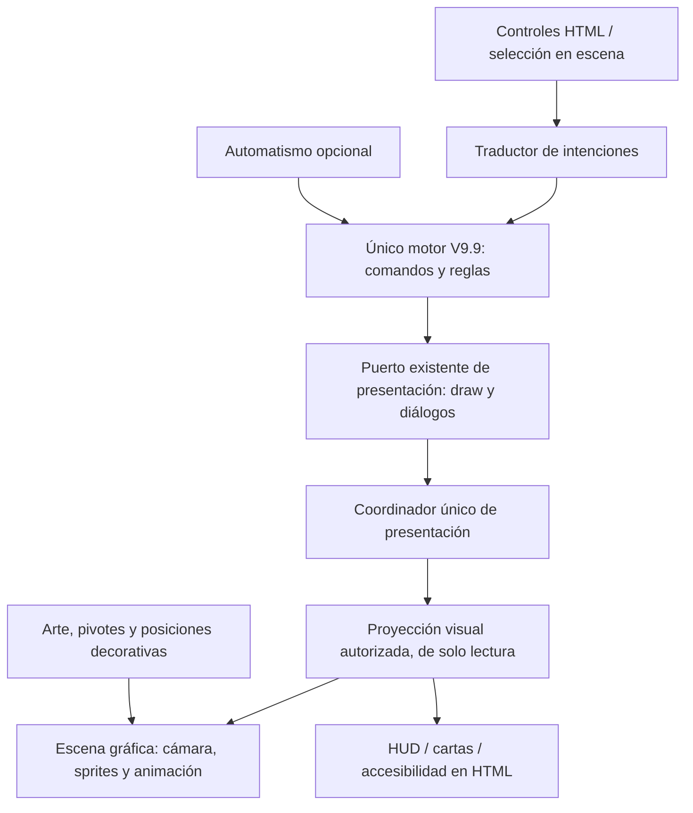

# 74 — H3.1: auditoría y planificación de identidad visual

**29/10/2026, Montevideo. Auditoría documental terminada; pendiente de revisión del creador.** Este encargo inicia H3 «Identidad Visual y Experiencia Jugable». No implementa Phaser, modifica el producto ni autoriza H3.2. [Plan incremental H3.1–H3.6](75-plan-hito-3-identidad-visual.md) · [evidencia](evidencias/h31-auditoria.json).

## Acuerdos posteriores del creador — H3.1 aceptada con precisiones

El creador acepta H3.1 y autoriza exclusivamente H3.2. La dirección acordada es **un tablero ilustrado y detallado en2D por capas, mapa continuo con las siete localidades, cámara de ángulo fijo, desplazamiento y zoom**. Edificios, supervivientes, zombis y barricadas son elementos independientes. No se requieren modelos3D ni rotación. Los espacios son representaciones de tablero, sin navegación libre, distancias, colisiones o nuevas reglas. Los personajes pueden permanecer estáticos; animación/efectos son feedback.

En móvil se admiten botones de centrado y paneles contextuales. **El resumen con sectores separados no sustituye al mapa continuo como objetivo.** La recomendación anterior de resumen + sector ampliado queda conservada abajo como propuesta histórica y no es la dirección aprobada.

H3.2 se limita al hospital y Phaser como candidato principal, conservando Canvas de comparación. PixiJS queda como alternativa solo ante un bloqueo concreto, sin PoC paralelo. Debe fijarse versión, respetar originales/pivotes, comparar esquina con tolerancia alrededor de Canvas y medir costos/reinicio/limpieza. La aprobación artística de proporciones, encaje y kit corresponde a H3.3: cambiar renderer no promete mejorar la apariencia. No se autoriza fusionar PR16/17, conectar reglas, construir el mapa completo, publicar o comenzar H3.3.

## 1. Dictamen ejecutivo

La base permite comenzar una evaluación visual gradual: el motor se ejecuta sin DOM y el hospital demuestra composición 2.5D, cámara y controles. Todavía no hay una representación gráfica conectada al juego. El refactor D1/D2 no convierte automáticamente la presentación actual en una API gráfica completa: persisten estado de interacción privado, un único puerto de presentación y efectos con nombres procedentes de la interfaz HTML.

**Recomendación:** evaluar Phaser como renderizador del mundo, conservando HTML para HUD, cartas y decisiones. Mantener un único motor de reglas y una proyección de estado de solo lectura para la escena. Conservar Canvas 2D como comparación del experimento mientras se decide; no comprometerse todavía con dos renderizadores de producto ni con la sustitución de la interfaz.

**Hallazgo que condiciona la elección:** el registro público anuncia Phaser **4.2.1**. Su guía oficial marca Canvas como deprecado, aunque disponible. El fallback automático no garantiza equivalencia con los efectos WebGL. El paso siguiente propuesto es un PoC acotado y medido, no migrar el juego completo por la popularidad del framework.

El creador **aprueba la primera experiencia del hospital como base experimental**, según este encargo. Esa aceptación actualiza el estado de revisión visual anterior, sin autorizar fusionar PR #16, elegir Phaser definitivamente ni comenzar mecánicas propias.

## 2. Fuentes, estado y método

| Elemento | Estado verificado |
| --- | --- |
| Main y base de la rama documental | `826199d96645b95869509995772c914290d63ac7`, sin avances al iniciar |
| Referencia preservada | Tag anotado `v0.9.9-referencia-modular` → `62e4e85150b2416ccf07d671c186b5c421993b0b`; release existente e intacta |
| HTML de producto | SHA-256 `43b8883ad4821e4b50c40791615c5ef6c0b3030476409b4e1c6da4dbd872d692`, idéntico al preservado |
| PR #16 | OPEN/draft, `prototype/hospital-2-5d`, head `ba1d93a4ae73a91a6f07660584e2374b53043a67`, cuatro checks success consultados |
| Implementación del hospital | `c9452c7af55959a5373510dc6e9c7c87e308eeb9`; commits posteriores documentales, sin integración en main |
| Rama de esta entrega | `docs/h3-1-identidad-visual`, creada desde main en worktree separado; no hereda ni copia código del prototipo |
| Instrucciones | No se encontró AGENTS.md aplicable. Leídos README, tablero 18, protocolo15, planes01/62/63 e informes67/68/71/72/73 |

El código del juego se inspeccionó desde main; el prototipo desde su propia rama. Sus rutas `prototypes/`, `assets/prototipo-hospital/` e informe 73 **no existen en main**. Las referencias a ese material apuntan al [snapshot del PR #16](https://github.com/LeviEdition/invierno-en-la-colonia/tree/ba1d93a4ae73a91a6f07660584e2374b53043a67), sin incorporarlo mediante esta documentación.

Se realizó lectura de fuentes, consultas de Git/GitHub y metadatos públicos de Phaser, pruebas existentes e inspección de interfaz en contextos nuevos de Chromium. Los scripts temporales de inspección quedaron fuera del repositorio. La escena Phaser no se instaló, importó ni ejecutó; se descargó su distribución únicamente a un directorio temporal para medir bytes. No se añadieron dependencias, tests, workflows o código de producto.

### Alcance de la evidencia nueva

- Checkout limpio de main: `npm ci`, `npm run check:build`, `npm test`: **467/467**, cero fallos/omisiones/cancelaciones. No comparar ese conteo con 477 como pérdida de cobertura: las diez pruebas extra del hospital pertenecen a PR #16 y no están fusionadas.
- Chromium154.0.8037.57: inspección de V9.9 en 1365×768,393×852 y 320×640. Inicio, tablero y ocho paneles por viewport: acciones, inventario, grupos, encrucijadas, registro, ayuda, objetivo y crisis. Sin excepciones JS ni overflow horizontal en esos recorridos. [JSON](evidencias/h31-ui-v99.json).
- Se resolvieron por la interfaz los avisos iniciales necesarios en partidas de inspección, con RNG fijo 0.45 para capturas. No se alteró una partida del usuario ni se modificaron reglas. Los recuentos observados no son un balance de juego.
- Gate existente del hospital ejecutado nuevamente: tres viewports, oclusión, mostrar ocultos, selección, cámara, teclado y gestos CDP aprobados. [JSON](evidencias/h31-prototipo-controles.json). No equivale a teléfono físico.
- Muertes, mordeduras, rescates y terminales se revisaron en fuente y pruebas existentes; no se provocaron todos esos estados en esta inspección visual. El CI previo y los informes conservan su procedencia; no se presentan como pruebas nuevas de partidas completas u offline.
- Diagnóstico del arnés: un selector inicial encontró un botón oculto residual del DOM; se limitó a elementos visibles. Las capturas posteriores desactivan animaciones transitorias. No se corrigió código del juego por esos incidentes.

**Capturas nuevas:** [tablero de escritorio](evidencias/h31-v99-tablero.png) y [acciones en móvil emulado](evidencias/h31-v99-acciones-movil.png). La notificación que aparece sobre la cabecera es transitoria y se conserva como evidencia, no como simulación de un defecto permanente.

## 3. Inventario visual de V9.9

Una página HTML autocontenida, sin rutas de navegación independientes. `src/invierno.template.html` define la estructura; `src/presentation/reference-view.mjs` genera contenido. Hay **16 tipos de modal** en un contenedor compartido, más inicio, pase y fallecimiento. El inventario siguiente diferencia elementos existentes de posibilidades futuras.

| Componente existente | Representación y fuente actuales | Implicación para H3 |
| --- | --- | --- |
| Inicio/configuración | Diálogo `setupScreen`, dos grupos: humano+IA o dos jugadores locales | Conservar ambos modos durante validación visual; todavía no diseñar el modo de un solo grupo |
| HUD de misión | `goalCard`: nombre, descripción, muestras, progreso y ronda límite; tres objetivos definidos | Mantener valores y criterio de victoria del motor; no convertir la barra en una nueva regla |
| Crisis | `crisisCard`, modal de requisitos/aportes/penalidad y aportes desde mochila/equipo | UI HTML con explicación de tipo y resultado; no recalcular contribuciones en escena |
| Turno/colonia | `turnLabel`, resumen de líderes, Saltar IA, final de partida | Cambiar texto/presentación sin disparar transiciones desde animaciones |
| Estadísticas | Moral, comida, hambre, ronda, residuos, zombis, indefensos; rescates cuando hay cola; tooltip `statInfo` | HUD legible y valores del motor; semántica y texto además del color |
| Tablero/localidades | **Colonia, Supermercado, Hospital, Comisaría, Gasolinera, Escuela, Biblioteca** | Siete áreas lógicas, no un mapa de coordenadas transitables |
| Colonia |12 plazas de habitantes y 12 accesos agregados; indefensos representados textualmente | Decorar plazas no autoriza inventar puertas con reglas o subdividir colonia |
| Seis localidades exteriores |4 plazas y 4 accesos cada una; leyenda de objetos por frecuencia | Reutilizar identidad y datos; faltan cinco edificios exteriores y arte de colonia |
| Supervivientes en tablero | Botones `.surv`: nombre, grupo, influencia, ataque/búsqueda, heridas, frío, habilidad, equipo, líder y selección |16 definiciones de personaje; seis actores iniciales. Sus IDs y estados deben gobernar los sprites |
| Perfiles | Modal con estadísticas, habilidad, movimiento y equipo; icono de retrato genérico | Faltan retratos/cuerpos propios; no rediseñar atributos o habilidades para justificar arte |
| Grupos/liderazgo | Listado de ambos grupos y elección inicial/sucesoria | Mantener identidad, dueño y prioridad de decisión; un líder visual no cambia las reglas |
| Zombis | Conteo `zones[i].z` y calaveras en accesos, sin entidades lógicas individuales | Sprites derivados del contador; sus posiciones no conceden alcance, daño o visión |
| Barricadas/accesos | Conteo `b`, símbolos de barricada y accesos libres; estado basado en `zcap` | El motor no identifica una barricada por puerta física. Asignación gráfica debe ser decorativa y determinista |
| Ruido | Contador y SVG de altavoz por zona | Indicador local y textual; no añadir propagación geométrica de sonido |
| Dados de acción | Flotantes y selector del modal; valor y selección por índice; desaparecen al consumirse | Animación cosmética opcional; no volver a tirar ni crear dados al dibujar |
| Acciones | Actor, habilidad, dado, mejorar con comida, destino, mover, buscar, atacar, barricada, limpiar y atraer | Botones/contexto accesibles que emiten comandos; no acciones nuevas por clic sobre decorado |
| Búsqueda/botín | Elección de carta, ruido y explicación de devolución de las demás | Mantener elección e interrupciones, sin autoelegir al cerrar animación |
| Inventario/objetos | Lista de cartas con icono, nombre, efecto, tipo, Usar/Equipar/Aportar;17 definiciones del catálogo | Datos e iconos son reutilizables como referencia; falta ilustración y un lenguaje de iconos uniforme |
| Equipo/transferencia | Ficha, descripción expandible, transferencia a otro personaje y aporte a crisis | Conservar referencias de objeto y elegibilidad; no arrastrar a destinos ilegales |
| Tratamiento/habilidad | Selector de paciente y usos de habilidad | La escena muestra objetivos válidos según consultas del motor |
| Atraer zombis | Selector de localidad de origen y cantidad restante | No transformar distancias en nuevas restricciones |
| Exposición/mordedura | Mensajes de resultados y decisión sacrificio/arriesgar | No usar física o colisiones de Phaser para resolver exposición |
| Encrucijadas |26 definiciones; historia y elecciones cuando se activa; estado oculto antes; decisión IA indicada | Reutilizar presentación textual; no introducir Director, eventos persistentes ni revelar cartas ocultas |
| Reclutamiento/rescates | Confirmación de incorporación y cola si no hay plaza | No colocar un sprite antes de su incorporación efectiva al estado |
| Fallecimiento/sucesión | Diálogo propio, impacto y Continuar; luego elección de líder si corresponde | Orden y bloqueo de entrada mandados por el motor; animación interrumpible |
| Registro/notificaciones | Hasta120 entradas de log, banner y toasts `aria-live` | Texto accesible; los mensajes no son una API estructurada para deducir reglas o animaciones |
| Menú/ayuda/nueva partida | Menú flotante, reglas, confirmación de reinicio | Conservar acceso por teclado y limpieza de listeners al montar/desmontar |
| Pase de dispositivo | Pantalla privada con confirmación, fondo inerte y gestión de foco | Detener entrada del mundo y ocultar datos de la audiencia anterior |
| Finales | Etiqueta FIN DE PARTIDA y banner de victoria/derrota, tablero sin acciones válidas | No hay una pantalla cinematográfica final independiente; podría diseñarse después sin resolver otra vez el resultado |

**Ausentes:** sprites de supervivientes, barricadas y demás edificios; animaciones direccionales; terrenos completos; navegación libre, pathfinding y colisiones espaciales; pantalla de campaña/Director; menú de guardar/cargar o almacenamiento persistente en las fuentes auditadas. `snapshot()` es copia de estado, no un sistema de guardado. La visión futura no convierte esas ausencias en bugs de V9.9.

Fuentes del inventario: [datos](../src/domain/reference-data.mjs), [estado inicial](../src/domain/reference-state.mjs), [plantilla](../src/invierno.template.html#L320) y [paneles/vista](../src/presentation/reference-view.mjs#L101). Los contratos y el puerto público están en [reference-contracts](../src/application/reference-contracts.mjs) y [reference-engine](../src/application/reference-engine.mjs#L803).

### Diagnóstico de interfaz

La información está disponible, pero muy concentrada en HUD, tarjetas y modales. En los tres tamaños observados no hubo overflow horizontal; eso no garantiza buena lectura de toda la pantalla. El tablero contiene bastante contenido vertical y el menú/dados ocupan espacio fijo inferior. Se observó una notificación temporal sobre el encabezado del modal: el próximo diseño necesita una política explícita de capas y avisos.

La plantilla contiene **414 apariciones de `!important`** y sucesivas reglas de estilo. Es un indicador de costo para retocar el tema, no una prueba de fallo funcional. Recomendación para el producto futuro: nueva capa de presentación y tokens de estilo, conservando la referencia congelada en vez de reescribir de golpe esa cascada.

## 4. Auditoría del hospital y reutilización

El [informe 73 del PR #16](https://github.com/LeviEdition/invierno-en-la-colonia/blob/ba1d93a4ae73a91a6f07660584e2374b53043a67/docs/73-prototipo-visual-hospital-2-5d.md) conserva decisiones y pruebas. El prototipo usa módulos nativos y HTTP; V9.9 conserva su distribución offline independiente.

| Material | Evidencia y costo | Reutilización recomendada |
| --- | --- | --- |
| Hospital PNG |1254×1254, RGBA,2.392 MB; margen y residuos alfa1; silueta útil documentada | Reutilizar original y pivote como edificio piloto. Para interiores/tejado desmontable faltan capas y superficies que el PNG no contiene |
| Suelo PNG |1536×1024, RGB opaco,3.271 MB; imagen finita con calle/vereda | Reutilizar en el PoC; no asumir que es una textura repetible sin costuras o un mapa de caminos |
| Zombi PNG |1175×1338, RGBA,0.816 MB; postura y orientación únicas, gran margen transparente | Reutilizar como zombi estático; no sirve de superviviente ni de animación completa |
| Cámara y controles | Arrastre, umbral6 px, rueda/pinza anclada,50–400% del encuadre, teclado y 44 px | Reutilizar comportamiento y pruebas; adaptar transformación al renderizador elegido |
| Configuración de escena | Escalas, pivotes de píxel y tres posiciones explícitas | Reutilizar metadatos; no escalar ese conjunto de posiciones a navegación general |
| Renderer Canvas | Una transformación para suelo, sombra y sprites; selección por alfa | Mantener como comparación. La implementación no se transporta directamente a WebGL |
| Guion de pruebas | Lee `getContext('2d')`, matrices Canvas y composiciones de referencia | Reutilizar criterios, entradas y PNG; adaptar la inspección a capturas y coordenadas del renderizador, sin borrar el gate actual |
| Tipografía/iconos V9.9 | Fuentes de sistema/Georgia, texto, emoji y algún SVG | Reutilizar lenguaje y semántica; sustituir gradualmente emoji variables por iconos coherentes cuando se apruebe el kit |

Los tres PNG suman **6,478,691 bytes**, aproximadamente6.18 MiB. Su base RGBA8 decodificada se estima en **18,870,120 bytes**, aproximadamente18 MiB, antes de buffers, copias, atlas o mipmaps. No es una medición de VRAM. Replicar imágenes grandes por siete escenarios sin política de carga puede costar más memoria que la propia biblioteca gráfica.

Los originales se mantienen intactos y con hashes de procedencia. Un futuro proceso de atlas/recorte debería generar derivados y conservar metadatos de tamaño original, desplazamiento y pivote. No eliminar fondos por color ni perder los márgenes que definen los pies. Barricadas, supervivientes, colonia y cinco localidades exteriores necesitan material nuevo o rediseño; no existe un banco de sprites listo para reutilizar.

## 5. Canvas 2D actual frente a Phaser

La comparación es entre **el Canvas 2D manual del prototipo** y **Phaser 4.2.1 como candidato**. Phaser es un framework que puede usar distintos backends; no es sinónimo de WebGL, de 3D ni de nuestras reglas.

| Aspecto | Canvas 2D actual | Phaser candidato | Consecuencia para decidir |
| --- | --- | --- | --- |
| Escena de tres imágenes | Resuelta con poco código, sin biblioteca; redibuja a demanda | Añade infraestructura y un loop de juego por defecto | No hay evidencia de ventaja de rendimiento en esta escena pequeña |
| Muchas entidades/animación | Gestión manual de objetos, atlas, culling y tiempos | Objetos, escenas, texturas, cámaras, tweens, input y batching WebGL | Beneficio plausible al escalar; medir antes de adoptarlo |
| Profundidad | Orden explícito y composición alfa | Depth/orden/máscaras disponibles | Ninguno resuelve automáticamente edificios altos, interiores o oclusiones cíclicas |
| Cámara y gestos | Matemática y control ya probados | Cámara/input integrados, pero pinza y política de interacción siguen siendo responsabilidad de la aplicación | Comparar mismo anclaje/zoom; elegir una sola ruta de eventos para evitar doble arrastre |
| Renderizado móvil | Pocas capas; costo de escalado y memoria aún relevante | Aceleración, pero límites GPU, DPR, filtros y pérdida de contexto | No afirmar compatibilidad o ahorro de batería sin equipo físico y métricas |
| Interfaz accesible | HTML externo al canvas | Canvas/WebGL tampoco crea semántica HTML automática | Conservar HUD, cartas, formularios y diálogos en DOM |
| Pruebas | Siete tests de cámara y gate ligado a Canvas 2D | Necesita adaptar inspección de píxeles/matrices; el arnés actual no funciona sobre WebGL | Costo explícito; conservar aserciones y baseline, no borrarlos para conseguir verde |
| Build y distribución | ESM servidos por HTTP; sin dependencia extra | Paquete compatible con ESM; hay que probar el esbuild existente y empaquetar recursos | No añadir Vite/framework UI por defecto ni asumir salida offline lista |
| Mantenimiento | Poco código hoy; más infraestructura artesanal si crece | Menos herramientas gráficas propias, mayor dependencia de versión y APIs | Documentar versión, adaptadores y actualización; no depender de APIs internas o plugins v3 |
| Reglas/física | No contiene reglas | Ofrece física opcional, no reglas V9.9 ni Director | No habilitar Arcade/Matter/pathfinding para decidir combate o movimientos |
| Canvas alternativo | Es la base actual | En Phaser 4 está disponible pero **deprecado**; efectos avanzados requieren WebGL | Definir compatibilidad y degradación antes de prometer fallback equivalente |

### Fuentes y costo comprobado

Consulta de metadatos: Phaser 4.2.1, licencia MIT. Distribución `phaser.min.js` descargada sin ejecutarla: **1,375,976 bytes**, **352,441 bytes con gzip9 local**. Esa compresión no es una medición de transferencia del servidor del futuro juego. El paquete npm informa112,530,289 bytes desempaquetados: incluye más material y **no equivale** al peso descargado por el jugador.

Fuentes primarias, consultadas para esta auditoría:

1. [Registro npm, versión actual](https://registry.npmjs.org/phaser/latest), dato observado4.2.1; debe fijarse una versión en el PoC, no usar `latest` como contrato.
2. [README oficial fijado av4.2.1](https://github.com/phaserjs/phaser/blob/v4.2.1/README.md): capacidades, distribución y licencia.
3. [Guía oficial de migraciónv3→v4](https://github.com/phaserjs/phaser/blob/v4.2.1/changelog/v4/4.0/MIGRATION-GUIDE.md): Canvas deprecado, renderizador nuevo, filtros/máscaras y matrices de cámara cambiados.
4. [Creación del renderer](https://github.com/phaserjs/phaser/blob/v4.2.1/src/core/CreateRenderer.js): `AUTO` puede escoger WebGL o Canvas según disponibilidad y build; eso no garantiza paridad de efectos.
5. [Configuración](https://github.com/phaserjs/phaser/blob/v4.2.1/src/core/Config.js) y [distribución medida](https://cdn.jsdelivr.net/npm/phaser@4.2.1/dist/phaser.min.js).

No se hicieron benchmarks de Phaser, pruebas de contexto WebGL o esbuild con esa biblioteca. Las afirmaciones de rendimiento del proveedor son capacidades declaradas, no resultados obtenidos aquí. La guíav4 advierte que cambian máscaras y matrices respecto av3: tutoriales o plugins anteriores requieren revisión. El endpoint `docs.phaser.io/llms.txt` devolvió404; se usaron fuentes oficiales versionadas en lugar de atribuirle contenido no leído.

**Costo estimado cualitativo:** PoC de un sector, medio; adaptador de estado/comandos y pruebas, medio-alto; producción de arte y expansión de escenarios, alto y dependiente de recursos; accesibilidad/móvil/distribución, medio-alto. Son tamaños de trabajo, no horas comprometidas. La biblioteca no reduce por sí sola el costo de escribir/animar personajes o separar edificios en capas.

**Decisión propuesta:** mantener Phaser como candidato principal para H3.2, con mundo WebGL y HUD HTML, sin aprobación definitiva. Si no mejora el costo total para el alcance acordado o exige abandonar compatibilidad necesaria, ajustar o conservar Canvas 2D. No desarrollar dos presentaciones completas en paralelo para evitar tomar esa decisión.

## 6. Arquitectura visual propuesta

### Lo que ya existe y lo que falta

| Fuente actual | Qué aporta | Límite confirmado |
| --- | --- | --- |
| `domain/reference-data.mjs`, `reference-state.mjs` | Catálogo, lugares, actores y estado por partida | Esquema de dos grupos y localidades discretas; no coordenadas físicas |
| `domain/reference-rules.mjs`, `reference-items.mjs`, `reference-crisis.mjs`, `item-catalog.mjs` | Consultas y consecuencias reales | No deben copiarse en sprites, botones o físicas |
| `application/reference-turns.mjs`, `death-director.mjs` | Turnos, esperas y sucesión de avisos | Conservar prioridades y finalización; un tween no debe terminar el turno |
| `application/reference-engine.mjs` | `start`, `dispatch`, `snapshot`, puertos de presentación/automatismos |814 líneas de coordinación y compatibilidad; selección/destino/diálogos pendientes fuera de `snapshot()` |
| `reference-contracts.mjs`, `read-only-context.mjs` |57 capacidades de vista y protección de estado | Solo lectura no equivale a política de revelación: no publicar datos ocultos del contexto |
| `create-application.mjs` | Un motor, UI y agente conectados; routing de comandos | Hoy compone explícitamente HTML y agente; no es una fábrica de escenas gráficas intercambiables |
| `presentation/reference-view.mjs`, `commands.mjs` | HTML, foco, menús, cartas y comandos declarativos | Rehace `board.innerHTML` al dibujar; contiene presentación derivada y formatos específicos |
| `agents/reference-agent.mjs` | Consumidor del motor por capacidades | Mantenerlo independiente del render; no eliminar segundo grupo al adoptar gráficos |

El motor **no tiene `subscribe()`**. `connectPresentation()` instala una presentación y sustituye el puerto anterior. Conectar DOM y Phaser por separado podría desconectar callbacks de la primera vista. `snapshot()` devuelve una copia de `game`, sin selección, destino, dado elegido o cola de decisiones privada; por sí solo no basta para representar la interacción.

Otro límite importante: `paint()` procesa rescates antes de pedir `view.draw()`. **El loop gráfico nunca debe llamar `paint()` para refrescar un fotograma.** `draw()` sí es presentación; la prueba `renderer-boundary-d2.test.mjs` comprueba que no procesa rescates ni cambia estado/azar. Los futuros contratos deben conservar esa distinción.

### Propuesta: un coordinador, una proyección y varias superficies

Los nombres del diagrama son **roles propuestos**, no módulos creados en H3.1. En H3.4, si se autoriza, el coordinador se conectaría una sola vez al motor y delegaría los efectos HTML necesarios. Sin un segundo estado mutable de partida ni otro motor lógico en la escena.

1. **Proyección:** convertir consultas de solo lectura y estado autorizado en datos para dibujar: actores por ID, localidad, estado, contadores y señales de selección. Actualizar al notificarse un cambio existente; no reconstruir reglas desde HTML, textos del log o descripciones de cartas.
2. **Estado visual:** cámara, hover, posición decorativa, animación y cachés viven en presentación. Las heridas, dados, inventario, muerte, turnos y resultados siguen en el motor. Los sprites nunca son la fuente de verdad.
3. **Identidad:** `select` usa actualmente un índice del grupo, mientras `profile` usa ID. Traducir un clic en `actorId` a un índice **vigente** al emitir el comando; no conservar índices tras muerte, reclutamiento o pase. No añadir IDs lógicos permanentes a zombis/barricadas para dibujarlos. La clave interna `ai` también representa al jugador2 en modo local: resolver etiquetas y propiedad según modo/consultas, sin convertirlo visualmente en un robot.
4. **Intenciones:** seleccionar/destino/acción pasan por `dispatch` o capacidades existentes. El motor acepta/rechaza y la vista sincroniza el resultado. La disponibilidad incompleta en la API no se corrige duplicando condiciones en Phaser: cualquier nueva consulta exige un contrato pequeño y pruebas autorizadas.
5. **Animación:** representar un cambio aceptado. Movimiento visual no cambia `loc`; muerte/fin de partida interrumpen animaciones y conservan el estado final. No volver a calcular exposición al llegar un sprite a su destino.
6. **Azar:** el motor permite inyectar `Math`. Reservar un flujo de RNG de juego; animaciones, partículas o inicialización del framework no deben consumirlo. La igualdad de partidas con la misma semilla se comprueba también al redibujar/zoomear repetidamente.
7. **Audiencia y decisiones:** respetar pase privado, dueño del turno y orden de decisiones. `crossroadsView()` puede devolver el texto de la carta preparada; la vista actual solo lo muestra si corresponde. La nueva proyección debe conservar esa condición y no enviar información oculta a tooltips o Mostrar ocultos.
8. **Ciclo de vida:** montar/desmontar sin listeners, callbacks o motores duplicados. No invocar dos rutas de input para el mismo gesto. Deshabilitar entrada del mundo durante inicio, pase, muerte y decisiones obligatorias; la animación no altera esas prioridades.

El código actual permite esta dirección, pero todavía no ofrece DTO visual, eventos tipados de resultado ni un contrato completo de acciones disponibles. Se propone empezar por el puerto existente y una proyección mínima; no reabrir una refactorización general como requisito de H3.2. Los callbacks ausentes hoy pueden caer en no-ops: las pruebas del adaptador deberán detectarlos explícitamente.

### Profundidad y localidades

La unidad lógica actual es la localidad, no un punto con distancia. Propuesta para el primer producto visual: resumen de siete áreas y un sector seleccionado ampliado, especialmente en móvil. Es una decisión de presentación pendiente de aprobación, no una nueva forma de viajar.

Dentro del sector, asignar posiciones decorativas estables a ocupantes y contadores. Usar relaciones explícitas de oclusión del edificio; el orden por pies puede servir entre actores de un mismo plano, pero no resuelve cualquier fachada o tejado. Si hace falta ocultar solo parte de un edificio, prever capas de arte o regiones/máscaras. No añadir interiores navegables, caminos bloqueados ni puertas con reglas por disponer de una imagen.

Mantener etiquetas y selección accesibles para personajes tapados cuya información ya sea pública. Un modo Mostrar ocultos es una ayuda visual; no descubre cartas, inventarios privados o datos narrativos no autorizados.

## 7. Guía visual preliminar — propuesta para revisión

La dirección general ilustrada, invernal y posapocalíptica es la visión del creador; las especificaciones siguientes son **propuestas**, no una biblia artística ya aprobada.

| Eje | Propuesta y criterio |
| --- | --- |
| Perspectiva | Oblicua/dimétrica de ángulo fijo. Una relación2:1, aproximadamente26.6° en sus ejes de suelo, puede probarse como convención de producción; no se afirma que los PNG actuales la cumplan exactamente |
| Escala | Un adulto de pie como referencia de altura1; puerta aproximada1.2–1.35, zombi encorvado0.75–0.9. Calibrar con el hospital y aprobar una lámina comparativa antes de producir el resto; son proporciones gráficas, no distancias de combate |
| Pivotes | Punto de contacto de pies/suelo por recurso, en coordenadas del original. Ejemplo zombi `(716,1218)` sobre 1175×1338; conservarlo al generar atlas/derivados |
| Capas del mundo | Suelo → sombras/decoración baja → actores y oclusores según relaciones locales → marcas de selección/estado. Tejados/fachadas separados si el diseño aprobado lo necesita |
| Paleta | Nieve gris azulada `#DCE3EA`, fondo `#14212B`, panel `#1C2C37`, texto `#EEF2F5`, texto secundario `#B8C6CF`, latón/selección `#D5C092`, alerta `#D37E7E`. Son tokens candidatos, con contraste por medir en cada uso |
| Iluminación | Ambiente frío difuso y puntos cálidos en ventanas/refugio. Respetar luz pintada en los PNG y sombras de contacto suaves; no prometer iluminación3D dinámica a partir de estos recortes |
| Tipografía | Fuente de sistema legible para controles/cuerpo y serif sobria para títulos, como continuidad de V9.9. Evitar texto ornamental en valores críticos; fuentes externas requieren decisión de distribución |
| Tamaños | Cuerpo objetivo14–16 px, información secundaria al menos12 px cuando el contexto lo permita; controles táctiles≥44×44 px con separación. HUD y tipografía no se reducen al alejar la cámara |
| Lenguaje de interfaz | Etiquetas verbales, iconos consistentes y cantidades; selección, peligro, bloqueo y dueño diferenciados también por forma/texto. Mostrar por qué una acción no está disponible cuando el motor lo informa |
| Estados de actor | Nombre/ID estable, dueño/líder, selección, heridas, frío y muerte visibles sin depender de una animación; no cambiar estadísticas para acomodar un retrato |
| Escritorio/móvil | Mundo central con paneles de información; en móvil, HUD resumido y panel contextual accesible sin cubrir decisiones críticas. Mantener listado de actores/localidades como alternativa al toque sobre sprites |
| Ruido visual | Textura temática sutil en paneles; reservar contraste para lectura y amenazas. Toasts no deben tapar títulos, confirmaciones o decisiones obligatorias |

Objetivos de contraste a verificar:4.5:1 para texto normal y 3:1 para indicadores/componentes relevantes cuando corresponda, con comprobaciones reales de foco y lector. No se certifica WCAG por elegir una paleta o tamaños mínimos.

La lámina debe calibrarse primero con el hospital experimental aprobado; no se exige descartar arte útil por imponer una convención geométrica.

La sensación de RPG táctico puede venir de cuerpos, escala, sombras, selección y feedback contextual. No requiere introducir cuadrícula, puntos de acción, alcance geométrico, navegación libre o reglas distintas. El mapa ilustra decisiones del motor.

## 8. Riesgos y decisiones del creador

| Riesgo confirmado o incertidumbre | Impacto | Mitigación propuesta / compuerta |
| --- | --- | --- |
| Phaser 4 cambia matrices, máscaras y backend; Canvas deprecado | Portar ejemplosv3 o prometer fallback equivalente puede fallar | H3.2 con versión fija y pruebas de entrada/oclusión; decidir política de GPU antes de adoptar |
| Estado de UI fuera de snapshot y puerto único | HUD/escena pueden desincronizarse o desconectar efectos | Coordinador único, proyección mínima y contrato de efectos en H3.4 |
| `paint()` tiene efectos de aplicación | Refrescar cada frame podría procesar rescates o alterar orden | Loop visual solo sobre datos; test de no mutación/no RNG al renderizar |
| Uso compartido de RNG/timers | Framework o animación pueden perturbar tiradas o duplicar transiciones | Flujo de azar de motor separado, comandos idempotentes respecto del input y comparación de trazas |
| Índices de actor/dado y cambios de dueño | Selección obsoleta puede actuar sobre otro superviviente | IDs visuales estables, traducción fresca y pruebas de muerte/relevo/pase |
| Información oculta y bloqueos | Fuga de cartas o input durante diálogos | Proyección por audiencia y pruebas de jerarquía/foco; Mostrar ocultos solo para oclusión visual |
| Arte plano y pocas fuentes | Cambiar de orientación/interior o simular caminar necesita trabajo artístico real | Kit piloto aprobado y lista de recursos, sin inventar capas ausentes |
| Texturas grandes/DPR/filtros | Memoria, batería y fluidez en móvil | Carga por sector, derivados con metadatos, medir DPR y evitar efectos innecesarios |
| Tests acoplados a Canvas y DOM | Una migración puede perder cobertura mientras parece verde | Conservar baseline y añadir contratos del renderer; separar regresión lógica de diferencias de rasterización |
| HUD denso, avisos y teclado | Información o controles críticos ocultos | H3.4/H3.6 con vista móvil, foco, lector y superposición medidos |
| Distribución offline / preview de terceros | Funciona en un enlace pero no en el formato entregable | Decidir formato antes de ampliación; arte/código locales y build reproducible, sin CDN imprescindible |
| Falta de hardware mínimo definido | Afirmaciones de compatibilidad/performance sin evidencia | Elegir equipo móvil y navegador objetivo; reservas explícitas si falta prueba física |

No se confirma una regresión funcional grave que obligue a modificar V9.9 en este encargo. Se señalan límites de integración y experiencia dentro de la cobertura observada; no se abrió otra auditoría de fidelidad reglamentaria.

### Decisiones pendientes, en orden

1. **V-01 — autorizado después del informe:** PoC H3.2 exclusivo del hospital con Phaser candidato y Canvas de referencia; versión fija y adopción aún por evaluar.
2. **V-02:** aprobar/refinar perspectiva, lámina de escala y paleta/lectura de la guía preliminar antes del kit artístico H3.3.
3. **V-03 — acordado después del informe:** mapa continuo con siete localidades,2D por capas y cámara fija. En móvil se permiten centrado y paneles contextuales; sectores separados no sustituyen ese objetivo. H3.2 aún no construye el mapa completo.
4. **V-04:** definir PC/móvil/navegadores mínimos y qué ocurre sin WebGL; el Canvas deprecado de Phaser no resuelve por sí solo esa decisión.
5. **V-05:** conservar HTML único también para el futuro producto visual o adoptar carpeta web/otro formato offline. La release de referencia sigue inalterable cualquiera sea la respuesta.
6. **V-06:** aprobar el alcance/costo del kit piloto de superviviente, barricada y capas del hospital, antes de producir todas las localidades y animaciones.

Las decisiones SP-03/SP-04 y el esquema de un solo grupo permanecen en 63, sin cambios ni implementación. La autorización visual tampoco reabre dados, balance o narrativa.

## 9. Secuencia, aceptación y cierre de H3.1

El [plan 75](75-plan-hito-3-identidad-visual.md) descompone H3.1–H3.6, sus dependencias, pruebas y salidas. La secuencia recomendada es **auditar → comparar renderizador → fijar kit visual → integrar un sector → ampliar representación → validar experiencia y distribución**. No abrir todos los frentes a la vez.

Criterios de esta entrega:

- Estado remoto, referencia y PR #16 identificados por SHA; aceptación experimental distinguida de autorización de merge.
- Inventario con siete zonas,16 personajes definidos,17 objetos,26 encrucijadas, tres objetivos y 16 tipos de modal, con fuentes y límites de inspección.
- Comparación versionada Phaser/Canvas sin instalación ni ejecución de Phaser; costo de descarga y riesgo del fallback explícitos.
- Arquitectura con un motor, comandos existentes, proyección de solo lectura y tratamiento de cámara, decisiones, RNG, audiencia y ciclo de vida.
- Guía preliminar identificada como propuesta; recursos reutilizables y trabajo artístico faltante separados.
- Plan H3.2–H3.6 con criterios verificables, decisiones y compuertas de autorización.
- Rama documental independiente: solo Markdown, JSON de evidencia y capturas en docs; sin cambios de código, dependencias, assets originales, workflows, main, prototipo o SP-03.

**Estado final de alcance:** H3.1 listo para revisión, no aceptado automáticamente. Detenerse. La única siguiente tarea es la revisión del creador del informe/plan y su decisión sobre H3.2. No se crea código, instala Phaser, fusiona PR #16 ni comienza otro hito como consecuencia de este informe.
