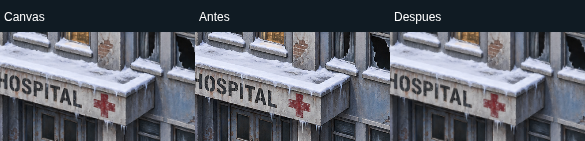

# 76 — H3.2: comparación técnica del hospital con Phaser

**Actualización vigente ·30/10/2026:** revisión acotada posterior al PR18, código `b4df86688f22717ab7ff706d482e0f0c2d99a6a0`. Los riesgos de bfcache y arranque se reprodujeron y corrigieron;483 pruebas locales aprobadas. El bloque final registra soluciones, evidencias y reservas. Las mediciones y cierres anteriores se conservan como historia, no como aceptación del creador ni adopción definitiva de Phaser.

**Entrega experimental para revisión.** H3.1 aceptada con las precisiones del creador; H3.2 autorizada, H3.3 no iniciada. [Tablero](18-tablero-operativo.md) · [auditoría74](74-h3-1-auditoria-identidad-visual.md) · [plan75](75-plan-hito-3-identidad-visual.md).

## Resultado y recomendación

El hospital funciona con **Phaser4.2.1, WebGL**, conservando composición, pivotes, cámara y controles de Canvas. La escena sigue aislada del motor V9.9. No hay mapa completo, reglas nuevas, movimiento libre, colisiones, física ni arte nuevo.

**Recomendación: ajustar antes de adoptar definitivamente.** Phaser es viable como candidato para el futuro tablero continuo y ofrece administración de escenas/texturas, cámara y herramientas de feedback. En esta escena de tres imágenes no demostró una ventaja de fluidez frente a Canvas y añade descarga, inicialización y mantenimiento. La versión4.2.1 requirió un adaptador de ciclo de vida y liberación explícita del contexto. Conservar este PoC para revisión y comprobar hardware móvil real antes de comprometer el renderer del producto. No se implementó PixiJS: no apareció un bloqueo que justificara otro PoC.

Esto cierra el experimento técnico para revisión, no aprueba la apariencia ni autoriza H3.3. Proporciones, contacto con el suelo, profundidad artística y kit superviviente/barricada corresponden a esa etapa. El renderer no mejora por sí solo el arte.

## Estado inicial, procedencia y límites

- Main remoto comprobado: `826199d96645b95869509995772c914290d63ac7`, sin avances. Árbol del creador limpio en `prototype/hospital-2-5d`; se trabajó en otro worktree, `/tmp/invierno-h32`.
- Primero se registró el acuerdo de mapa continuo y H3.1 aceptada en74/75/18, rama documental PR17: `77d2fc5479957364adbb99719c550f567203d85d` y `cde237d481f1eadb716ea158a4194bb9e633eecc`. Sus checks de regresión/engine/browser terminaron success. Se preservaron las propuestas anteriores como históricas.
- Rama experimental independiente `experiment/h3-2-phaser-hospital`, derivada de ese estado documental y, por ascendencia, de main. No se fusionaron PR16/17. La dependencia documental queda visible en el diff hacia main.
- Canvas y PNG proceden exactamente de PR16/head `ba1d93a4ae73a91a6f07660584e2374b53043a67`. Se copiaron archivos por snapshot, sin merge ni edición de la rama aprobada. [Manifiesto verificable](../test-support/h32-reference.json): fuentes Canvas, tests, PNG, manifiesto y evidencia histórica. El informe73 se incorpora sin reescribir sus resultados; sus checkpoints son historia.
- Tag anotado `v0.9.9-referencia-modular` conserva objeto `0fdb214612486f4cc46c1acb444390de963d05e8` y commit `62e4e85150b2416ccf07d671c186b5c421993b0b`. HTML V9.9 conserva SHA-256 `43b8883ad4821e4b50c40791615c5ef6c0b3030476409b4e1c6da4dbd872d692`. Release y sus dos adjuntos sin cambios; oráculo57872ee permanece en la ascendencia. Documento63/SP-03 idéntico a main.

Dirección aceptada: tablero ilustrado2D por capas, **mapa continuo de siete localidades**, cámara fija y elementos independientes. El hospital es el sector de prueba, no un sustituto del mapa por sectores separados. Botones de centrado y paneles móviles son compatibles con ese objetivo. No hay autorización de merge, publicación, H3.3 ni integración con el motor.

## Archivos y decisiones de implementación

| Componente | Responsabilidad |
| --- | --- |
| `prototypes/hospital/` y `assets/prototipo-hospital/` | Referencia Canvas y originales inalterados del snapshot auditado |
| `prototypes/hospital-phaser/index.html`, `style.css` | Entrada independiente; controles, textos, foco y avisos siguen en HTML |
| `main.mjs` | Montaje, estado visual local, ResizeObserver, controles, reinicio y disposición |
| `renderer.mjs` | Objetos Phaser, transformación única de cámara, capas, sombra y selección |
| `game.mjs` | Adaptador pequeño de arranque/visibilidad de Phaser4.2.1; sin reglas de juego |
| `scripts/build-hospital-phaser.mjs` | Esbuild0.28.2 existente; ESM minificado local, metadatos/hash y comprobación reproducible |
| `scripts/serve-hospital.mjs` | Servidor Node de ambas escenas, limitado a sus rutas; build al iniciar, sin Python |
| `scripts/check-h32-browser.mjs`, `check-h32-lifecycle.mjs` | Composición, entrada, fallos, cámara y recursos en Chromium real |
| `scripts/measure-h32-renderers.mjs` | Ensayos secuenciales de carga fría/caliente, reposo, navegación y heap |
| `test-support/h32-pixels.mjs`, `h32-reference.json`; tests H3.2 | Comparación de píxeles entre backends y conservación de bytes/servidor/build |
| `.github/workflows/h3-2-hospital.yml` | Compuerta del head exacto; artifacts de pruebas y medición, sin deployment |

Phaser se fija como devDependency exacta4.2.1; lockfile fija también su dependencia eventemitter3. No se añadió otro framework/bundler. El bundle local de `dist/hospital-phaser/` es generado e ignorado por Git; el producto V9.9 y su build no importan Phaser. No se carga CDN en ejecución.

Se importan directamente la configuración/pivotes, matemática de cámara, carga de imágenes, hit-test alfa y `bindControls` de Canvas. Los plugins Phaser de mouse/touch/keyboard/gamepad quedan desactivados. **Una única ruta PointerEvents** resuelve arrastre, clic y pinza; no se conecta otro drag de Phaser. Botones HTML y teclado llegan a la misma cámara. El input de demostración no genera comandos del motor.

Cámara Phaser con origen0,0, zoom visual×DPR y scroll inverso de la traslación. Su `getWorldPoint()` se contrasta con la inversa de la cámara de referencia; suelo, hospital, personaje, sombra y selección comparten esa cámara. El personaje conserva ancla716,1218 y escala0,095; hospital630,1148 y0,65. No se recortaron imágenes ni se eliminaron colores. PNG hospital/zombi mantienen alfa real, suelo opaco; pruebas de activos y hashes preservadas.

**Capas explícitas:** delante = suelo/sombra/hospital/zombi; detrás y esquina = suelo/sombra/zombi/hospital. Mostrar ocultos lleva el hospital a alfa0,28. La sombra se dibuja separadamente como textura radial derivada, con el mismo centro y extensión de la elipse original. No se presenta `depth=y` como solución general a edificios. El ancla por pies y los márgenes originales permanecen intactos.

## Comparación de composición y calibración

Se obtiene cada composición real WebGL y sus variantes diagnósticas sin actor/con actor al frente; se repite con el renderer Canvas original, mismos recursos, cámara, viewport y DPR. Se cuentan píxeles reconocibles por diferencia RGB L1>16. La fracción visible se normaliza contra el actor completo **dentro de cada backend**, para evitar confundir el distinto filtrado del fondo con oclusión. Estas variantes solo están disponibles con `?diagnostics=1`; no cambian la escena normal ni las reglas.

**Rojo conservado:** la tolerancia inicial de trabajo±2pp falló en320px: Canvas56,08%, Phaser53,68%, diferencia2,40pp. Esa cifra inicial fue propuesta técnica nuestra, no un requisito numérico del creador. [Evidencia previa](evidencias/h32-calibracion-inicial.json). No se cambió la posición para hacerlo pasar.

**Criterio calibrado: ±3 puntos porcentuales**, alrededor de la fracción Canvas del mismo viewport/DPR. Es una banda de6 puntos, muy inferior al intervalo10–90% rechazado. El actor es pequeño y se reduce una imagen de1338px de alto a unas decenas de píxeles; Canvas y WebGL LINEAR no producen exactamente los mismos bordes/contraste. En320px, la medida inicial pasó de699 píxeles reconocibles completos Canvas a598 WebGL. La discrepancia de2,40pp cabe en la banda, pero se informa, no se afirma identidad píxel a píxel.

La tolerancia se acompaña de comprobaciones independientes: posiciones, escalas y orígenes exactos; inversa de cámara con error≤0,02 unidades de mundo; zoom anclado; traslado de **todo el framebuffer** con acuerdo≥99,5%. Así se evita usar una banda ampliada para ocultar un error geométrico. La hipótesis de diferencia de rasterización está respaldada por esa geometría y por el filtrado observado; no se ha aislado cada contribución del driver.

| Viewport / DPR | Delante / detrás Phaser | Esquina Canvas | Esquina Phaser | Diferencia | Acuerdo pan framebuffer |
| --- | --- | --- | --- | --- | --- |
| 1365×768 / 1 | 100% / 0% | 56.74% | 54.74% | 2.00pp | 100.00% |
| 393×852 / 2 | 100% / 0% | 56.68% | 54.85% | 1.83pp | 100.00% |
| 320×640 / 2 | 100% / 0% | 56.08% | 53.68% | 2.40pp | 100.00% |

Mostrar ocultos revela99,9–100% reconocible en Phaser; desactivarlo vuelve a0% detrás. [Delante](evidencias/h32-phaser-delante.png) · [esquina](evidencias/h32-phaser-esquina.png) · [esquina móvil emulada](evidencias/h32-phaser-movil-esquina.png).

Las capturas de compositor sirven para oclusión y revisión humana. Para comprobar traslación se lee el framebuffer dentro de POST_RENDER: la caja CSS tiene altura fraccionaria y capturar su reescalado introduce diferencias. La primera comparación por screenshots obtuvo98,37%; no era una capa desplazada. La prueba corregida usa píxeles físicos antes de la reescala CSS, sin cambiar la cámara o el arte.

## Pruebas ejecutadas y alcance de la evidencia

- `npm ci`, `npm run check:build`, `npm test`: **480/480**, cero fallos/omisiones/cancelaciones. Son467 del juego +10 del snapshot hospital +3 nuevas de servidor/build/conservación. No se redujo cobertura.
- `npm run build:hospital` y `npm run check:hospital-build`: bundle byte a byte reproducible; HTML V9.9 intacto. El test del servidor primero reprodujo404 por una normalización incorrecta de la raíz; corrección mínima y dos pruebas verdes.
- Gate Canvas original ejecutado nuevamente sin editarlo: tres viewports, poses, alfa, cámara, selección, teclado, rueda, límites, pinza y arrastre CDP; sin excepciones. [JSON Canvas](evidencias/h32-canvas.json).
- Gate nuevo: **1365×768 DPR1,393×852 DPR2,320×640 DPR2**, delante/detrás/esquina, mostrar/restaurar ocultos, botones≥44px, teclado, rueda anclada, cámara real Phaser, pan con comparación de framebuffer, pinza CDP y arrastre móvil, resize, reset, tres reinicios por viewport, disposición/reapertura y0 overflow horizontal. Cero pageerror/console.error en recorridos normales. [JSON Phaser](evidencias/h32-browser.json).
- PNG de hospital bloqueado por red: aviso accesible, controles deshabilitados, solo reinicio disponible; desbloquear/reintentar recupera la escena sin app parcial.
- WebGL simulado no disponible: aviso y enlace a la referencia Canvas funcional; no se usa el backend Canvas deprecado de Phaser ni se oculta el cambio mediante fallback automático.
- Prueba específica de ciclo de vida: cinco reinicios con recuentos estables de listeners/ResizeObserver/objetos GL; selección real sobre alfa y zona vacía antes/después de zoom; límites de zoom; pérdida/restauración de contexto; disposición final sin listeners propios, observers ni objetos GL activos; handlers previos `window.onblur/onfocus` preservados. [JSON ciclo de vida](evidencias/h32-lifecycle.json).

**Condiciones locales:** Playwright-core1.57.0, Chromium154.0.8037.57 headless; Node24.19.0, Linux y CPU identificados en el JSON de medición. WebGL1 mediante ANGLE/SwiftShader Vulkan software, textura máxima8192. No son mediciones de una GPU física ni de un teléfono Android. CDP y viewports móviles son emulación. El CI usa Node22 y su Chromium descargado, registra sus propias condiciones; no se mezclan sus números con los locales.

## Costo medido y comparación

[Datos crudos locales](evidencias/h32-performance.json) · [bundle reproducible](evidencias/h32-build.json). Valores de tabla: mediana de tres ensayos; rangos de frío entre paréntesis.

| Viewport | Renderer | Listo frío ms (rango) | Listo caliente ms | P95 intervalo navegación ms | Draw calls reposo3s | Heap JS tras GC MiB |
| --- | --- | --- | --- | --- | --- | --- |
| 1365 | Canvas | 181 (155–219) | 55 | 16.7 | 0 | 1.57 |
| 1365 | Phaser-demand | 378 (373–453) | 250 | 16.7 | 0 | 4.73 |
| 1365 | Phaser-continuous | 381 (377–383) | 241 | 16.8 | 174 | 4.94 |
| 393 | Canvas | 207 (171–224) | 44 | 16.8 | 0 | 1.61 |
| 393 | Phaser-demand | 401 (399–404) | 230 | 16.8 | 0 | 4.78 |
| 393 | Phaser-continuous | 370 (368–394) | 255 | 16.8 | 169 | 4.98 |

JavaScript servido: Canvas5 módulos **13.102 bytes**, gzip9 por archivo5.316; Phaser bundle **1,409,348 bytes**, gzip9 **376,966** (medición local, el servidor de prueba no comprime). Esbuild conserva aviso legal MIT. SHA-256 bundle `e0afde9f6f41d7e85bcb08d617cc14abdea0f586a3a4d31a46dde6a029a1939f`. Más dos estilos y HTML en Phaser, conservados en los ResourceTiming. El paquete completo no se envía al navegador.

Método: tres ensayos por configuración y viewport, orden rotativo Canvas/Phaser bajo demanda/Phaser continuo; contexto nuevo para carga fría y reload para caliente; HTTP localhost sin compresión ni throttling. Tiempo hasta ocultar el indicador de carga medido con MutationObserver. Incluye módulos, decode y preparación del renderer; **no es una medición aislada de parseo**. Cache caliente usa revalidación ETag del servidor. Los ResourceTiming y bytes transferidos están completos en el JSON.

Reposo3s, navegación4s: eventos DOM de teclado por rAF, dirección alternada y zoom periódico; no son acciones humanas. P50/P95 son intervalos del rAF de carga, **no tiempos de ejecución GPU ni una certificación de FPS del dispositivo**. Los contadores drawImage/drawArrays/drawElements y tiempo de envío CPU ayudan a comprobar trabajo real del renderer. Heap CDP después de GC forzada, no memoria total del proceso ni VRAM. Sin otros tests/builds de esta tarea durante los ensayos finales; host compartido con carga externa no controlada. Primeros ensayos exploratorios, solapados con diagnóstico/cambios, se descartaron de la tabla final.

Canvas dibuja bajo demanda. Phaser continuo produjo172 cuadros en3s en la prueba exploratoria: trabajo evitable para una escena estática. Por defecto el adaptador duerme el loop tras POST_RENDER y lo despierta al cambiar estado/cámara. `?loop=continuous` permite repetir la comparación; no es otra escena. Futuros tweens/animaciones necesitarían mantener despierto el loop mientras duren, trabajo no implementado ahora.

Los tres PNG suman6.478.691 bytes, comunes a ambos renderizadores. Base RGBA estimada18.870.120 bytes (~18MiB), más sombra128×64×4=32.768 bytes. **Estimación dimensional**, no VRAM medida: excluye copias CPU, backbuffers, internos Phaser, DPR y posibles mipmaps. El conteo de objetos/texturas no mide su memoria. El paquete npm Phaser instalado ocupa unos112,5MB de archivos en este entorno; solo el bundle y recursos servidos llegan al navegador.

No se extrapola esta escena de un edificio/un zombi al mapa de siete localidades. Atlas, culling efectivo, límites de memoria, carga por zonas y animaciones siguen sin validar. No se añadieron sprites de estrés ni un kit artístico fuera del alcance.

## Reinicio, limpieza y reservas del framework

La prueba encontró dos detalles de Phaser4.2.1 que una comparación solo visual no detecta:

1. `src/core/VisibilityHandler.js` registra `visibilitychange` sin cancelarlo en destroy y asigna `window.onblur/onfocus`. Se reproduce el crecimiento por reinicio en la [evidencia roja](evidencias/h32-lifecycle-inicial.json). `HospitalGame` reemplaza el método protegido `Game.start()` con su arranque WebGL y tres suscripciones cancelables; no parchea globalmente EventTarget ni edita node_modules. La versión queda fijada. **Es un costo real de mantenimiento:** revisar este adaptador antes de cambiar Phaser.
2. `WebGLTextureUnitsWrapper.init()` crea una textura temporal1×1 no guardada en wrappers. `Game.destroy()` elimina los recursos registrados, pero la prueba detectó un handle restante por contexto. Tras destruir se libera explícitamente el contexto mediante `WEBGL_lose_context`; ya no quedan listeners de recuperación. Los conteos finales verifican objetos GL activos, distinguiendo `delete*` de liberación por pérdida de contexto. Si la extensión falta, se elimina canvas y toda referencia de la app; la liberación restante depende del navegador/GC, no se promete liberación inmediata. No se midió VRAM.

La prueba usa instrumentación QA externa de listeners/GL y filtra suscripciones propias, no los listeners internos de Playwright. Tras restaurar un contexto, los handles anteriores dejan de ser objetos válidos; el conteo usa `isTexture/isBuffer/...`, no solo «create menos delete».

`Restablecer vista` solo ajusta cámara. `Reiniciar escena` cancela RAF pendiente, aborta controles HTML y PointerEvents, desconecta ResizeObserver, destruye Game y monta una copia limpia del canvas accesible; reinicia la pose/selección/ocultos. Fallo de carga no deja controles activos ni instancia parcial. Navegar fuera libera la escena; la partida V9.9 no participa.

## Cómo reproducir

Desde la raíz de esta rama con Node22+:

```sh
npm ci
npm run check:build
npm test
npm run build:hospital
npm run check:hospital-build
npm run dev:hospital
```

Abrir **http://127.0.0.1:8771/prototypes/hospital-phaser/**. Comparar con **http://127.0.0.1:8771/prototypes/hospital/**. Mantener el servidor abierto; Ctrl+C para detenerlo. VS Code: abrir carpeta y Terminal → Nueva terminal. Alternativa Live Server: construir con `npm run build:hospital`, luego «Open with Live Server» sobre `prototypes/hospital-phaser/index.html` con la raíz completa disponible. No se requiere Python, CDN ni servidor de V9.9. El bundle no se reconstruye solo al editar: repetir build/reiniciar servidor y recargar. [README](../README.md#probar-h32-desde-vs-code-sin-python) incluye puerto alternativo y PowerShell.

Para repetir QA, instalar Playwright como herramienta temporal, sin guardarlo en lockfile:

```sh
npm install --no-save --package-lock=false playwright@1.57.0
npx playwright install chromium
```

Con el servidor en otra terminal:

```sh
node scripts/check-h32-browser.mjs
node scripts/check-h32-lifecycle.mjs
node scripts/measure-h32-renderers.mjs
```

Los scripts usan `CHROMIUM_PATH`, por defecto `/usr/bin/chromium`. Si se usa el Chromium de Playwright, definir la ruta que imprime `node --input-type=module -e "import {chromium} from 'playwright';console.log(chromium.executablePath())"`; PowerShell `$env:CHROMIUM_PATH='ruta impresa'`, bash `export CHROMIUM_PATH='ruta impresa'`. `H32_ORIGIN` cambia el origen; salidas por defecto `/tmp/h32-browser`, `/tmp/h32-lifecycle`, `/tmp/h32-performance` (variables H32_OUTPUT_DIR/H32_LIFECYCLE_DIR/H32_PERF_DIR). Las instrucciones normales para abrir no requieren instalar QA.

Este prototipo usa HTTP con módulos/PNG, no apertura file://. El HTML V9.9 offline publicado conserva sus instrucciones y bytes. No se volvió a publicar ni a certificar la release.

## Revisión crítica y pendientes

Se hizo una segunda lectura del diff y contratos después de las pruebas, sin otro agente/revisor independiente en esta entrega. Se comprobaron: ningún import del motor, ausencia de consumo de RNG de juego, una ruta de input, transformación compartida, fixtures originales intactos, limpieza real y fallos visibles. Los defectos de ciclo de vida confirmados se corrigieron y se conservaron las pruebas rojas. Los fallos del arnés por scroll fuera del viewport y escala CSS de screenshots se corrigieron en QA, sin alterar el producto para forzar resultados.

Reservas: método protegido del framework fijado, WebGL requerido, minificación con detalle/aliasing distinto, nitidez limitada al ampliar los PNG, filtrado y sombra sin identidad píxel a píxel. Sin Android/iOS físicos, Safari/Firefox, TalkBack, GPU de hardware, perfil de batería ni medición VRAM. Tampoco se ensayaron todas las fallas posibles del driver o la extensión de pérdida de contexto ausente. No existe evidencia para afirmar que este renderer escalará sin problemas al mapa completo.

**Siguiente tarea única: revisión del creador del PoC, informe y diff, y decisión sobre renderer/H3.3.** No iniciar arte, conexión de reglas o mapa antes de esa autorización. PR16/17 y este experimento permanecen sin merge, sin publicación automática. Para revertir la evaluación, cambiar a main: sus fuentes, build y referencia no se tocaron; no se mueve ningún tag.

## Commits, PR y CI

Implementación: `678fd0cd1b6b9c569fad1d507b97d8547468192d`. La documentación y evidencia local se añaden en un commit posterior de la misma rama experimental. No se escribe aquí el SHA de este mismo documento; el head exacto, checks y enlaces de ejecución se registran en el PR de borrador y en la evidencia de entrega posterior. Así se evita una referencia circular al commit que contiene este texto. El workflow H3.2 hace checkout explícito de `pull_request.head.sha`; los workflows existentes de regresión D1/D2 conservan sus contratos.


### Comprobación de GitHub Actions y cierre documental

[PR18, abierto en borrador hacia main](https://github.com/LeviEdition/invierno-en-la-colonia/pull/18), sin merge ni auto-merge. Head de validación `930117e656a26022af0a1e1ce2afeb021c97181f`, código de implementación678fd0c. **Cuatro checks success:** [regresión480/480](https://github.com/LeviEdition/invierno-en-la-colonia/actions/runs/40989984441), [engine y navegador D1/D2](https://github.com/LeviEdition/invierno-en-la-colonia/actions/runs/40989984388), [hospital H3.2](https://github.com/LeviEdition/invierno-en-la-colonia/actions/runs/40989984474). El workflow D1/D2 ejecutó comparaciones40/40 por referencia, cinco partidas QA y su reproducción en producto, compuertas de interfaz y file offline. Evidencia fresca de esta entrega, no una sustitución por CI histórico de H3.1.

Se descargó el artifact del hospital y se comprobaron los cuatro JSON passed, los tres viewports, cinco reinicios,18 ensayos y el build. **Bundle CI idéntico al local**, incluido SHA-256 y tamaño. [Resumen duradero de CI](evidencias/h32-ci.json) identifica condiciones/versiones de runner separadas de la medición local; los datos y capturas completos quedan en el artifact del run. El commit posterior solo registra este resultado y se comprueba de nuevo en CI; su head final se comunica en el PR y entrega, evitando referenciar el SHA de este mismo documento.

Ramas remotas main826199d9 y prototipo ba1d93a4, tag/release y SP-03 verificados intactos tras preparar el PR. Trabajo detenido para revisión del creador; sin H3.3 ni publicación.


## Revisión acotada de cierre solicitada tras PR18 — reproducciones iniciales

Base320fc92, sin cambios locales y coincidente con FETCH_HEAD. No hubo avance remoto ni cambios de main/prototipo/referencia. Se repitieron npm ci y480/480 antes de corregir. La configuración de fetch solo obtiene la rama en FETCH_HEAD, sin ref origin/..., por eso se contrastó directamente ese SHA; no hay divergencia ni pérdida de trabajo.

[Evidencia roja nueva](evidencias/h32-cierre-reproduccion-inicial.json), conservada junto a la evidencia anterior:

- **bfcache confirmado:** Chromium154 con el argumento de Playwright que desactiva bfcache retirado, sin desactivar otras protecciones. Salida a Canvas y Atrás: misma identidad aleatoria del documento, pagehide.persisted=true y pageshow.persisted=true. Estado final disposed, app=null. No es una recarga normal.
- **Cancelación confirmada en caso controlado:** se retrasa un PNG y se envía pagehide sintético, luego se deja completar; termina ready/publica app. Esta reproducción controla la carrera, no afirma navegación física ni bfcache en ese caso.
- **Excepción síncrona confirmada:** QA lanza tras super(config) en el constructor; aparece aviso de error, pero Game parcial conserva running/booted/renderer. No basta con mostrar el aviso.
- **Fallo asíncrono confirmado:** QA lanza en Scene.create; queda loading/starting y aparece pageerror. **Arranque sin completar:** create retorna sin resolver; también queda loading. La observación inicial fue1,5s, no demuestra que ningún driver vaya a fallar así sin la inyección.

Las inyecciones solo existen en bundles construidos por QA con esbuild; no cambian arte ni añaden mecanismos de fallo al producto. Revisión y corrección aún en curso; los cierres previos superiores conservan su carácter histórico y no aceptan automáticamente esta revisión nueva.


## Cierre de la revisión acotada de H3.2 ·30/10/2026

### Hallazgos, reproducción y resultado

| Caso | Estado confirmado | Corrección y comprobación |
| --- | --- | --- |
| Atrás con bfcache | En320fc92 volvía el mismo documento con app liberada | `pageshow.persisted` solicita un montaje nuevo. Tres ciclos reales con misma identidad, persisted=true, recursos/listeners estables y un comando por clic |
| Salida durante PNG pendiente | Pagehide controlado permitía publicar al terminar la descarga | AbortController y generación invalidan el intento; cola serial limpia antes de montar otra instancia. Caso controlado y navegación real durante carga verificados por separado |
| Salida durante Game/Scene pendiente | Riesgo de publicación o callback fuera de su pantalla | Navegación real durante Scene.create pendiente restauró bfcache y permitió ignorar el create viejo, con una sola escena/contexto operativo |
| Constructor lanza después de asignar recursos | El aviso aparecía, pero Game parcial seguía activo | Captura mediante callback público preBoot y liberación de la instancia parcial antes de habilitar reintento; cero contextos/loops activos del intento fallido |
| Excepción asíncrona en create/start | Create quedaba loading; start también requiere una frontera de error | Create tiene rechazo explícito. Errores JS del propio bundle durante boot rechazan la espera; listener temporal, sin ocultar errores ajenos ni reemplazar window.onerror |
| Game/Scene no completa | Espera sin límite | Presupuesto compartido15s desde montaje, con timeout, aviso role=alert y reintento. Create sin completar y callbacks tardíos probados |
| Callback de start después de retirar Game | En la primera corrección se reprodujo acceso al loop destruido | Guardia WeakSet en HospitalGame.start. Prueba espera el callback real de17s, confirma que ocurrió, loop viejo detenido y nuevo contexto único |

**Explicación sencilla:** bfcache conserva la página y su JavaScript; no equivale a abrirla desde cero. Por eso «destruir al salir» necesita «reconstruir al volver». Además, salir de una página no cancela automáticamente una promesa. Cada montaje ahora tiene una identidad y una señal de cancelación: un resultado viejo se consume y se descarta, no publica otra escena. No se modifica el cargador Canvas original: sus descargas PNG pueden completar; se cancela la espera y se consume su resultado tardío sin crear Game.

**Política visual explícita:** tras restauración desde bfcache se restablecen Delante, cámara encuadrada, selección=false y ocultos=false; botones, checkbox, descripciones y zoom coinciden. No se intenta persistir cámara o posición de demostración. El scroll de la página lo conserva el navegador. Cambiar foco/visibilidad sin navegar no crea otra instancia ni resetea esa escena. V9.9 y guardados no están conectados.

`pagehide`/`pageshow` son suscripciones de vida de la página y permanecen una vez cada una para poder volver. Los recursos de cada escena se retiran: controles, observer, RAF, hooks de Phaser, contexto y texturas. El nuevo criterio distingue **dos listeners de navegación estables** de **cero listeners de escena/observadores/contextos activos tras disponer**. El cero absoluto del gate anterior no contemplaba recuperar bfcache; se conserva su evidencia histórica.

### Arranque acotado y limpieza parcial

La promesa ya no da por terminado el arranque solo porque entró en Scene.create: espera también el primer POST_RENDER real de Game. Esto distingue «se crearon objetos» de «el loop del renderer comenzó». Un solo deadline de15.000ms cubre PNG, Game/Scene y primer frame, con temporizadores cancelados al resolver, rechazar o abortar. La cifra ofrece más de30 veces el mayor arranque local anterior (~453ms); es una política conservadora del PoC, no un SLA de cualquier dispositivo/red.

La prueba de bloqueo usa los15s reales, sin bajar el timeout del producto. Los fallos sintéticos ocurrieron aproximadamente a452/422/487ms (constructor/create/start); las esperas agotadas a15,29–15,38s desde navegación, incluyendo tiempo previo al montaje. Un arranque que aparece después del timeout o la cancelación ya no puede publicar ni reactivar la instancia vieja. El watchdog no interrumpe una ejecución JS síncrona infinita ni un navegador/driver bloqueado; depende de que el event loop pueda ejecutarse. Suspensión/throttling del navegador puede demorar su entrega.

La captura pública preBoot permite conservar el handle de Game aunque new lance después de super. En una instancia inicializada se solicita Game.destroy y se procesa su pendingDestroy mediante el método público Game.step; así la liberación no depende del siguiente rAF, que puede estar congelado al navegar. Antes de READY, Phaser4.2.1 presupone systemScene/stamp al destruir: el helper corta las suscripciones READY, libera los gestores inicializados, retira el canvas/pool y pierde el contexto. Los Image.onload internos que eventualmente terminen no tienen un renderer ni un READY donde reactivar Game; las referencias CPU restantes quedan para GC. Se comprueba actividad/listeners/objetos GL, no VRAM ni liberación inmediata de toda memoria CPU.

El teardown parcial y las comprobaciones de fase son específicos de4.2.1 y deben revisarse junto al adaptador al cambiar versión. No es una utilidad genérica para varias instancias Phaser compartiendo plugins. El PoC mantiene una sola instancia publicada. Los errores de limpieza se registran; en los casos ejecutados fueron0.

### Revisión final de HospitalGame contra el código oficial

Se contrastaron `Game.js`, `VisibilityHandler.js` y `Config.js` instalados por npm con el [tag oficial v4.2.1](https://github.com/phaserjs/phaser/tree/v4.2.1). El contenido coincide normalizando LF/CRLF; no se afirma igualdad de bytes entre distribuciones. [SHAs y enlaces](evidencias/h32-cierre-adapter-fuente.json).

**No se encontró una solución por API pública equivalente y más pequeña.** autoFocus=false evita el focus automático, pero no las asignaciones onblur/onfocus ni el listener anónimo. pre/postBoot sirven para capturar o observar Game; postBoot se llama antes de instalar VisibilityHandler y no proporciona su callback. Quitar handlers del emisor Game tampoco elimina la referencia DOM. Restaurar solo window.onblur/onfocus dejaría el listener de documento. Un parche de la distribución trasladaría la dependencia privada a un parche del vendor; no simplifica su mantenimiento.

| Comportamiento oficial | Tratamiento del PoC y alcance |
| --- | --- |
| isRunning, postBoot y loop.start(step) | Reproducidos para el renderer WebGL seleccionado |
| Rama headlessStep | Omitida: no hay backend HEADLESS ni fallback Phaser Canvas en este PoC |
| VisibilityHandler instala callbacks DOM y emite HIDDEN/VISIBLE/BLUR/FOCUS | Sustituido por callbacks cancelables que llaman directamente onHidden/onVisible/onBlur/onFocus |
| Reloj/foco y PAUSE/RESUME | Conservados a través de esos métodos; comprobados en la prueba dirigida |
| Broadcasts HIDDEN/VISIBLE/BLUR/FOCUS a terceros | **No reproducidos**. El PoC no tiene consumidores efectivos: teclado Phaser desactivado, NoAudio con handlers NOOP, cero sonidos y plugins custom. No se declara equivalencia general de la API |
| Autoenfoque y prefijos de navegadores antiguos | autoFocus=false; se usa document.hidden estándar. No se certifican navegadores antiguos |
| Start tardío de instancia cancelada | Guardia añadida solo tras reproducir el callback contra un loop destruido; WeakSet no retiene la instancia por sí mismo |

Se mantiene **Phaser4.2.1**, sin editar node_modules. El reemplazo protegido sigue siendo una reserva técnica, no una base aprobada para activar audio, plugins o consumidores nuevos. La advertencia exige revisión antes de cambiar versión **o capacidades**. No se amplió a otro renderer ni a un motor lógico.

### Pruebas y honestidad de la evidencia

- **483/483 Node**, cero fallos/omisiones;467 juego+10 Canvas+3 H3.2 inicial+3 de cancelación/timeout. npm ci/check:build/build:hospital/check:hospital-build aprobados. [Registro local](evidencias/h32-cierre-validacion-local.json).
- Gate Canvas original sin editar y gate Phaser en1365×768,393×852 y320×640 aprobados. Delante/detrás/esquina, banda±3pp, ocultos, selección, cámara, pan framebuffer100%, teclado y táctil conservados. [Canvas](evidencias/h32-cierre-canvas.json) · [Phaser](evidencias/h32-cierre-browser.json).
- [Gate de navegación/arranque](evidencias/h32-cierre-navegacion-arranque.json):3 restauraciones bfcache reales; misma identidad y persisted=true. Los contadores de un timer permanecieron constantes entre eventos **freeze y resume reales** durante353–400ms. No se usa pagehide→pageshow para exigir cero ticks: puede haber un callback antes de congelar o tras reanudar.
- Recarga normal identificada por documento nuevo/persisted=false. Salida real durante PNG pendiente volvió con recarga normal; no se cuenta como bfcache. La salida real durante Game pendiente sí restauró bfcache. Caso sintético de cancelación de PNG etiquetado por separado, sin afirmar navegación real.
- Seis fallos inyectados solo en bundles QA: constructor síncrono, create asíncrono, start asíncrono, create sin completar, create tardío y start tardío. Todos salen de Cargando, muestran alerta, liberan recursos, cancelan timers y recuperan mediante el botón. Loop retirado detenido y máximo un contexto operativo. Un error de otro script no se atribuye a Phaser.
- En el caso negativo de start se conserva la propagación normal del error JS a window.onerror/Playwright (H32_ASYNC_START esperado); no se oculta. Los recorridos sanos no generan pageerror/console.error. Handlers ajenos de error/foco/visibilidad conservados.
- [Adaptador](evidencias/h32-cierre-adapter.json): blur/focus y hidden/visible **sintéticos**, reloj, PAUSE/RESUME y reanudación de controles; destrucción y handlers ajenos comprobados. El comando CDP frozen fue aceptado pero **no detuvo un timer** en este headless: verified=false, no se cuenta como suspensión real. La suspensión real dentro de bfcache sí se prueba arriba. No hay validación de suspensión física del SO/teléfono.
- [Ciclo de vida](evidencias/h32-cierre-lifecycle.json):5 reinicios, contexto perdido/restaurado y limpieza final con2 hooks de página y0 recursos de escena.
- [LAN](evidencias/h32-cierre-lan.json):4 respuestas200 desde loopback/interfaz virtual del mismo entorno, ambas versiones. No es una prueba desde teléfono ni de la red del creador. Se conserva por defecto127.0.0.1 y se ofrece --host0.0.0.0 explícito.

Evidencia previa conservada. [Diagnósticos de QA](evidencias/h32-cierre-diagnosticos-qa.json) distinguen la aserción de freeze no demostrada y el conteo incorrecto pagehide→pageshow de un fallo del producto. También guardan un rechazo tardío de la primera versión del helper, reproducido y corregido para consumir promesas incluso con señal ya abortada.

Al habilitar acceso LAN se añadió una comprobación de rutas codificadas: el servidor podía entregar package.json fuera de sus directorios previstos. Se reprodujo200 y corrigió404 validando otra vez la ruta canónica; la prueba quedó en el test del servidor. No se accedió a secretos ni se realizó otra auditoría general.

**Build actual:**1.412.238 bytes, gzip9 378.108, SHA-256 `ed6b74eb280ea288971e79c797ab8d31cf5b817d7b3ace79927e4a5af9ee37d8`, reproducible. [Metadatos nuevos](evidencias/h32-cierre-build.json). Son2.890 bytes más que la primera entrega. La tabla de rendimiento superior corresponde a la entrega inicial, conservada como histórica; no se presenta como medición nueva del arranque corregido. El CI ejecuta de nuevo el benchmark y conserva sus condiciones/resultados en su artifact.

Condiciones: Linux, Node24.19.0, Chromium154.0.8037.57/Playwright1.57, WebGL SwiftShader software. CI usa su Node22/Chromium y registra resultados aparte. No Android/iOS físico, batería, VRAM, Safari/Firefox, foco físico del escritorio o red Wi-Fi del creador. No se simularon todas las fallas extremas de GPU/memoria ni se garantiza interrupción de código síncrono bloqueado.

### Probar desde VS Code y celular

En la copia local y rama experimental, actualizar sin reescribir historial y abrir terminal en la raíz:

```sh
git fetch origin
git switch experiment/h3-2-phaser-hospital
git pull --ff-only
npm ci
npm run dev:hospital
```

Node22+. Abrir `http://127.0.0.1:8771/prototypes/hospital-phaser/` y `http://127.0.0.1:8771/prototypes/hospital/`. Sin Python. Probar Esquina/ocultos/zoom/selección, abrir el enlace Canvas y volver con Atrás: Phaser vuelve limpio según la política descrita. Atrás por sí solo no demuestra bfcache: la evidencia automatizada registra persisted y la identidad del documento. Cambiar de pestaña sin navegar no debe reiniciar la escena. Reiniciar y restablecer vista conservan sus significados distintos.

Para celular, detener ese servidor y ejecutar `npm run dev:hospital -- --host 0.0.0.0`. Obtener IPv4 Wi-Fi/Ethernet de la PC (`ipconfig` en Windows) y abrir las mismas rutas sustituyendo127.0.0.1 por esa IPv4. Misma red, terminal abierta y Node permitido en red privada si Windows lo solicita. En el celular, localhost sería el propio celular. El servidor imprime interfaces; elegir la de la red correcta. No se desplegó un sitio ni se publicó una release.

QA adicional, con el servidor y Playwright/CHROMIUM_PATH configurados como en las instrucciones anteriores:

```sh
node scripts/check-h32-navigation-startup.mjs
node scripts/check-h32-adapter.mjs
```

### Dictamen de cierre

Los riesgos reproducidos quedan corregidos dentro de H3.2. La elección sigue siendo **ajustar antes de adopción definitiva**, por dependencia protegida, teardown específico y cobertura física pendiente. No existe aprobación artística o de producción por este cierre. Main, referencia/tag/release, PR16, arte, Canvas y SP-03 permanecen intactos; no motor, reglas, mapa ni H3.3.

**Único siguiente paso: revisión y aceptación del creador de esta corrección de cierre.** No fusionar ni avanzar automáticamente. El head exacto final y sus checks se verifican antes de entregar y se enlazan en PR18; el commit documental posterior se distingue del código b4df866, sin SHA circular en este documento.


### CI de la corrección y entrega documental

Código **b4df86688f22717ab7ff706d482e0f0c2d99a6a0**, cuatro checks success: [regresión483](https://github.com/LeviEdition/invierno-en-la-colonia/actions/runs/41048175125), [engine/browser D1-D2](https://github.com/LeviEdition/invierno-en-la-colonia/actions/runs/41048175119) y [hospital/cierre/benchmark](https://github.com/LeviEdition/invierno-en-la-colonia/actions/runs/41048175185). Incluye las regresiones de referencia existentes,40 comparaciones por variante, partidas QA/producto y gates offline. El workflow hospital comprueba explícitamente el head, además de los checks PR asociados.

Artifact descargado: seis JSON passed (Canvas, Phaser, ciclo de vida, navegación/arranque, adaptador y rendimiento),18 muestras de benchmark y **bundle idéntico al local**. [Resumen durable](evidencias/h32-cierre-ci.json) distingue Chromium/condiciones del runner y evidencia local. No se sustituyó esta verificación por checks previos. La documentación posterior registra este resultado sin alterar el código; sus checks finales se verifican también y se enlazan en PR18 con el head exacto, sin una referencia circular al SHA de este documento.


### Soporte posterior: pantalla «Inicializando» al abrir desde VS Code

El creador informa que la prueba permanece en Inicializando y consulta si falta descargar algo. **Causa en su PC todavía no confirmada**, sin consola ni comando de apertura. La entrada HTML requiere `dist/hospital-phaser/game.mjs`, generado e ignorado por Git; clonar y abrir con Live Server sin instalar/construir puede dejar ese módulo ausente. La indicación es Node22+, `npm ci` y `npm run dev:hospital` desde la raíz: instala Phaser4.2.1 fijado, construye y sirve la escena. Para Live Server se necesita antes `npm run build:hospital`. Si persiste, solicitar el primer error de consola para separar recurso404, dependencia, servidor o WebGL. No se atribuye un nuevo fallo funcional confirmado ni se cambia el producto; no se ejecutaron pruebas en la PC del creador.

**Diagnóstico confirmado por captura del creador:** PowerShell devuelve PSSecurityException/UnauthorizedAccess al intentar ejecutar `C:\Program Files\nodejs\npm.ps1`, porque la ejecución de scripts está deshabilitada. Se indicó `npm.cmd ci` y `npm.cmd run dev:hospital` desde la carpeta que contiene package.json; ejecuta el lanzador cmd de la misma instalación sin modificar la política. Node está instalado. Queda pendiente que el creador confirme la instalación/construcción y apertura de la escena; el bloqueo de npm no demuestra por sí solo la causa final de Inicializando. Sin cambios de código ni pruebas físicas en su PC.
## Revisión adicional de nitidez H3.2 — 30/10/2026

**Alcance:** observación del creador sobre pixelación global en Phaser, antes de aceptar H3.2. Se integra con el cierre de bfcache/arranque/adaptador; no autoriza H3.3, adopción definitiva ni merge. Base remota comprobada: PR18 OPEN/draft, `6036b81779079c8721d7e5fd4b44744cc9c4459f`, cuatro checks success. Main `826199d96645b95869509995772c914290d63ac7`, PR16 `ba1d93a4ae73a91a6f07660584e2374b53043a67` y tag/release preservados. Se respetaron dos cambios documentales locales previos de soporte Windows; no había cambios de implementación ajenos.

### Diagnóstico reproducido y controles

La diferencia se reproduce en Chromium154/SwiftShader: hospital con bordes dentados y detalles de suelo/zombi con aliasing al reducirlos. No se atribuye al arte. Los PNG y Canvas siguen protegidos por el manifiesto del PR16.

Se utiliza el renderer Canvas original, con el estado de cámara/posición/viewport de Phaser, sobre un framebuffer idéntico. Esto elimina diferencias de interfaz o encuadre como causa. El arnés conserva además la comprobación del Canvas real. Se compara vista inicial, zoom1,25× y0,8× respecto de la inicial, en1365×768/DPR1,1365×768/DPR1,25 y393×852/DPR2. Los tres controles de composición también se repiten en320×640/DPR2 con el gate existente.

- **Resolución:** no se reprodujo un framebuffer subdimensionado ni aplicación doble de DPR. Ancho/alto internos = `round(clientWidth/clientHeight × min(DPR,3))`; drawingBuffer coincide. Por ejemplo, CSS1001×558,625, viewport lógico1001×559; framebuffer1001×559 enDPR1 y1251×699 enDPR1,25. La diferencia fraccionaria CSS de0,375 px existe también en Canvas, sin magnificación global incorrecta. No se aumenta resolución para ocultar el problema.
- **Configuración:** `antialias=true`, `antialiasGL=true`, `pixelArt=false`, `roundPixels=false`, `image-rendering:auto`; MIN/MAG realmente LINEAR(9729). PixelArt/NEAREST y resolución insuficiente quedan descartados como causa de esta reproducción. No demuestra todas las combinaciones del equipo del creador ni un cambio de monitor/DPR sin recarga.
- **Control de una variable:** desactivar antialiasGL deja prácticamente igual la diferencia de los recortes. Activar solo `mipmapFilter` no modifica las tres imágenes: son NPOT y continúan con MIN=LINEAR. Añadir solo la superficie potencia de dos tampoco elimina el aliasing. Con ambas cosas aparece MIN=LINEAR_MIPMAP_LINEAR(9987), MAG=LINEAR, y mejora la reducción. Los intermedios se producen mediante esbuild exclusivamente QA, sin interruptores de fallos/calidad en el producto.
- **Fuente oficial instalada:** `node_modules/phaser/src/renderer/webgl/WebGLRenderer.js#createTextureFromSource`, `wrappers/WebGLTextureWrapper.js#generateMipmap` y `core/Config.js`. En4.2.1 el renderer usa WebGL1 y habilita/genera mipmaps solo para fuentes potencia de dos. Poner únicamente la opción de configuración no alcanza. Phaser no fue actualizado.

### Corrección mínima y procedencia de derivados

Antes de implementarla se justificó la necesidad y el costo: se mantiene WebGL1/Phaser4.2.1 y se usan las API públicas `textures.addAtlas` y `render.mipmapFilter`. No se modifica un shader, el adaptador Game.start, el motor ni los recursos originales.

`texture-quality.mjs` crea, al montar, una superficie Canvas auxiliar con dimensiones potencia de dos. Copia la imagen a escala1:1, extiende sus bordes en el espacio sobrante conservando alfa y reserva un texel de margen por eje cuando cabe sin aumentar otra vez la potencia. El atlas declara un frame `original` con el ancho/alto completo del PNG, sin trim ni rotación. Los pivotes se siguen calculando contra las dimensiones originales; posición, escala, pies, sombras y hit-test por alfa no cambian. El relleno queda fuera del frame y no se dibuja como contenido de la escena. No hay nuevos PNG, versiones descargables del arte ni compresión con pérdida.

Las fuentes GPU auxiliares son suelo2048×1024, hospital2048×2048 y zombi2048×2048. Sus frames conservan1536×1024,1254×1254 y1175×1338 respectivamente. El margen es interno al atlas; no desplaza al actor en el mundo. Se utiliza filtrado trilineal para reducir y lineal para ampliar. No recupera detalles ausentes al ampliar más allá de los texeles del original.

### Evidencia conservada y revisión de criterios

Se conserva el rojo de producto previo: el gate de calidad espera9987 y encuentra9729, con controles/dimensiones correctos. También se registra el primer candidato con margen0: supera la tolerancia existente de esquina en320px por3,0786pp. Se probaron filtros y márgenes como variables separadas; LINEAR_MIPMAP_NEAREST falla por6,00pp en320 y no se adopta. El margen mínimo1 conserva el mismo frame/pivote y satisface los tres tamaños con la banda existente±3pp; no se amplió esa tolerancia ni se movió el zombi.

Una hipótesis nueva del arnés de calidad exigía20% menos MAE RGB también al alejar: no se sostiene con el margen1 (hospital mejora aproximadamente9,6%). Se conserva ese resultado experimental; el gate nuevo exige≥20% de mejora inicial del hospital/zombi y mejora al alejar, además de mipmaps efectivos y tamaños/frames exactos. **MAE RGB mide diferencia con Canvas, no nitidez ni aceptación visual.** No se convierte una cifra elegida para QA en requisito artístico ni se debilita un gate Canvas previo. La textura de suelo puede quedar algo más suave y más distante de Canvas en la vista inicial, aun mejorando al alejar.

Las comparativas muestran **Canvas | Phaser antes | Phaser después**. Cada columna y recorte utiliza los mismos píxeles físicos y ROI; no hay escalados diferentes ni ampliaciones del zombi. Los recortes pequeños tienen margen exterior uniforme para leer las etiquetas. Abrir/descargar el PNG al100%: GitHub o el navegador pueden reducir la imagen para encajarla. El arte original no se modifica para producir la evidencia.

### Comparativas para revisar

- Composición completa: [inicial](evidencias/h32-nitidez-desktop-dpr1-initial.png), [acercamiento1,25×](evidencias/h32-nitidez-desktop-dpr1-in.png), [alejamiento0,8×](evidencias/h32-nitidez-desktop-dpr1-out.png).
- Recortes iniciales: [hospital](evidencias/h32-nitidez-desktop-dpr1-initial-hospital.png), [suelo](evidencias/h32-nitidez-desktop-dpr1-initial-ground.png), [zombi](evidencias/h32-nitidez-desktop-dpr1-initial-zombie.png).
- Acercamiento: [hospital](evidencias/h32-nitidez-desktop-dpr1-in-hospital.png), [suelo](evidencias/h32-nitidez-desktop-dpr1-in-ground.png), [zombi](evidencias/h32-nitidez-desktop-dpr1-in-zombie.png).
- Alejamiento: [hospital](evidencias/h32-nitidez-desktop-dpr1-out-hospital.png), [suelo](evidencias/h32-nitidez-desktop-dpr1-out-ground.png), [zombi](evidencias/h32-nitidez-desktop-dpr1-out-zombie.png).
- DPR1,25 inicial: [hospital](evidencias/h32-nitidez-desktop-dpr125-initial-hospital.png), [suelo](evidencias/h32-nitidez-desktop-dpr125-initial-ground.png), [zombi](evidencias/h32-nitidez-desktop-dpr125-initial-zombie.png).
- Móvil emulado/DPR2 inicial: [hospital](evidencias/h32-nitidez-mobile-dpr2-initial-hospital.png), [suelo](evidencias/h32-nitidez-mobile-dpr2-initial-ground.png), [zombi](evidencias/h32-nitidez-mobile-dpr2-initial-zombie.png).



Los18 PNG del repositorio ocupan10.648.485 bytes, **evidencia QA fuera del producto**. [Manifiesto con dimensiones/hashes](evidencias/h32-nitidez-capturas.json). Se recomprimió IDAT con zlib9 sin pérdida, verificando igualdad del stream de píxeles filtrados; no se cambió resolución. El artifact CI incluye además las composiciones/recortes de todos los zooms y DPR generados por el arnés. El parche de suelo se elige dentro del encuadre de cada viewport: más amplio a la izquierda en escritorio, a la derecha en móvil. Dentro de cada comparación es idéntico para los tres backends/versiones; sus coordenadas físicas quedan registradas.

**MAE RGB del recorte, escritorio/DPR1** (0 significa igualdad; no es puntuación artística):

| Vista | Hospital antes → después | Suelo antes → después | Zombi antes → después |
| --- | --- | --- | --- |
| Inicial | 5,71 → 4,40 | 0,94 → 3,25 | 10,34 → 5,13 |
| Acercar1,25× | 5,54 → 4,86 | 0,65 → 1,81 | 7,18 → 6,46 |
| Alejar0,8× | 5,87 → 5,31 | 5,03 → 1,71 | 11,49 → 5,62 |

No hay equivalencia píxel a píxel ni mejora uniforme de este indicador. El suelo inicial se suaviza más que en Canvas; al alejar mejora la reducción. Los mipmaps también pueden suavizar detalles finos del hospital. **La revisión visual del creador sigue abierta**, incluso con todos los gates verdes. No se declara resuelta su percepción en su propio equipo.

### Costo medido y estimado

Linux6.18.55, AMD EPYC9V74,5 CPU lógicas visibles, memoria de sistema visible35.743.760.384 bytes, entorno compartido; Node24.19.0, Playwright1.57.0, Chromium154.0.8037.57 headless y ANGLE/Vulkan **SwiftShader por software**, no GPU física. HTTP localhost, sin throttling/compresión. Ningún otro build/gate de esta tarea en paralelo; carga ajena no controlada.

Seis contextos nuevos, tres por variante y orden alternado,1365×768/DPR1. Bundles QA minificados con las mismas sondas en ambas variantes; no son un benchmark exacto del bundle sin sondas. Medianas de las tres muestras, no inferencia estadística ni presupuesto de un teléfono:

| Medida | Antes | Después |
| --- | --- | --- |
| Navegación hasta `hospital-ready` | 482,4 ms | 597,0 ms |
| Preparar texturas y enviar trabajo al renderer | 66,4 ms | 117,8 ms |
| Mediana de intervalo de navegación,60 comandos por rAF | 18,8 ms | 21,8 ms |
| P95 de esos intervalos, mediana entre ensayos | 23,2 ms | 27,0 ms |
| Dibujos en350ms de reposo, cada ensayo | 0 | 0 |
| Heap JS utilizado tras GC | 5.001.520 bytes | 5.027.948 bytes |

El tiempo de preparación no espera finalización de GPU. Los intervalos incluyen planificación/JS/render del entorno; no son tiempo GPU. El heap no contabiliza los bitmaps ni VRAM y no demuestra que el incremento de memoria sea solo26KB. [Muestras completas](evidencias/h32-nitidez-calidad.json).

**Estimación RGBA de las tres texturas principales:** antes18.870.120 bytes (~18,00MiB); después41.943.040 bytes de nivel base +13.981.012 de niveles inferiores =55.924.052 (~53,33MiB). Incremento estimado~35,34MiB, sin contar sombra, framebuffer, temporales/cachés/driver ni superficies auxiliares. Los Canvas auxiliares suman40MiB de backing RGBA teórico mientras viven las texturas; el navegador puede usar copias o almacenamiento acelerado. **No se midió VRAM ni RAM total de proceso.** El formato/almacenamiento efectivo depende del navegador/GPU.

El bundle de producto pasa de1.412.238 a**1.412.823 bytes** (+585); gzip9 de378.108 a**378.382** (+274). SHA-256: `7e7b90ab465bc4b7113ffb20c4c0780a9c0e9d0db1d0cfab83659b46632f5e54`. Mismos6.478.691 bytes de PNG descargados,0 recursos nuevos de arte y0 dependencias nuevas. [Build](evidencias/h32-nitidez-build.json).

### Validación integrada y revisión crítica

**Ejecutado ahora:** instalación limpia `npm ci`, `npm run check:build`,483/483 mediante `npm test`, `npm run build:hospital` y `npm run check:hospital-build`. Sin quitar cobertura;467 del juego,10 Canvas y6 H3.2. Los cuatro checks del head6036b81 se consultaron como referencia inicial, no se presentan como CI de esta corrección.

| Compuerta nueva o repetida | Resultado local y evidencia |
| --- | --- |
| Calidad controlada | 27 registros:15 de escritorio con5 variantes×3 zooms;6 deDPR1,25 y6 móvil/DPR2. [JSON](evidencias/h32-nitidez-calidad.json) |
| Originales en los frames auxiliares | 18.870.120 canales RGBA comparados a escala1:1;0 diferencias, incluido alfa. [JSON de calidad](evidencias/h32-nitidez-calidad.json) |
| Canvas real original | Tres tamaños, mismas pruebas intactas. [JSON](evidencias/h32-nitidez-canvas.json) |
| Phaser normal | Tres posiciones, ocultos, selección, teclado/tacto CDP, resize/reset/reinicio, recursos fallidos y ausencia WebGL.0 errores normales,0 overflow. [JSON](evidencias/h32-nitidez-browser.json) |
| Geometría y oclusión | Pivotes/escalas exactos; esquina difiere1,90/0,62/2,94pp en1365/393/320, dentro de±3pp existentes. Pan de framebuffer100% en los tres tamaños |
| Liberación/contexto | Cinco reinicios con recursos estables; pérdida/restauración de contexto, disposición final0 objetos GL/observers; solo2 hooks de página intencionales. [JSON](evidencias/h32-nitidez-lifecycle.json) |
| Navegación/arranque | Tres retornos bfcache reales; cancelación durante PNG/Game, seis fallos, reintentos y callbacks tardíos. [JSON](evidencias/h32-nitidez-navigation.json) |
| Adaptador de arranque | Mismo código Game.start/teardown que6036b81. Foco/visibilidad sintéticos, suspensión observada en bfcache, reanudación/destrucción y handlers ajenos conservados. [JSON](evidencias/h32-nitidez-adapter.json) |

**Evidencia previa conservada:** [rojo sin mipmaps](evidencias/h32-nitidez-rojo.json), [filtros](evidencias/h32-nitidez-filtros.json), [márgenes](evidencias/h32-nitidez-margenes.json) y todos los archivos h32-cierre-* anteriores. Los ajustes iniciales del arnés (nombre de método diagnóstico y ROI fuera de cuadro) se corrigieron antes de contar las pruebas; no eran defectos del producto.

**Revisión crítica:** no se añadieron listeners, contextos o rutas de entrada. Las superficies se registran en TextureManager y las libera el ciclo de vida existente; se comprobó recuperación de contexto con los atlas. El frame declarado y la copia RGBA son exactos, no se cambian reglas, pivotes ni hit-test. La elección de un margen1 influye en la fase de muestreo, no en coordenadas del mundo; el caso borde320 queda próximo al límite y no debe tomarse como equivalencia universal. La prueba de calidad numérica no sustituye inspección visual ni caracteriza todos los zooms/dispositivos.

HospitalGame sigue siendo un adaptador protegido fijado a4.2.1: no surgió necesidad de ampliarlo. Se reutiliza la comparación oficial y justificación de las omisiones del cierre anterior, y se repiten sus gates sobre el producto actual. Siguen pendientes revisión al cambiar versión/capacidades y teardown específico. No hubo actualización de Phaser.

**Reservas:** costo de memoria/carga y suavizado residual; GPU física, Android/iOS físico, batería, Safari/Firefox y suspensión física del SO no probados. CDP frozen no cuenta como suspensión validada; bfcache real sí se ejerció. No se afirma que aumentar calidad mejore arte, proporciones o encaje. No hubo aprobación visual del creador posterior a esta corrección.

### Reproducir y revisar sin Python

En VS Code, abrir la carpeta con `package.json` **y** `package-lock.json`, revisar `git status` y actualizar la rama experimental sin descartar cambios. Detener cualquier servidor anterior conCtrl+C. En PowerShell:

```powershell
git fetch origin
git switch experiment/h3-2-phaser-hospital
git pull --ff-only
npm.cmd ci
npm.cmd run dev:hospital
```

Las últimas dos líneas evitan el bloqueo confirmado de `npm.ps1` sin cambiar la política de PowerShell. La captura posterior de EUSAGE y el listado sin lockfile, con una subcarpeta `invierno-en-la-colonia`, motivaron indicar entrar a esa copia y comprobar ambos archivos; no se generó un lockfile distinto ni se probó su PC remotamente.

Abrir [Phaser](http://127.0.0.1:8771/prototypes/hospital-phaser/) y [Canvas](http://127.0.0.1:8771/prototypes/hospital/) en el mismo navegador/zoom. El comando reconstruye el bundle ignorado por Git. Comparar tras Restablecer vista, después un clic en+ y uno en− desde la vista restablecida; revisar los tres elementos. Probar Esquina/Mostrar ocultos/selección y enlace Canvas→Atrás. Desde Live Server, ejecutar antes `npm.cmd run build:hospital` y servir la raíz completa, no una subcarpeta.

Celular en la misma Wi-Fi: `npm.cmd run dev:hospital -- --host 0.0.0.0`, IPv4 de la PC obtenida con `ipconfig`, mismas rutas sustituyendo127.0.0.1. Node permitido en red privada y terminal abierta. Esta instrucción no acredita una prueba física o de la red doméstica.

QA automatizado (Playwright externo y `CHROMIUM_PATH` como en las instrucciones previas): `node scripts/check-h32-quality.mjs`. El workflow hospital incluye esa comparación, historial completo para recuperar el renderer6036b81 y artifacts; esbuild sigue siendo el único bundler.

**Recomendación:** conservar Phaser como candidato y revisar estas imágenes/ambas escenas antes de aceptar H3.2. La reducción está corregida en el entorno probado, con diferencias residuales y costo importante explicitados; no se declara cerrada la observación perceptual del creador. Mantener el dictamen **ajustar antes de adopción definitiva**. Detenerse: sin H3.3, motor, mapa completo, animaciones, fusiones o publicación.

### Commits y CI de esta revisión

Implementación **`9ef2e392fd2ed23a289bbc031ea892bffc26dffb`**, con cuatro checks SUCCESS verificados: [regresión483](https://github.com/LeviEdition/invierno-en-la-colonia/actions/runs/41064115172), [engine y browser](https://github.com/LeviEdition/invierno-en-la-colonia/actions/runs/41064115216), [hospital/calidad/cierre/benchmark](https://github.com/LeviEdition/invierno-en-la-colonia/actions/runs/41064115192). El workflow hospital hace checkout del head exacto; no se sustituye por el CI inicial6036b81.

Artifact descargado y contrastado: siete JSON passed,27 comparaciones/6 muestras de costo de calidad,18 ensayos del benchmark general y bfcache realmente ejercida también en Chromium143. Bundle idéntico al local Node24/Chromium154; CI usa Node22 y su Chromium/SwiftShader. [Registro CI](evidencias/h32-nitidez-ci.json) · [validación local](evidencias/h32-nitidez-validacion-local.json). No se mezclan mediciones de equipos/versiones como si fueran una misma muestra.

Comprobación adicional de liberación: las tres TextureSource auxiliares anulan image/source/renderer/texture/glTexture tras disponer la escena. [Resultado](evidencias/h32-nitidez-atlas-dispose.json). Comprueba referencias, no el instante de recolección del bitmap ni VRAM efectiva. La revisión del código oficial TextureSource.destroy respalda esa ruta pública.

El commit posterior incorpora capturas y este cierre documental; conserva exactamente el mismo bundle de producto y recibe su propia verificación de checks. Su SHA y resultado final se registran en la descripción de [PR18](https://github.com/LeviEdition/invierno-en-la-colonia/pull/18), evitando autorreferencia al SHA del propio documento. No hay merge ni release. Main826199d9, tag62e4e851, release y sus adjuntos, PR16/arte/Canvas y SP-03 se comprobaron intactos antes de entregar.
