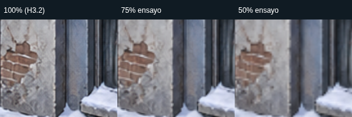

# 77 — H3.3: preparación técnica del taller visual y kit piloto

**Actualización03/11/2026:** el creador autoriza expresamente el encargo completo del paquete y precisa mapa principal,36 fichas/espacios, interfaz y conservación del taller. Las reservas de autorización de alcance de este informe quedan como **historia superada**, no como bloqueo vigente. La continuación se registra en el [informe78](78-h3-3-maqueta-mapa-interactivo.md); H3.3 sigue sujeto a revisión visual, sin H3.4 o motor.

**Actualización02/11/2026, Montevideo:** archivos de la entrega accesibles e incorporados en un modo optativo del sector, descrito debajo. El bloqueo de acceso de la revisión anterior queda resuelto. Las fechas, capturas y resultados anteriores se conservan como evidencia histórica; no equivalen a validaciones del nuevo kit.

## Integración acotada del kit recibido — 02/11/2026

### Base, alcance y procedencia

La subida del creador `d9f73be0c30c2218658e50cbf5fb9bec362697ce` agrega `kit_arte_h33/`: siete PNG, dos bocetos, manifiesto y notas. Se restauró el worktree temporal perdido por reemplazo del entorno desde la rama existente8d7d72b y se avanzó **solo por fast-forward**, sin descartar archivos ni reescribir historia. Checkout principal limpio en PR16; main826199d9 y PR18/4fc7c66 intactos. No AGENTS.md aplicable. Releídos protocolo15,74–77, README y notas del paquete. PR19 sigue OPEN/draft, dependiente de PR18.

**Diferencia de alcance:** `PROMPT_CODEX.md` del paquete propone mapa interactivo completo, siete localidades,36 plazas/accesos, expediente, dados/acciones de muestra y ambiente. La autorización vigente en el chat limita H3.3 al sector hospital y prohíbe construir el mapa completo. La subida de archivos no se interpreta como sustitución de esas restricciones. Se conserva el documento como propuesta pendiente; no se implementan esa ampliación ni sus acciones/estadísticas, efectos o capacidades. Que las notas llamen al mapa «aceptado» queda atribuido al paquete, sin inventar una aceptación artística adicional del creador en esta entrega.

**Originales sin edición ni duplicación:** se usan directamente las rutas versionadas `kit_arte_h33/assets/` y `referencias/`; no se copian los PNG a otra carpeta. La procedencia declara arte generado con IA aportado por el creador, según LEEME del paquete, sin atribuirlo a fotografía o dibujo manual. Nombres como `retrato-mara` son identificadores de archivo, no conexión al catálogo del motor. El validador acotado cruza los nueve registros con bytes/hash/cabecera PNG y el manifiesto de la entrega; Pillow12.3 leyó además los canales completos para la evidencia de alfa. No se añade dependencia al producto.

| Original recibido | Dimensiones / modo | Bytes | Uso en esta entrega |
| --- | --- | --- | --- |
| mapa-prototipo.png |1448×1086 RGB|4.032.838|Referencia de composición fuera de WebGL; no fondo ni mapa jugable |
| retrato-mara.png |1254² RGB|2.932.420|Ficha S1 circular de muestra |
| retrato-superviviente-02.png |1254² RGB|2.525.733|Ficha S2 circular de muestra |
| retrato-superviviente-03.png |1254² RGB|2.798.578|Ficha S3 circular de muestra |
| retrato-superviviente-04.png |1254² RGB|2.670.374|Ficha S4 circular de muestra |
| zombi.png |1312×1199 RGBA|932.878|Actor de oclusión/accesos del sector |
| barricada.png |1536×1024 RGBA|2.103.514|Actor de accesos del sector |
| Dos bocetos de interfaz |1672×941 RGBA, alfa255|3.987.864+4.002.443|Solo galería; no se usan como fondo ni controles reales |

Los nueve archivos suman25.986.642 bytes; los siete recursos17.996.335. El sector carga ocho imágenes: hospital/suelo anteriores, dos actores nuevos y cuatro retratos, **19.625.964 bytes de PNG originales**. La galería carga mapa/bocetos fuera de la escena mediante lazy-loading del navegador; no se cuentan como texturas WebGL ni se afirma que no tengan costo de descarga/decodificación. [Inspección y hashes](evidencias/h33-kit-recibido-inspeccion.json).

### Incorporación y límites visuales

`?kit=uploaded` selecciona `uploaded-kit.json`; la URL sin ese parámetro mantiene el kit técnico anterior. Se reutilizan cámara, controles PointerEvents, arranque/cancelación, selección y renderer. El selector de kit navega/recarga, restablece vista y evita dos escenas simultáneas. Cambiar perfil o preparación de retratos conserva cámara/selección mediante el mismo montaje serial. Las dos referencias Canvas/H3.2 y `kit.json` anterior quedan intactas.

Cuatro retratos diferentes sustituyen las cuatro siluetas **como fichas**, no como cuerpos de superviviente. Se recortan en círculo solo en Canvas auxiliar, con selección circular y aro ámbar. Sus centros son anclas de fichas; no pies ni patrón de altura. Los PNG RGB con su fondo pintado permanecen intactos. Los cuatro accesos mantienen un único ocupante: vacío, zombi o barricada; casos máximos/mixtos siguen siendo datos de presentación sin reglas.

Zombi: límites con alfa>16 `(397,35,558,1122)`, apoyo provisional `(718,1090)`, escala0,095; barricada: `(194,99,1183,864)`, apoyo `(752,810)`, escala0,07. Los puntos se estimaron visualmente entre contactos de ambos pies/patines, no sobre el margen inferior del PNG. Alturas visibles106,59 y60,48 unidades, respectivamente, frente a puerta de ensayo126. No son medidas físicas ni aprobación de proporciones. Se preservan posiciones Delante/Detrás/Esquina y orden explícito. La nueva silueta tiene una fracción de esquina distinta de la anterior: se registra su propia oclusión, **sin atribuir equivalencia de píxeles entre imágenes diferentes**; el gate del kit previo conserva su tolerancia estrecha frente a H3.2.

Alfa real: zombi0–255, barricada0–254. Ambos tienen píxeles de baja opacidad fuera de la silueta principal; inspección en fondo claro, oscuro y damero documentada, sin eliminar colores ni aplicar umbral a la imagen. Alfa16 es criterio de diagnóstico/selección, **no un recorte destructivo del render**. No se generó una versión normalizada. [Comparación de alfa](evidencias/h33-kit-alfa.png).

### Ensayo de texturas y retratos

Mismo camino POT/mipmaps de H3.2, aislado en este taller; no implica aprobarlo para todos los recursos del futuro juego. Los retratos circulares tienen un ensayo explícito384px y una opción sin ese límite (resolución del perfil activo). Se justificó comparar por el costo de cuatro imágenes1254² que se dibujan como fichas de64 unidades. Recorte original y reducido conservan centro, proporciones y tamaño de representación; no se escriben derivados a assets.

| Kit subido | RGBA+mipmaps estimados | Auxiliares POT, backing lógico | Canvas de preparación, backing lógico |
| --- | --- | --- | --- |
|100%, retratos384|69,33MiB|52MiB|2,25MiB|
|75%, retratos384|37,33MiB|28MiB|15,76MiB|
|50%, retratos384|21,33MiB|16MiB|8,25MiB|
|100%, retratos sin límite384|149,33MiB|112MiB|24,00MiB|

Son ocho texturas principales, no el alcance de tres imágenes de la tabla histórica inferior. La barricada75% sigue en POT2048×1024: por eso el costo intermedio es37,33MiB y **corrige la estimación conversacional inicial de32MiB**, que suponía un salto de tamaño inexistente. Los cuatro retratos nativos explican85,33MiB frente a5,33MiB con384px: diferencia80MiB en la estimación de texturas. Incluso sin reducir, el círculo requiere cuatro Canvas de preparación1254²; se corrigió el contador para incluirlos. La tabla no mide VRAM/RAM real ni suma recursos compartidos/caches como si fueran asignaciones físicas independientes. Excluye framebuffer, driver, sombras y recursos internos.

La red del sector es idéntica en todos los perfiles:19.625.964 bytes originales, más bundle/HTML. El círculo384 es optativo/comparable y no sirve aún archivos más pequeños. Su detalle debe aceptarse visualmente: puede resultar insuficiente con zoom/DPR mayores que los probados. Las tiras de retratos por perfil100/75/50 conservan el límite384 y por eso muestran la misma preparación; **la tira adicional original vs384 es la comparación de esa reducción**, no se confunden ambos experimentos. Recortes192×160 píxeles físicos por panel, sin reescalar una alternativa más que otra. [Original/384 al zoom máximo](evidencias/h33-kit-retrato-original-vs384.png).

No se define un nuevo presupuesto de producto. Los64/24/16MiB históricos eran propuesta para otras tres texturas; el aumento y los resultados nuevos se dejan para revisión con hardware objetivo y futura maqueta, sin extrapolar a siete localidades.

### Validación y reservas de esta continuación

Referencia inicial ejecutada: `npm ci`, `check:build`,491/491. El primer intento de instalación no pudo crear la caché predeterminada fuera del workspace; se repitió con caché temporal y permisos concedidos. No se cambió lockfile ni versiones. Cuatro pruebas nuevas se escribieron antes de incorporar el contrato/selector de arte (rojo: exportación/kit nuevos ausentes); después verifican integridad/procedencia, representación de retratos y ocupación exclusiva, apoyo bajo derivación, círculo de selección y costos nativo/384. Suite final495/495, sin quitar cobertura. Los builds verifican ambos kits y rechazan importar el motor o entradas completas de referencia.

La evidencia de navegador se ejecuta secuencialmente: gates existentes de Canvas, Phaser y taller anterior; nuevo gate de kit recibido; comparación de texturas anterior. Chromium de escritorio y dos móviles emulados, DPR1/2, no teléfono físico. Los JSON nuevos y capturas enlazados abajo detallan condiciones, conteos, oclusión, perfiles, círculos, cámara, teclado/tap/pinza, resize, cinco reinicios por tamaño, recuperación de contexto, carga fallida/reintento, retorno real bfcache cuando se registra persisted=true y liberación de ocho fuentes/auxiliares/Canvas derivados. Sin errores normales ni overflow. Solo dos hooks de navegación por documento intencionales después del desmontaje; se preservan handlers ajenos. Reposo sin draws durante la ventana de350ms observada.

| Nueva imagen de zombi |1365×768 /DPR1|393×852 /DPR2|320×640 /DPR2|
| --- | --- | --- | --- |
| Delante |100%|100%|100%|
| Detrás |0%|0%|0%|
| Esquina |52,61%|51,67%|53,70%|

La comparación estrecha anterior con H3.2 se reejecutó sobre el kit anterior, sin cambiar sus PNG/pivotes o tolerancias. La tabla nueva corresponde a **otra silueta**, con lectura de framebuffer y orden explícito; no establece una tolerancia nueva contra Canvas ni aprobación artística.

Entorno local: Linux6.18.57, Node24.19, Chromium154/Playwright1.57, CPU visible AMDEPYC9V74/5 procesadores lógicos y35.743.748.096 bytes de memoria del host. WebGL mediante ANGLE/Vulkan SwiftShader por software, no GPU física. HTTP localhost sin throttling. Tiempos registrados son una observación funcional por configuración, con imágenes calientes al cambiar preparación; no serie estadística, tiempo GPU, rendimiento físico móvil ni presupuesto de FPS.

Evidencia nueva: [kit recibido y condiciones](evidencias/h33-kit-recibido-browser.json), [Canvas](evidencias/h33-kit-recibido-canvas.json), [Phaser](evidencias/h33-kit-recibido-phaser.json), [taller anterior](evidencias/h33-kit-recibido-taller-anterior.json), [18 muestras/18 comparativas del tratamiento anterior reejecutadas](evidencias/h33-kit-recibido-texturas-referencia.json), [build](evidencias/h33-kit-recibido-build.json) y [resumen local](evidencias/h33-kit-recibido-validacion.json). Diez capturas seleccionadas versionadas (4.869.552 bytes), [dimensiones y hashes](evidencias/h33-kit-recibido-capturas.json); el gate produce25 imágenes completas disponibles en el artifact CI. La lámina de alfa adicional se generó e inspeccionó localmente y está versionada.

- Sector: [delante](evidencias/h33-kit-delante.png), [esquina](evidencias/h33-kit-esquina.png), [mixto escritorio](evidencias/h33-kit-mixto.png), [mixto393](evidencias/h33-kit-mixto-393.png), [interfaz320](evidencias/h33-kit-interfaz-320.png).
- Recortes nativos al zoom máximo100/75/50: [barricada](evidencias/h33-kit-barricada-max.png), [zombi](evidencias/h33-kit-zombi-max.png), [retratos con límite común384](evidencias/h33-kit-retrato-perfiles-max.png). [Original vs384](evidencias/h33-kit-retrato-original-vs384.png), original a la izquierda, muestra diferencias residuales del retrato a igual escala; no demuestra que384 sirva para cualquierDPR.

Inspección visual realizada sobre las capturas de sector, interfaz móvil, comparaciones de actores y original/384: se ven las fichas completas y rostros reconocibles al acercar; se mantienen los espacios libres/ocupados y oclusión parcial natural en la esquina. Hay diferencias de rasterización y detalle fino, no una aprobación artística. El cuerpo del zombi puede quedar fuera de un recorte diagnóstico192×160 al zoom máximo: el panel centra el mismo punto en las tres preparaciones y no se reencuadra una para disimularlo.

CI: el workflow H3.3 incluye ahora las rutas del paquete, valida ambos manifiestos y ejecuta también el nuevo gate, conservando los anteriores y el artifact completo. Hace checkout del head exacto. El resultado remoto y su SHA se registran en la [descripción/checks del PR19](https://github.com/LeviEdition/invierno-en-la-colonia/pull/19), separados del commit de subida y de la evidencia local. Este documento no se refiere al SHA de su propio commit. Bundle local reproducible:1.440.282 bytes/gzip9 386.215, SHA-256 `212b0e9f55f2dedea639dc627ee838cf8b8a26b3767c0df8a0d3922f859b5a41`. Referencia Phaser permanece `7e7b90ab465bc4b7113ffb20c4c0780a9c0e9d0db1d0cfab83659b46632f5e54`.

Para probar: `npm.cmd ci`, `npm.cmd run dev:workshop`, mantener terminal abierta y abrir **http://127.0.0.1:8772/prototypes/hospital-workshop/?kit=uploaded**. Seleccionar «4 supervivientes + ocupación mixta» para ver los seis recursos del sector juntos; usar Delante/Detrás/Esquina para la oclusión. La galería debajo conserva mapa/bocetos y permite abrir sus originales. [Guía Windows/VSCode/LAN](../prototypes/hospital-workshop/README.md). Sin Python. Windows y la red doméstica son instrucciones, no plataformas físicamente comprobadas aquí.

La primera comprobación de reinicios comparó una escena mixta que había compilado tres programas GL con una escena inicial que necesitaba dos; no era acumulación. Se conservó el fallo del arnés y se comparan cinco instancias de la **misma composición**, manteniendo igualdad estricta de listeners/objetos GL y liberación final a cero. No se relajaron los criterios visuales anteriores. [Primer gate y diagnóstico](evidencias/h33-kit-recibido-primer-gate.json).

**Hallazgo del CI inicial y corrección de QA:** [ejecución0a9a287](https://github.com/LeviEdition/invierno-en-la-colonia/actions/runs/41514294299) aprueba instalación,495 tests, builds y gates de Canvas/Phaser/taller anterior, pero falla el gate nuevo al consultar una app todavía null durante el cambio a75%. [Artifact rojo](evidencias/h33-kit-recibido-ci-rojo.json). Reproducido con el mismo Chromium143.0.7499.4/Playwright1.57.0 que CI. El predicado asíncrono de `waitForFunction` devuelve una Promise truthy; Playwright resuelve a false sin continuar el polling. [Reproducción controlada](evidencias/h33-kit-recibido-reproduccion-espera.json): con decodificación demorada400ms, la espera antigua vuelvefalse en38ms y el taller sigue loading; después alcanza ready, app presente y starts2 esperados, sin una segunda instancia o fallo del producto.

Se añade `test-support/h33-browser-wait.mjs`: importa el módulo fuera del polling, conserva un JSHandle temporal y consulta **sincrónicamente** estado ready, instancia no null y número de arranque esperado; libera el handle al terminar. Se usa en los tres scripts QA de H3.3 (taller anterior, kit nuevo y medición), sin cambiar renderizado, datos, límites, timeout de producto o criterios de aceptación. Se fuerza demora200ms en tres cambios de perfil del nuevo gate para comprobar recuperación real; esos tiempos llevan su etiqueta QA y no son rendimiento normal. Otra carrera del propio test, al consultar el documento anterior durante el cambio de kit, se reproduce y corrige aguardando URL/carga antes de inspeccionar el nuevo módulo. [Evidencia de ese paso](evidencias/h33-kit-recibido-navegacion-qa-rojo.json), sin atribuirlo a una regresión de la escena.

Bundle/producto permanece SHA-256 `212b0e9f55f2dedea639dc627ee838cf8b8a26b3767c0df8a0d3922f859b5a41`; esta continuación modifica QA/documentación únicamente. Los JSON/capturas locales Chromium154 anteriores conservan su procedencia y no se presentan como CI aprobado. Comprobación adicional **Chromium143/Playwright1.57 local aprobada**, secuencial: [kit recibido,3 viewports/12 tiras y carga demorada](evidencias/h33-kit-recibido-browser143.json), [taller anterior,3 viewports](evidencias/h33-kit-recibido-taller143.json), [18 muestras/18 comparativas anteriores](evidencias/h33-kit-recibido-texturas143.json). El CI del nuevo head exacto se registra aparte en PR19; no se sustituye ni oculta la ejecución fallida. Las imágenes seleccionadas versionadas siguen siendo las de Chromium154, y los JSON143 se identifican expresamente como otra ejecución local, no como artifact remoto.

**Revisión crítica:** los originales son inmutables y la procedencia llega al commit de subida; la ruta HTTP sirve solo assets/referencias del paquete, no sus instrucciones ni el resto del repositorio. El recorte afecta tanto imagen como hit-test; auxiliares circulares se liberan incluso al factor1. No se duplica input ni se amplía el adaptador Phaser4.2.1. El cambio de kit cancela/desmonta mediante navegación y los cambios de calidad comparten la cola existente. Queda abierta la elección de preparación y hardware, sin modificar la solución H3.2. Un renderizador nuevo no arreglaría la proyección de los recursos.

**Reservas visuales:** hospital/suelo pertenecen al arte anterior, que no coincide aún con el nuevo mapa; no se simula una unificación. Fichas pequeñas en encuadre móvil lejano; hay zoom y selección HTML accesible, pero no se promete44px para cada actor a cualquier escala. Se conserva la franja de fondo fuera del suelo al encuadrar en móvil. No se fingió navegación por el nuevo mapa ni se usaron bocetos con HUD pintado como controles reales. Apoyos, distribución final, proyección, nitidez y aceptación artística permanecen pendientes. Sin físicos Android/iOS, GPU/VRAM real, red doméstica, Safari/Firefox o aceptación visual H3.2.

Los dos bocetos recibidos sí orientan la composición y la interfaz; no se los descarta. Aún no aportan un hospital separado con geometría/apoyos medidos, referencia humana erguida común ni aprobación de capas/proyección. Estas son las decisiones de maqueta que siguen pendientes, no un pedido de reenviar las imágenes ya recibidas.

**Único siguiente paso:** revisión del creador del sector con los recursos recibidos y confirmación de la referencia de escala/apoyo/proyección de la maqueta. El mapa completo, las36 posiciones y el expediente del documento adjunto son propuestas pendientes de autorización separada. H3.3 sigue abierto, sin H3.4, fusiones, releases o reglas nuevas.

**30/10/2026, Montevideo. Trabajo autorizado: preparación técnica, no cierre artístico de H3.3.** El creador prepara una maqueta del hospital. El taller permite evaluar lo actual y sustituir después sus recursos; no aprueba ángulos, proporciones, capas o arte que dependan de esa maqueta.

## Base y límites

Rama independiente `experiment/h3-3-taller-visual`, desde `4fc7c66c1af1d053458519b5c6367a8b9224e8a0` de PR18. PR16 ba1d93a4, PR17 cde237d4 y PR18 siguen OPEN/draft, sin fusionar; main826199d96645b95869509995772c914290d63ac7 y referencia/tag/release intactos. No se encontró AGENTS.md aplicable. Leídos README, tablero, protocolo15 e informes74/75/76. Árbol inicial limpio; no había trabajo local ajeno.

El PR de H3.3 se dirige a la rama de PR18 para mostrar solo este incremento. Es una dependencia técnica, no aceptación de H3.2 ni autorización de integración. Se conserva la advertencia sobre Game.start/teardown específicos de Phaser4.2.1 y la validación física pendiente. El taller importa utilidades sin editar los experimentos de referencia.

Alcance: hospital, suelo, zombi, siluetas/marcadores técnicos, cuatro posiciones de superviviente y cuatro accesos de prueba compartidos por zombi/barricada. Esos datos no son capacidades, casillas lógicas, distancias o reglas del juego. Cuadrícula XY de diagnóstico: no fija la proyección del futuro tablero. Escala de persona/puerta provisional, sin unidades métricas acordadas.

No motor, reglas, IA, dados, balance, crisis, narrativa, guardados, navegación libre, mapa completo, editor, importador arbitrario o animaciones. No cambio de renderer, arte final, merge o release.

## Estado

Preparación técnica ejecutable y validada localmente y en CI del commit de implementación, detallado al final. **H3.3 no terminado:** faltan maqueta y aprobación artística. No hay aceptación implícita de H3.2 ni de pruebas físicas. PR19 permanece en borrador.

### Revisión visual posterior: siete elementos aportados por el creador

El creador envió las imágenes originales en el chat y confirmó su procedencia; se recibieron **siete elementos distintos**: mapa, cuatro retratos, barricada y zombi. La barricada se adjuntó dos veces: no constituye un octavo recurso. Esta revisión se basa en las imágenes visibles en la conversación. No son los siete registros técnicos del manifiesto actual, que sigue conteniendo tres PNG anteriores y cuatro marcadores.

**Límite de acceso:** las herramientas disponibles muestran en el workspace y los worktrees los tres PNG anteriores, pero no los archivos binarios de estos adjuntos nuevos ni una referencia descargable. Esto no demuestra que el creador enviara capturas o archivos incorrectos. Se corrige la suposición conversacional anterior de que faltaban los originales: fueron enviados, pero su acceso binario no está disponible aquí. El ZIP era una alternativa de transferencia, no un requisito del kit; el creador informa que tampoco puede subirlo.

| Elemento visible | Utilidad y observación visual | Pendiente antes de incorporarlo |
| --- | --- | --- |
| Mapa del asentamiento | Vista continua con siete conjuntos construidos, caminos nevados, luz cálida en ventanas y entorno frío. Sirve para discutir composición, orientación y relación entre sectores. Edificios, suelo, árboles y luces aparecen integrados en una sola imagen | No se presupone correspondencia individual con las siete localidades de V9.9 ni aprobación del mapa final. No permite recuperar automáticamente capas o un suelo limpio para ocultar/revelar actores; no se construirá el mapa completo en H3.3 |
| Cuatro retratos | Estilo ilustrado, ropa invernal y fondo frío comunes; vestuario, edades aparentes y rasgos permiten distinguirlos. Candidatos para fichas/paneles | No hay nombres, atributos ni aprobación de personajes nuevos. Al mostrar cabeza/torso no aportan pies ni altura corporal: no sustituyen los marcadores del tablero ni permiten medir escala con una puerta. Comprobar legibilidad en miniatura antes de decidir un recorte de interfaz |
| Barricada | Madera, chapa y nieve coherentes con los materiales del entorno; apoyos visibles y silueta reconocible. Candidata a ensayo en un acceso | La vista presenta un halo oscuro alrededor: no se infiere si es fondo opaco, transparencia o sombra a partir de la visualización. Verificar alfa y separar conceptualmente sombra de apoyo; comparar dirección de sus aristas con el hospital antes de aprobar la perspectiva. No se borrarán colores para simular transparencia |
| Zombi de cuerpo entero | Silueta completa con ambos pies visibles y acabado ilustrado próximo al conjunto. Candidato para probar anclaje, escala y oclusión | Su pose encorvada no sirve como patrón humano de altura erguida. Revisar pies respecto del suelo oblicuo, escala de puerta, visibilidad en tamaño de tablero y separación de tonos oscuros sobre el hospital. El fondo de visualización no confirma alfa |

**Juicio preliminar:** conservar los siete aportes como candidatos/referencias. La paleta fría, los acentos cálidos y los materiales muestran una dirección común; eso no demuestra una proyección común ni calidad suficiente al tamaño real del tablero. El detalle fino de mapa, retratos y ropa puede perderse al reducir; no se declara un fallo de resolución sin probar sus archivos a la escala prevista.

**Propuesta acotada, no implementada:** comparar primero zombi y barricada en el sector hospital; mantener las cuatro siluetas de superviviente hasta disponer de un cuerpo entero o ficha de tablero expresamente elegida. Conservar el mapa como referencia de composición y los retratos como candidatos de interfaz. No recortar edificios del mapa ni generar cuerpos, sombras o arte adicional como parte de esta revisión.

**Lo que sigue faltando de la maqueta:** relación puerta/persona erguida, apoyos y huella del hospital, aristas de proyección y ejemplos de oclusión. El mapa ayuda a orientar el aspecto general, pero no fija esas mediciones. Ni los retratos ni el zombi encorvado reemplazan esa referencia común.

**Comprobación nueva:** consulta de Git/GitHub, inspección de disponibilidad de archivos y revisión visual de los adjuntos. Base local y remota H3.3 `acd3900ab925cf575e99b66cb8b9a71640592e43`, árbol limpio; PR19 OPEN/draft y base H3.2 conservados; main sigue `826199d96645b95869509995772c914290d63ac7`. Solo se actualizan este informe y el tablero. No se han importado archivos, medido dimensiones/bytes/hash/alfa de los nuevos elementos, creado derivados, cambiado el manifiesto ni ejecutado una comparación en escena de este kit. Las 491 pruebas y capturas anteriores corresponden exclusivamente a los recursos previos; no validan estos siete aportes.

**Única siguiente tarea:** hacer accesibles los archivos ya enviados, por ejemplo incorporándolos desde GitHub a la rama H3.3, y verificar sus metadatos antes de probar zombi/barricada. No se exige ZIP ni repetir envíos desde el teléfono. Se documentará la procedencia y una ruta única de recursos al incorporarlos; la sugerencia conversacional `assets/kit-h33/` no crea una segunda estructura y puede trasladarse con trazabilidad a `assets/hospital-workshop/`, prevista por el taller. Hasta entonces se conserva el taller actual, la aprobación artística pendiente y el límite anterior a H3.4.

## Diseño y archivos

Se conserva el sistema esbuild0.28.2 y Phaser4.2.1, sin dependencias nuevas. `npm run dev:workshop` prepara las entradas y usa HTTP nativo de Node; el servidor reutiliza el preview existente para las rutas de referencia. No altera `dev:hospital` ni sus puertos/archivos. El build del taller rechaza imports del motor `src/` o de los main de Canvas/H3.2; el metafile lo hace verificable.

| Archivo o módulo nuevo | Responsabilidad |
| --- | --- |
| `prototypes/hospital-workshop/kit.json` | Contrato del piloto: siete recursos (tres PNG, cuatro marcadores), procedencia/hash, dimensiones, alfa, apoyo original, escala, límites, estados, referencia común, perfiles y posiciones provisionales |
| `kit.mjs` | Validación pequeña sin librería de esquemas, representación/estimación y casos de presentación. No importa reglas |
| `resources.mjs` | Carga/dimensiones, mapas de alfa para selección y reducción uniforme. No modifica archivos |
| `renderer.mjs` | Objetos Phaser, sombras y guías; un solo transform de cámara, orden explícito y disposición de recursos propios |
| `main.mjs`, HTML/CSS | Controles accesibles, selección/centrado, etiquetas HTML y ciclo de montaje/cancelación/reinicio. Ningún motor o estado de partida |
| `scripts/check-workshop-kit.mjs`, `build-workshop.mjs`, `serve-workshop.mjs` | Validar PNG/hash/alfa/procedencia, construir/check reproducible y servir el taller junto a referencias |
| `scripts/check-h33-browser.mjs`, `measure-h33-textures.mjs` | Gates de interfaz/recursos y comparación aislada de texturas, con Playwright externo al producto |
| `tests/h33-kit.test.mjs`, `h33-preview.test.mjs`, `test-support/h33-reference.json` | Ocho pruebas nuevas y manifiesto de integridad de la base |

El contrato reutiliza `assets/prototipo-hospital/manifest.json` en lugar de crear otro catálogo de originales. Se cruza cada registro con bytes/hash/dimensiones/canal del PNG. Los futuros archivos se agregarán bajo `assets/hospital-workshop`, con su propio manifiesto de procedencia; no se sobrescriben originales. Los derivados actuales son **solo runtime**, y se identifican por origen+factor+método; QA exporta PNG y registra sus hashes/pivotes. El algoritmo Canvas de reducción puede variar por navegador/versión: no se afirma reproducibilidad binaria de derivados entre navegadores. Originales y bundle sí tienen comprobación fija.

[Manifiesto del kit](../prototypes/hospital-workshop/kit.json) · [guía breve y checklist de maqueta](../prototypes/hospital-workshop/README.md). Las claves de recursos son estables: se puede pasar un marcador a imagen cambiando kind, archivo/metadatos y estado disponible, sin reescribir la escena. La guía conserva la procedencia y exige revisar presupuesto/tests al cambiar intencionadamente las dimensiones.

### Qué es provisional

La referencia es un espacio de ilustración XY, cámara oblicua fija **sin ángulo numérico aprobado** (`angle:null`, pending-model). La cuadrícula configura paso40–160 en ese espacio; no es una proyección de suelo ni casillas de movimiento. Las guías persona104/puerta126 no son metros ni un acuerdo de proporciones; están marcadas como ensayo. El control de figuras0,75–1,25 permite comparar, no aprobarlas.

S1–S4 y A1–A4 son posiciones de presentación. Cada acceso de ensayo muestra un zombi, una barricada o vacío. Casos máximos y mixto no conceden capacidades ni crean entidades lógicas. H/P son guías, no supervivientes. Los conteos indican figuras representadas en **capas activas**, no porcentaje de píxeles visibles tras oclusión. Etiquetas/apoyos se dibujan por encima para diagnóstico; se pueden apagar para la vista normal.

Delante/Detrás/Esquina conservan los apoyos y posiciones de H3.2. El orden es explícito: actor detrás→hospital; hospital→actor delante, con sombras separadas. **No es una solución general de profundidad por Y.** La oclusión sigue el alfa real de los PNG; Mostrar ocultos baja la opacidad del hospital.

## Preparación y presupuesto de texturas

El aumento de H3.2 tiene dos causas: redondear las fuentes NPOT a potencia de dos (base RGBA pasa de18.870.120 a41.943.040 bytes) y añadir13.981.012 bytes de niveles inferiores. Resultado55.924.052 bytes (~53,33MiB), antes de otros recursos. Phaser4.2.1/WebGL1 requiere esas dimensiones para el camino de mipmaps usado; no se cambia de renderer ni modifica el preparador original.

El taller compara el tratamiento H3.2 con75% y50%. Se consideró25% al preparar el ensayo, pero se descartó por margen insuficiente al acercar; no se eligió como candidato. El rango sigue50–400% del encuadre, sin limitar zoom para esconder degradación. Incluso el PNG original se amplía por encima de un texel por píxel en ciertos recursos/zoom/DPR; ningún perfil recupera detalle ausente.

**Representación estable:** Canvas de `ceil(ancho×factor)`×`ceil(alto×factor)`, transformación uniforme; pivote×factor y escala de representación/factor. La extensión fraccionaria restante es margen, no estiramiento. La geometría original y los apoyos se comprueban en Phaser; el PNG original/alfa no se modifica ni normaliza.

| Recurso | Original | Derivado75% | Derivado50% | Textura POT 100 /75 /50 |
| --- | --- | --- | --- | --- |
| Hospital | 1254×1254,2.391.925 bytes | 941×941 | 627×627 | 2048² /1024² /1024² |
| Suelo | 1536×1024,3.270.542 bytes | 1152×768 | 768×512 | 2048×1024 /2048×1024 /1024×512 |
| Zombi | 1175×1338,816.224 bytes | 882×1004 | 588×669 | 2048² /1024² /1024² |

| Perfil | Base RGBA POT | RGBA con mipmaps | Auxiliares POT, backing lógico | Canvas derivados, backing lógico |
| --- | --- | --- | --- | --- |
| H3.2 /100% | 40MiB | 53,33MiB | 40MiB | 0 (usa Image original) |
| 75% | 16MiB | 21,33MiB | 16MiB | 10.622.980 bytes |
| 50% | 10MiB | 13,33MiB | 10MiB | 4.718.868 bytes |

Son **estimaciones RGBA por dimensiones**, no VRAM/RAM efectivas. Los auxiliares pueden estar acelerados/compartidos y existen caches/copias del navegador. Excluyen framebuffer/DPR, driver, texturas internas/sombra y buffers de marcadores. Los originales decodificados y mapas de alfa de selección también ocupan memoria; no se presentan esas tablas como uso total. Cuatro zombis comparten una textura, no cuatro copias.

El suelo75% sigue necesitando la misma POT que el original; reducir píxeles no siempre reduce la memoria GPU si no cruza el umbral. No se extrapola este hospital a otras localidades.

### Bytes y tiempos medidos, no estimados

Los tres perfiles **descargan los mismos6.478.691 bytes de PNG originales**. Los PNG exportados por QA pesan, en este Chromium,7.550.680 bytes al100%,4.226.992 al75% y1.968.723 al50%. La primera cifra es una reencodificación Canvas, **no el archivo original ni su transferencia**. Los derivados exportados no forman parte de la red del taller; aún no se implementa un pipeline de distribución que ahorre esos bytes. Sin compresión GPU, nuevos codecs o dependencias.

Linux/Node24.19.0/Chromium154.0.8037.57/Playwright1.57; CPU y memoria visibles en el JSON. ANGLE/Vulkan **SwiftShader por software**, sin GPU física ni teléfono. HTTP localhost, caché de imágenes caliente al cambiar perfil; tres ensayos por perfil/viewport, orden rotativo, sin exportar PNG durante la medición. Los tiempos incluyen retirada anterior, carga/selección alfa, preparación y primer frame; no son carga fría de la biblioteca ni finalización GPU. Host compartido; no representan rendimiento móvil físico.

| Viewport /DPR | Montaje100% mediano | Montaje75% mediano | Montaje50% mediano |
| --- | --- | --- | --- |
| 1365×768 /1 | 274,1ms | 185,6ms | 153,8ms |
| 393×852 /2 emulado | 273,5ms | 188,2ms | 155,9ms |

18 muestras;0 draws en350ms de reposo en cada muestra. [Datos completos y build medido](evidencias/h33-texturas.json). No se midió VRAM, RAM total del proceso, batería o presupuesto de FPS en teléfono; tampoco se afirma aquí rendimiento de ocupación máxima por estos tiempos de la escena de comparación.

### Propuesta de presupuesto, pendiente de aprobar

- Referencia100%: hasta64MiB para **estas tres texturas principales con mipmaps**, para conservar comparación; no presupuesto total de aplicación.
- Candidato a revisar75%: hasta24MiB en el mismo alcance (medido por dimensiones:21,33).
- Ensayo económico50%: hasta16MiB (13,33), con pérdida a evaluar al ampliar. El zombi actual tolera visualmente más reducción que hospital/suelo; **no se aprueba un único perfil para todos**.
- Red actual:6,18MiB de PNG comunes; no hay ahorro implementado. Una futura decisión de servir derivados requerirá archivos fijados/revisados y nueva evidencia, no ocurre silenciosamente aquí.

Presupuesto provisional del piloto: debe revisarse con la maqueta, nuevos superviviente/barricada, zoom útil y equipo objetivo. No autoriza producir todo el catálogo ni dimensionar siete localidades copiando este costo.

## Evidencia para revisión visual

[Capturas y hashes/dimensiones](evidencias/h33-capturas.json):24 PNG,8.495.415 bytes. Seis de interfaz/sector;18 tiras de recortes. Cada panel de textura tiene192×160 **píxeles físicos**, cámara centrada en el mismo recurso, mismo CSS/DPR/zoom dentro de la tira; no se agranda una variante más que otra. Cada viewport/DPR y zoom se identifica; no mezclar tiras de distinto DPR como si fueran el mismo encuadre.

- Taller mixto con guías: [escritorio](evidencias/h33-1365-mixto-guias.png), [393](evidencias/h33-393-mixto-guias.png), [320](evidencias/h33-320-mixto-guias.png).
- Interfaz: [escritorio](evidencias/h33-1365-interfaz.png), [393](evidencias/h33-393-interfaz.png), [320](evidencias/h33-320-interfaz.png).
- Hospital100/75/50: [mínimo](evidencias/h33-1365-hospital-min.png), [inicial](evidencias/h33-1365-hospital-initial.png), [máximo](evidencias/h33-1365-hospital-max.png).
- Suelo100/75/50: [mínimo](evidencias/h33-1365-ground-min.png), [inicial](evidencias/h33-1365-ground-initial.png), [máximo](evidencias/h33-1365-ground-max.png).
- Zombi100/75/50: [mínimo](evidencias/h33-1365-zombie-min.png), [inicial](evidencias/h33-1365-zombie-initial.png), [máximo](evidencias/h33-1365-zombie-max.png).
- Las mismas nueve tiras en móvil emulado están en evidencias/h33-393-*.png; sus rectángulos/cámara se registran en el JSON de texturas.

No son láminas de aprobación artística. La comparación muestra pérdida al ampliar hospital/suelo y menor diferencia en el zombi actual. El aspecto de los marcadores no es diseño del futuro superviviente/barricada.

## Validación técnica y revisión crítica

**Referencia inicial nueva:** npm ci, check:build y483/483. **Resultado nuevo:**491/491 (483 previas+8 nuevas), check:build y builds/checks de Phaser/taller. Se preservaron todos los archivos de referencia declarados en el manifiesto H3.3. El HTML V9.9 conserva SHA-25643b8883ad4821e4b50c40791615c5ef6c0b3030476409b4e1c6da4dbd872d692.

| Comprobación ejecutada | Resultado y alcance |
| --- | --- |
| Contrato/archivos | IDs, dimensiones, pivote, límites, escala, proyección pendiente, perfiles, integridad PNG/hash/alfa y cruce con manifiesto original; negativos de datos incoherentes y preview/rutas |
| Referencia Canvas | Gate existente intacto,3 tamaños. [JSON](evidencias/h33-referencia-canvas.json) |
| Referencia Phaser H3.2 | Gate existente intacto,3 tamaños, incluidas tolerancias Canvas previas. [JSON](evidencias/h33-referencia-phaser.json) |
| Taller | 1365×768/DPR1,393×852/DPR2 y320×640/DPR2.0 errores normales/overflow, objetivos HTML≥44px y etiquetas pulsables; teclado, tap/pinza/arrastre táctil CDP |
| Apoyos/cámara | 100/75/50% y figuras0,75–1,25, apoyo y proporción de contenido invariantes; selección por alfa original y por teclado; rueda/pinza ancladas, arrastre, reset, centrado y resize coherentes |
| Superposición | Delante100%, detrás0%, esquina coincide con H3.2 por lectura de framebuffer: diferencia0pp en los tres tamaños; gate±0,5pp. No compara esa métrica nueva con la del screenshot Canvas como si fueran la misma |
| Ocupación/capas |4S+4Z,4S+4B,4S+2Z+2B, transición preset→acceso manual, un ocupante por acceso; capas, etiquetas y grid120. Ocultar capa limpia selección inaccesible |
| Vida y fallos | Cinco reinicios por tamaño con recursos estables y un comando por activación; pérdida/restauración de contexto con75%; recursos fallidos/reintento y WebGL ausente con enlace Canvas |
| Navegación/cancelación | Retorno bfcache real persisted=true y misma identidad, restablece100%/estado inicial. Carrera durante PNG con eventos sintéticos separada; no publica instancia cancelada |
| Liberación |0 contextos/objetos GL/observers/timers de arranque;2 hooks de navegación por documento intencionales. Tres auxiliares POT y tres Canvas derivados75% quedan en1×1 tras disposición; fuentes anuladas, handlers ajenos preservados. No prueba VRAM real |
| Comparación de texturas |18 muestras y18 recortes comparables, canal RGBA y cobertura alfa conservada dentro del gate±1% relativo (desvío observado<0,1%). Hashes de exportación iguales entreDPR1/2 en este navegador; no garantía entre versiones |

[Taller/lifecycle](evidencias/h33-browser.json) · [texturas](evidencias/h33-texturas.json) · [diagnósticos iniciales](evidencias/h33-diagnosticos.json) · [build](evidencias/h33-build.json). Instrumentación QA fuera del producto; los datos son de presentación, no una partida ni pruebas físicas.

**Revisión crítica realizada:** se identificaron y ajustaron etiquetas móviles densas, sincronización de selectores de acceso/preset, limpieza de selección al ocultar capas y controles tras recuperación de contexto. Se añadió snapshot del perfil para exportaciones asíncronas y liberación de backing de Canvas propios después de retirar Phaser, sin tocar Image originales. Un marco/refactor genérico no era necesario.

Dos fallos iniciales del arnés se separan de defectos: coordenada de rueda fraccionaria distinta del evento CDP recibido (se alineó la entrada, sin relajar tolerancia) y suposición de pico alfa255 tras reducir (los PNG originales tienen muchos252/253; se valida canal/transparencia/cobertura sin forzar opacidad). No se maquilló el arte ni se declaró fallo de H3.2 por estos casos.

El adaptador Game.start y teardown de4.2.1 se reutilizan sin ampliarlos: sin audio, física, input Phaser duplicado, animaciones o nuevos consumidores de sus broadcasts omitidos. Se mantiene su advertencia de revisión al cambiar versión/capacidades; el taller añade gráficos/objetos que ya existían en el PoC, con HTML accesible. No se vuelve a evaluar otro renderer.

## Qué falta de la maqueta y decisiones pendientes

La [guía](../prototypes/hospital-workshop/README.md#qué-debe-aportar-la-maqueta) detalla el pedido: encuadre original con entorno; persona y puerta comunes; contacto con suelo, esquinas/aristas/escalones; proyección a partir de la maqueta; tres ejemplos de oclusión; capas reales necesarias (incluido frente/marquesina si deben tapar de manera distinta);4S/4 accesos ilustrativos; luz/sombras/alfa interior; alcance del superviviente/barricada y resolución/zoom útil.

**No decidido:** ángulos/proporciones, disposición final, paleta/acabado, separación definitiva de capas, arte de superviviente/barricada, perfil de textura de producción, zoom útil/hardware mínimo y presupuesto total. Sin maqueta no se inventan esos acuerdos.

**No ejecutado:** dispositivo físico, red doméstica del creador, GPU física/VRAM, Safari/Firefox, accesibilidad con lector físico ni aprobación artística/visual del creador. Emulación y captura técnica no los sustituyen. H3.2 visual y pruebas físicas siguen pendientes aunque se autorice este taller.

**Único siguiente paso:** revisión del creador del taller y aporte de la maqueta. H3.3 sigue abierto; no H3.4, motor, mapa completo, arte final, reglas, fusiones o releases.

## Entrega y CI

[PR19 en borrador](https://github.com/LeviEdition/invierno-en-la-colonia/pull/19), hacia `experiment/h3-2-phaser-hospital`. Implementación **21a805ec84868440a24608edeb088624c1d74f81**, [CI SUCCESS](https://github.com/LeviEdition/invierno-en-la-colonia/actions/runs/41097311067) sobre ese SHA exacto:491 tests/491 pass/0 fail, builds, contrato/archivos, referencias Canvas/Phaser, taller y texturas.

Artifact descargado: cuatro JSON passed,3 viewports,18 muestras/18 comparativas, bfcache real también en Chromium143. Bundle reproducible idéntico al local Node24/Chromium154:1.430.363 bytes, gzip9 384.574, SHA-256 `8bff2779567e5cd1d142932e75e80fc15950500a1b18cb4ff3a2c8193b928d69`. La referencia Phaser conserva `7e7b90ab465bc4b7113ffb20c4c0780a9c0e9d0db1d0cfab83659b46632f5e54`. [Resumen CI](evidencias/h33-ci.json) · [validación local](evidencias/h33-validacion-local.json).

El workflow propio es necesario porque el PR tiene base en PR18; no se afirman ejecutados los workflows filtrados solo a main. La evidencia previa de partidas completas/offline de V9.9 mantiene su procedencia histórica; en este encargo se reejecutan suite/build y gates gráficos correspondientes, sin cambios del motor o del HTML. El siguiente commit documental agrega este resultado y recibe su verificación de head exacto; SHA y checks finales se registran en la descripción del PR, sin SHA autorreferente en este documento.

Los árboles Git de `prototypes/hospital`, `prototypes/hospital-phaser` y `assets` son idénticos a la base4fc7c66. No se alteraron main826199d9, tag/release y sus adjuntos, PR16/17/18, SP-03, lockfile ni reglas. No hubo fusión, despliegue o nueva release.

**Límite del contrato:** la sustitución1:1 (incluido marcador→PNG por kind) está preparada. Si la maqueta exige nuevas capas de marquesina/frente u otra geometría de oclusión, habrá que decidir esos datos y un ajuste acotado del piloto después de revisarla; este taller no inventa capas ni un sistema general de edificios.

**Entrega técnica revisable; H3.3 sigue abierto.** Próxima y única tarea: revisión del creador y recepción de la maqueta según el checklist. Aprobación artística, elección final de perfiles/renderer y pruebas físicas continúan pendientes. Detenerse antes de H3.4.
