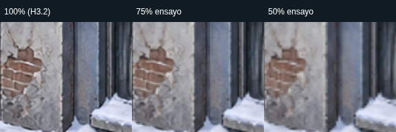

# 77 — H3.3: preparación técnica del taller visual y kit piloto

**30/10/2026, Montevideo. Trabajo autorizado: preparación técnica, no cierre artístico de H3.3.** El creador prepara una maqueta del hospital. El taller permite evaluar lo actual y sustituir después sus recursos; no aprueba ángulos, proporciones, capas o arte que dependan de esa maqueta.

## Base y límites

Rama independiente `experiment/h3-3-taller-visual`, desde `4fc7c66c1af1d053458519b5c6367a8b9224e8a0` de PR18. PR16 ba1d93a4, PR17 cde237d4 y PR18 siguen OPEN/draft, sin fusionar; main826199d96645b95869509995772c914290d63ac7 y referencia/tag/release intactos. No se encontró AGENTS.md aplicable. Leídos README, tablero, protocolo15 e informes74/75/76. Árbol inicial limpio; no había trabajo local ajeno.

El PR de H3.3 se dirige a la rama de PR18 para mostrar solo este incremento. Es una dependencia técnica, no aceptación de H3.2 ni autorización de integración. Se conserva la advertencia sobre Game.start/teardown específicos de Phaser4.2.1 y la validación física pendiente. El taller importa utilidades sin editar los experimentos de referencia.

Alcance: hospital, suelo, zombi, siluetas/marcadores técnicos, cuatro posiciones de superviviente y cuatro accesos de prueba compartidos por zombi/barricada. Esos datos no son capacidades, casillas lógicas, distancias o reglas del juego. Cuadrícula XY de diagnóstico: no fija la proyección del futuro tablero. Escala de persona/puerta provisional, sin unidades métricas acordadas.

No motor, reglas, IA, dados, balance, crisis, narrativa, guardados, navegación libre, mapa completo, editor, importador arbitrario o animaciones. No cambio de renderer, arte final, merge o release.

## Estado

Preparación técnica ejecutable y validada localmente y en CI del commit de implementación, detallado al final. **H3.3 no terminado:** faltan maqueta y aprobación artística. No hay aceptación implícita de H3.2 ni de pruebas físicas. PR19 permanece en borrador.

## Diseño y archivos

Se conserva el sistema esbuild0.28.2 y Phaser4.2.1, sin dependencias nuevas. `npm run dev:workshop` prepara las entradas y usa HTTP nativo de Node; el servidor reutiliza el preview existente para las rutas de referencia. No altera `dev:hospital` ni sus puertos/archivos. El build del taller rechaza imports del motor `src/` o de los main de Canvas/H3.2; el metafile lo hace verificable.

| Archivo o módulo nuevo | Responsabilidad |
| --- | --- |
| `prototypes/hospital-workshop/kit.json` | Contrato del piloto: siete recursos (tres PNG, cuatro marcadores), procedencia/hash, dimensiones, alfa, apoyo original, escala, límites, estados, referencia común, perfiles y posiciones provisionales |
| `kit.mjs` | Validación pequeña sin librería de esquemas, representación/estimación y casos de presentación. No importa reglas |
| `resources.mjs` | Carga/dimensiones, mapas de alfa para selección y reducción uniforme. No modifica archivos |
| `renderer.mjs` | Objetos Phaser, sombras y guías; un solo transform de cámara, orden explícito y disposición de recursos propios |
| `main.mjs`, HTML/CSS | Controles accesibles, selección/centrado, etiquetas HTML y ciclo de montaje/cancelación/reinicio. Ningún motor o estado de partida |
| `scripts/check-workshop-kit.mjs`, `build-workshop.mjs`, `serve-workshop.mjs` | Validar PNG/hash/alfa/procedencia, construir/check reproducible y servir el taller junto a referencias |
| `scripts/check-h33-browser.mjs`, `measure-h33-textures.mjs` | Gates de interfaz/recursos y comparación aislada de texturas, con Playwright externo al producto |
| `tests/h33-kit.test.mjs`, `h33-preview.test.mjs`, `test-support/h33-reference.json` | Ocho pruebas nuevas y manifiesto de integridad de la base |

El contrato reutiliza `assets/prototipo-hospital/manifest.json` en lugar de crear otro catálogo de originales. Se cruza cada registro con bytes/hash/dimensiones/canal del PNG. Los futuros archivos se agregarán bajo `assets/hospital-workshop`, con su propio manifiesto de procedencia; no se sobrescriben originales. Los derivados actuales son **solo runtime**, y se identifican por origen+factor+método; QA exporta PNG y registra sus hashes/pivotes. El algoritmo Canvas de reducción puede variar por navegador/versión: no se afirma reproducibilidad binaria de derivados entre navegadores. Originales y bundle sí tienen comprobación fija.

[Manifiesto del kit](../prototypes/hospital-workshop/kit.json) · [guía breve y checklist de maqueta](../prototypes/hospital-workshop/README.md). Las claves de recursos son estables: se puede pasar un marcador a imagen cambiando kind, archivo/metadatos y estado disponible, sin reescribir la escena. La guía conserva la procedencia y exige revisar presupuesto/tests al cambiar intencionadamente las dimensiones.

### Qué es provisional

La referencia es un espacio de ilustración XY, cámara oblicua fija **sin ángulo numérico aprobado** (`angle:null`, pending-model). La cuadrícula configura paso40–160 en ese espacio; no es una proyección de suelo ni casillas de movimiento. Las guías persona104/puerta126 no son metros ni un acuerdo de proporciones; están marcadas como ensayo. El control de figuras0,75–1,25 permite comparar, no aprobarlas.

S1–S4 y A1–A4 son posiciones de presentación. Cada acceso de ensayo muestra un zombi, una barricada o vacío. Casos máximos y mixto no conceden capacidades ni crean entidades lógicas. H/P son guías, no supervivientes. Los conteos indican figuras representadas en **capas activas**, no porcentaje de píxeles visibles tras oclusión. Etiquetas/apoyos se dibujan por encima para diagnóstico; se pueden apagar para la vista normal.

Delante/Detrás/Esquina conservan los apoyos y posiciones de H3.2. El orden es explícito: actor detrás→hospital; hospital→actor delante, con sombras separadas. **No es una solución general de profundidad por Y.** La oclusión sigue el alfa real de los PNG; Mostrar ocultos baja la opacidad del hospital.

## Preparación y presupuesto de texturas

El aumento de H3.2 tiene dos causas: redondear las fuentes NPOT a potencia de dos (base RGBA pasa de18.870.120 a41.943.040 bytes) y añadir13.981.012 bytes de niveles inferiores. Resultado55.924.052 bytes (~53,33MiB), antes de otros recursos. Phaser4.2.1/WebGL1 requiere esas dimensiones para el camino de mipmaps usado; no se cambia de renderer ni modifica el preparador original.

El taller compara el tratamiento H3.2 con75% y50%. Se consideró25% al preparar el ensayo, pero se descartó por margen insuficiente al acercar; no se eligió como candidato. El rango sigue50–400% del encuadre, sin limitar zoom para esconder degradación. Incluso el PNG original se amplía por encima de un texel por píxel en ciertos recursos/zoom/DPR; ningún perfil recupera detalle ausente.

**Representación estable:** Canvas de `ceil(ancho×factor)`×`ceil(alto×factor)`, transformación uniforme; pivote×factor y escala de representación/factor. La extensión fraccionaria restante es margen, no estiramiento. La geometría original y los apoyos se comprueban en Phaser; el PNG original/alfa no se modifica ni normaliza.

| Recurso | Original | Derivado75% | Derivado50% | Textura POT 100 /75 /50 |
| --- | --- | --- | --- | --- |
| Hospital | 1254×1254,2.391.925 bytes | 941×941 | 627×627 | 2048² /1024² /1024² |
| Suelo | 1536×1024,3.270.542 bytes | 1152×768 | 768×512 | 2048×1024 /2048×1024 /1024×512 |
| Zombi | 1175×1338,816.224 bytes | 882×1004 | 588×669 | 2048² /1024² /1024² |

| Perfil | Base RGBA POT | RGBA con mipmaps | Auxiliares POT, backing lógico | Canvas derivados, backing lógico |
| --- | --- | --- | --- | --- |
| H3.2 /100% | 40MiB | 53,33MiB | 40MiB | 0 (usa Image original) |
| 75% | 16MiB | 21,33MiB | 16MiB | 10.622.980 bytes |
| 50% | 10MiB | 13,33MiB | 10MiB | 4.718.868 bytes |

Son **estimaciones RGBA por dimensiones**, no VRAM/RAM efectivas. Los auxiliares pueden estar acelerados/compartidos y existen caches/copias del navegador. Excluyen framebuffer/DPR, driver, texturas internas/sombra y buffers de marcadores. Los originales decodificados y mapas de alfa de selección también ocupan memoria; no se presentan esas tablas como uso total. Cuatro zombis comparten una textura, no cuatro copias.

El suelo75% sigue necesitando la misma POT que el original; reducir píxeles no siempre reduce la memoria GPU si no cruza el umbral. No se extrapola este hospital a otras localidades.

### Bytes y tiempos medidos, no estimados

Los tres perfiles **descargan los mismos6.478.691 bytes de PNG originales**. Los PNG exportados por QA pesan, en este Chromium,7.550.680 bytes al100%,4.226.992 al75% y1.968.723 al50%. La primera cifra es una reencodificación Canvas, **no el archivo original ni su transferencia**. Los derivados exportados no forman parte de la red del taller; aún no se implementa un pipeline de distribución que ahorre esos bytes. Sin compresión GPU, nuevos codecs o dependencias.

Linux/Node24.19.0/Chromium154.0.8037.57/Playwright1.57; CPU y memoria visibles en el JSON. ANGLE/Vulkan **SwiftShader por software**, sin GPU física ni teléfono. HTTP localhost, caché de imágenes caliente al cambiar perfil; tres ensayos por perfil/viewport, orden rotativo, sin exportar PNG durante la medición. Los tiempos incluyen retirada anterior, carga/selección alfa, preparación y primer frame; no son carga fría de la biblioteca ni finalización GPU. Host compartido; no representan rendimiento móvil físico.

| Viewport /DPR | Montaje100% mediano | Montaje75% mediano | Montaje50% mediano |
| --- | --- | --- | --- |
| 1365×768 /1 | 274,1ms | 185,6ms | 153,8ms |
| 393×852 /2 emulado | 273,5ms | 188,2ms | 155,9ms |

18 muestras;0 draws en350ms de reposo en cada muestra. [Datos completos y build medido](evidencias/h33-texturas.json). No se midió VRAM, RAM total del proceso, batería o presupuesto de FPS en teléfono; tampoco se afirma aquí rendimiento de ocupación máxima por estos tiempos de la escena de comparación.

### Propuesta de presupuesto, pendiente de aprobar

- Referencia100%: hasta64MiB para **estas tres texturas principales con mipmaps**, para conservar comparación; no presupuesto total de aplicación.
- Candidato a revisar75%: hasta24MiB en el mismo alcance (medido por dimensiones:21,33).
- Ensayo económico50%: hasta16MiB (13,33), con pérdida a evaluar al ampliar. El zombi actual tolera visualmente más reducción que hospital/suelo; **no se aprueba un único perfil para todos**.
- Red actual:6,18MiB de PNG comunes; no hay ahorro implementado. Una futura decisión de servir derivados requerirá archivos fijados/revisados y nueva evidencia, no ocurre silenciosamente aquí.

Presupuesto provisional del piloto: debe revisarse con la maqueta, nuevos superviviente/barricada, zoom útil y equipo objetivo. No autoriza producir todo el catálogo ni dimensionar siete localidades copiando este costo.

## Evidencia para revisión visual

[Capturas y hashes/dimensiones](evidencias/h33-capturas.json):24 PNG,8.495.415 bytes. Seis de interfaz/sector;18 tiras de recortes. Cada panel de textura tiene192×160 **píxeles físicos**, cámara centrada en el mismo recurso, mismo CSS/DPR/zoom dentro de la tira; no se agranda una variante más que otra. Cada viewport/DPR y zoom se identifica; no mezclar tiras de distinto DPR como si fueran el mismo encuadre.

- Taller mixto con guías: [escritorio](evidencias/h33-1365-mixto-guias.png), [393](evidencias/h33-393-mixto-guias.png), [320](evidencias/h33-320-mixto-guias.png).
- Interfaz: [escritorio](evidencias/h33-1365-interfaz.png), [393](evidencias/h33-393-interfaz.png), [320](evidencias/h33-320-interfaz.png).
- Hospital100/75/50: [mínimo](evidencias/h33-1365-hospital-min.png), [inicial](evidencias/h33-1365-hospital-initial.png), [máximo](evidencias/h33-1365-hospital-max.png).
- Suelo100/75/50: [mínimo](evidencias/h33-1365-ground-min.png), [inicial](evidencias/h33-1365-ground-initial.png), [máximo](evidencias/h33-1365-ground-max.png).
- Zombi100/75/50: [mínimo](evidencias/h33-1365-zombie-min.png), [inicial](evidencias/h33-1365-zombie-initial.png), [máximo](evidencias/h33-1365-zombie-max.png).
- Las mismas nueve tiras en móvil emulado están en evidencias/h33-393-*.png; sus rectángulos/cámara se registran en el JSON de texturas.

No son láminas de aprobación artística. La comparación muestra pérdida al ampliar hospital/suelo y menor diferencia en el zombi actual. El aspecto de los marcadores no es diseño del futuro superviviente/barricada.

## Validación técnica y revisión crítica

**Referencia inicial nueva:** npm ci, check:build y483/483. **Resultado nuevo:**491/491 (483 previas+8 nuevas), check:build y builds/checks de Phaser/taller. Se preservaron todos los archivos de referencia declarados en el manifiesto H3.3. El HTML V9.9 conserva SHA-25643b8883ad4821e4b50c40791615c5ef6c0b3030476409b4e1c6da4dbd872d692.

| Comprobación ejecutada | Resultado y alcance |
| --- | --- |
| Contrato/archivos | IDs, dimensiones, pivote, límites, escala, proyección pendiente, perfiles, integridad PNG/hash/alfa y cruce con manifiesto original; negativos de datos incoherentes y preview/rutas |
| Referencia Canvas | Gate existente intacto,3 tamaños. [JSON](evidencias/h33-referencia-canvas.json) |
| Referencia Phaser H3.2 | Gate existente intacto,3 tamaños, incluidas tolerancias Canvas previas. [JSON](evidencias/h33-referencia-phaser.json) |
| Taller | 1365×768/DPR1,393×852/DPR2 y320×640/DPR2.0 errores normales/overflow, objetivos HTML≥44px y etiquetas pulsables; teclado, tap/pinza/arrastre táctil CDP |
| Apoyos/cámara | 100/75/50% y figuras0,75–1,25, apoyo y proporción de contenido invariantes; selección por alfa original y por teclado; rueda/pinza ancladas, arrastre, reset, centrado y resize coherentes |
| Superposición | Delante100%, detrás0%, esquina coincide con H3.2 por lectura de framebuffer: diferencia0pp en los tres tamaños; gate±0,5pp. No compara esa métrica nueva con la del screenshot Canvas como si fueran la misma |
| Ocupación/capas |4S+4Z,4S+4B,4S+2Z+2B, transición preset→acceso manual, un ocupante por acceso; capas, etiquetas y grid120. Ocultar capa limpia selección inaccesible |
| Vida y fallos | Cinco reinicios por tamaño con recursos estables y un comando por activación; pérdida/restauración de contexto con75%; recursos fallidos/reintento y WebGL ausente con enlace Canvas |
| Navegación/cancelación | Retorno bfcache real persisted=true y misma identidad, restablece100%/estado inicial. Carrera durante PNG con eventos sintéticos separada; no publica instancia cancelada |
| Liberación |0 contextos/objetos GL/observers/timers de arranque;2 hooks de navegación por documento intencionales. Tres auxiliares POT y tres Canvas derivados75% quedan en1×1 tras disposición; fuentes anuladas, handlers ajenos preservados. No prueba VRAM real |
| Comparación de texturas |18 muestras y18 recortes comparables, canal RGBA y cobertura alfa conservada dentro del gate±1% relativo (desvío observado<0,1%). Hashes de exportación iguales entreDPR1/2 en este navegador; no garantía entre versiones |

[Taller/lifecycle](evidencias/h33-browser.json) · [texturas](evidencias/h33-texturas.json) · [diagnósticos iniciales](evidencias/h33-diagnosticos.json) · [build](evidencias/h33-build.json). Instrumentación QA fuera del producto; los datos son de presentación, no una partida ni pruebas físicas.

**Revisión crítica realizada:** se identificaron y ajustaron etiquetas móviles densas, sincronización de selectores de acceso/preset, limpieza de selección al ocultar capas y controles tras recuperación de contexto. Se añadió snapshot del perfil para exportaciones asíncronas y liberación de backing de Canvas propios después de retirar Phaser, sin tocar Image originales. Un marco/refactor genérico no era necesario.

Dos fallos iniciales del arnés se separan de defectos: coordenada de rueda fraccionaria distinta del evento CDP recibido (se alineó la entrada, sin relajar tolerancia) y suposición de pico alfa255 tras reducir (los PNG originales tienen muchos252/253; se valida canal/transparencia/cobertura sin forzar opacidad). No se maquilló el arte ni se declaró fallo de H3.2 por estos casos.

El adaptador Game.start y teardown de4.2.1 se reutilizan sin ampliarlos: sin audio, física, input Phaser duplicado, animaciones o nuevos consumidores de sus broadcasts omitidos. Se mantiene su advertencia de revisión al cambiar versión/capacidades; el taller añade gráficos/objetos que ya existían en el PoC, con HTML accesible. No se vuelve a evaluar otro renderer.

## Qué falta de la maqueta y decisiones pendientes

La [guía](../prototypes/hospital-workshop/README.md#qué-debe-aportar-la-maqueta) detalla el pedido: encuadre original con entorno; persona y puerta comunes; contacto con suelo, esquinas/aristas/escalones; proyección a partir de la maqueta; tres ejemplos de oclusión; capas reales necesarias (incluido frente/marquesina si deben tapar de manera distinta);4S/4 accesos ilustrativos; luz/sombras/alfa interior; alcance del superviviente/barricada y resolución/zoom útil.

**No decidido:** ángulos/proporciones, disposición final, paleta/acabado, separación definitiva de capas, arte de superviviente/barricada, perfil de textura de producción, zoom útil/hardware mínimo y presupuesto total. Sin maqueta no se inventan esos acuerdos.

**No ejecutado:** dispositivo físico, red doméstica del creador, GPU física/VRAM, Safari/Firefox, accesibilidad con lector físico ni aprobación artística/visual del creador. Emulación y captura técnica no los sustituyen. H3.2 visual y pruebas físicas siguen pendientes aunque se autorice este taller.

**Único siguiente paso:** revisión del creador del taller y aporte de la maqueta. H3.3 sigue abierto; no H3.4, motor, mapa completo, arte final, reglas, fusiones o releases.

## Entrega y CI

[PR19 en borrador](https://github.com/LeviEdition/invierno-en-la-colonia/pull/19), hacia `experiment/h3-2-phaser-hospital`. Implementación **21a805ec84868440a24608edeb088624c1d74f81**, [CI SUCCESS](https://github.com/LeviEdition/invierno-en-la-colonia/actions/runs/41097311067) sobre ese SHA exacto:491 tests/491 pass/0 fail, builds, contrato/archivos, referencias Canvas/Phaser, taller y texturas.

Artifact descargado: cuatro JSON passed,3 viewports,18 muestras/18 comparativas, bfcache real también en Chromium143. Bundle reproducible idéntico al local Node24/Chromium154:1.430.363 bytes, gzip9 384.574, SHA-256 `8bff2779567e5cd1d142932e75e80fc15950500a1b18cb4ff3a2c8193b928d69`. La referencia Phaser conserva `7e7b90ab465bc4b7113ffb20c4c0780a9c0e9d0db1d0cfab83659b46632f5e54`. [Resumen CI](evidencias/h33-ci.json) · [validación local](evidencias/h33-validacion-local.json).

El workflow propio es necesario porque el PR tiene base en PR18; no se afirman ejecutados los workflows filtrados solo a main. La evidencia previa de partidas completas/offline de V9.9 mantiene su procedencia histórica; en este encargo se reejecutan suite/build y gates gráficos correspondientes, sin cambios del motor o del HTML. El siguiente commit documental agrega este resultado y recibe su verificación de head exacto; SHA y checks finales se registran en la descripción del PR, sin SHA autorreferente en este documento.

Los árboles Git de `prototypes/hospital`, `prototypes/hospital-phaser` y `assets` son idénticos a la base4fc7c66. No se alteraron main826199d9, tag/release y sus adjuntos, PR16/17/18, SP-03, lockfile ni reglas. No hubo fusión, despliegue o nueva release.

**Límite del contrato:** la sustitución1:1 (incluido marcador→PNG por kind) está preparada. Si la maqueta exige nuevas capas de marquesina/frente u otra geometría de oclusión, habrá que decidir esos datos y un ajuste acotado del piloto después de revisarla; este taller no inventa capas ni un sistema general de edificios.

**Entrega técnica revisable; H3.3 sigue abierto.** Próxima y única tarea: revisión del creador y recepción de la maqueta según el checklist. Aprobación artística, elección final de perfiles/renderer y pruebas físicas continúan pendientes. Detenerse antes de H3.4.
